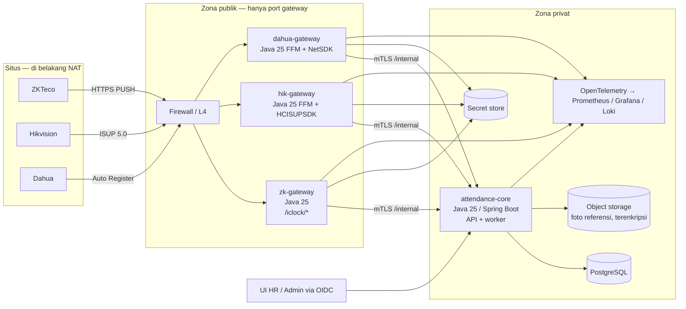
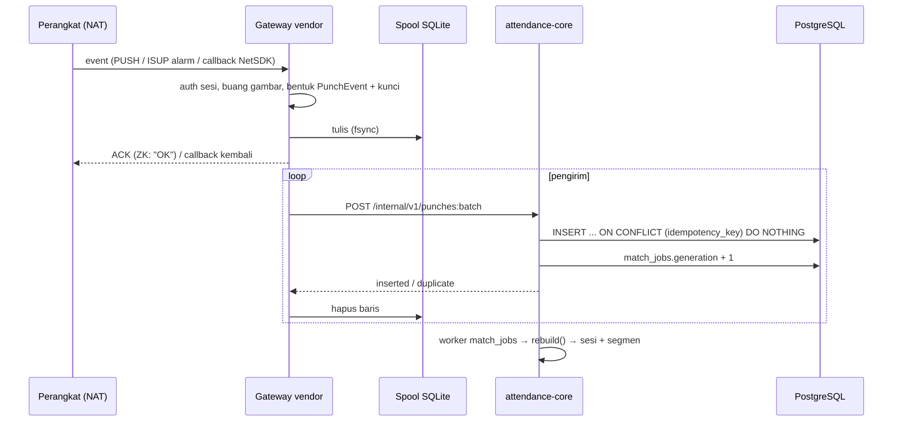
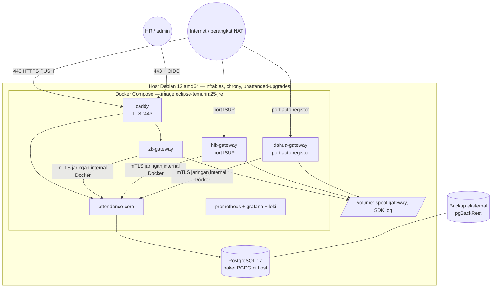

# Arsitektur dan Stack Teknologi — Sistem Absensi Multi-Vendor

| | |
|---|---|
| **Tanggal** | 2026-09-30 |
| **Status** | Draft rev 2 (Java 25), pendamping `desain-sistem-absensi-multi-vendor.md` rev 5 |
| **Audiens** | Engineer yang membangun sistem, tim infrastruktur, dan pengambil keputusan teknis |
| **Batasan utama** | Semua perangkat di situs berada di belakang NAT. Server tidak pernah bisa membuka koneksi ke perangkat |

---

## 1. Ringkasan keputusan

| Keputusan | Pilihan | Alasan singkat |
|---|---|---|
| Arah koneksi | **Perangkat selalu menghubungi server** (auto register / push) | Semua situs di belakang NAT; jalur yang dimulai server tidak mungkin |
| ZKTeco | **PUSH / ADMS** (HTTP iClock), diimplementasikan sendiri di Java | Ini mekanisme auto register resmi ZKTeco. SDK standalone (`zkemkeeper`, TCP 4370) justru dimulai server, jadi gagal di NAT |
| Hikvision | **ISUP 5.0** lewat SDK resmi HCISUPSDK, ISAPI dilewatkan di dalam ISUP | Mekanisme resmi Hikvision untuk perangkat tanpa IP tetap |
| Dahua | **Auto Register** lewat NetSDK resmi | Mekanisme resmi Dahua untuk perangkat di IP dinamis/NAT; satu API untuk seri CGI dan RPC2 |
| Bentuk proses | **Satu core + tiga gateway vendor**, semuanya proses terpisah | SDK native diisolasi; hanya gateway yang terbuka ke internet |
| Bahasa | **Java 25 LTS (Eclipse Temurin)** untuk core, semua gateway, dan listener | FFM (resmi sejak Java 22) + `jextract` untuk SDK C dengan callback; Hikvision hanya menyediakan demo C++/Java; `java.time` memisahkan waktu sipil dan absolut; satu bahasa di seluruh sistem. Sudah dibuktikan memanggil NetSDK Dahua dari Java 25 di server dev (§5.3) |
| Basis data | **PostgreSQL 17** (atau 18) | Advisory lock, `SKIP LOCKED`, `ON CONFLICT`, dan partial index dipakai langsung oleh desain |
| OS server | **Host Debian 12 (amd64)** menjalankan Docker; aplikasi di container **`eclipse-temurin:25-jre`** | Temurin 25 tersedia sebagai paket resmi untuk Debian 12, jadi Java juga bisa langsung di host. Container dipakai untuk isolasi dan build yang dapat diulang (§6.2) |
| Antrean | Tabel Postgres (`SKIP LOCKED`) + spool lokal SQLite di gateway | Tanpa Kafka; beban 20 punch/detik puncak |

---

## 2. Batasan: semua perangkat di belakang NAT

Konsekuensinya bukan sekadar "pakai SDK". Setiap jalur yang di desain rev 4 dimulai oleh server harus diganti:

| Kebutuhan | Jalur rev 4 (dimulai server) | Jalur rev 5 (dimulai perangkat) |
|---|---|---|
| Event punch real-time | ZK PUSH ✓, Hikvision HTTP Host ✓, Dahua callback ✓ (ketiganya perlu server terjangkau dari situs; tetap berlaku) | ZK PUSH, Hikvision ISUP alarm, Dahua auto-register event |
| Isi-ulang / rekonsiliasi | ZK TCP 4370 pull, Hikvision `AcsEvent` pull, Dahua `recordFinder` | Perintah lewat kanal yang sudah dibuka perangkat: ZK `DATA QUERY ATTLOG`, ISAPI `AcsEvent` di dalam ISUP, NetSDK pencarian record di sesi auto register |
| Pendaftaran wajah | ISAPI FDLib, Dahua CGI, ZK perintah ADMS | Sama, tetapi dikirim lewat kanal ISUP / sesi NetSDK / antrean `getrequest` ZK |
| Sinkron waktu, reboot | Panggilan langsung | Lewat kanal yang sama |

Syarat infrastruktur yang muncul:

1. Server punya **alamat publik tetap** (IP atau domain) yang dikonfigurasi di setiap perangkat.
2. Hanya **port gateway** yang terbuka ke internet. Core, basis data, dan UI admin tidak pernah terbuka.
3. Setiap perangkat punya **identitas + kunci sendiri** (SN + comm key ZK, Device ID + ISUP key Hikvision, device ID + kredensial auto register Dahua).
4. Koneksi perangkat bersifat **lengket** ke satu instance gateway. Perintah ke perangkat harus diarahkan ke instance yang memegang sesinya.

Alternatif yang dipertimbangkan: **VPN situs ke server** (router tiap situs membangun tunnel), sehingga server bisa menjangkau perangkat dan SDK tidak diperlukan. Ditolak untuk v1 karena menambah perangkat keras dan operasi jaringan di 50 situs, tetapi tetap menjadi jalan keluar untuk firmware yang tidak mendukung ISUP 5.0 / auto register / HTTPS (lihat §8).

---

## 3. Jalur per vendor, berdasarkan dokumentasi vendor

### 3.1 ZKTeco — PUSH / ADMS (tanpa SDK native)

Protokol PUSH berbasis HTTP dan dimulai perangkat. Endpoint yang dipakai: `/iclock/cdata` (handshake dan unggah `ATTLOG`), `/iclock/registry` (registrasi pada versi PUSH yang lebih baru), `/iclock/getrequest` (perangkat mengambil perintah), dan `/iclock/devicecmd` (hasil perintah).

- **Tidak memakai** SDK Windows `zkemkeeper` / protokol standalone TCP 4370: arahnya server → perangkat, jadi mustahil di NAT, dan SDK-nya COM Windows.
- **Rekonsiliasi:** gateway mengantrekan `DATA QUERY ATTLOG StartTime=… EndTime=…`. Perangkat mengirim ulang log lewat `POST /iclock/cdata`; kunci idempotensi yang sama membuat duplikat menjadi no-op. Ini menggantikan pull TCP 4370.
- **Pendaftaran:** `DATA UPDATE USERINFO` dan perintah foto/wajah lewat antrean `getrequest`. Format perintah wajah berbeda per firmware; dikonfirmasi dari manual PUSH versi yang terpasang saat komisioning.
- **Keamanan:** SN terdaftar + allowlist tidak cukup di internet publik. Wajib HTTPS pada firmware yang mendukung; perangkat tanpa HTTPS hanya boleh lewat VPN situs (§8).
- **Implementasi:** Java murni (parser teks tab-separated), tanpa library native. Ada pustaka referensi komunitas (mis. `zkteco-adms` di Go) untuk dibandingkan saat menulis fixture, tetapi tidak dipakai sebagai dependensi.

### 3.2 Hikvision — ISUP 5.0 lewat HCISUPSDK

Perangkat access control yang mendukung ISUP 5.0 didaftarkan dengan Device ID dan ISUP key yang ditentukan sebelumnya, lalu menghubungi server pada port registrasi (default 7660). ISAPI dapat dilewatkan di dalam ISUP, termasuk informasi event.

Komponen HCISUPSDK yang dipakai gateway:

| Komponen SDK | Peran | Dipakai untuk |
|---|---|---|
| CMS (registrasi) | Menerima registrasi perangkat, memegang sesi | Kehadiran perangkat, pengiriman perintah |
| Alarm server | Menerima event dari perangkat | Event access control → `PunchEvent` |
| ISAPI passthrough | Mengirim permintaan ISAPI di dalam sesi ISUP | `AcsEvent` (rekonsiliasi), `UserInfo` dan `FDLib` (pendaftaran), `System/time` |
| Storage server (SS) | Menerima gambar | **Tidak diaktifkan**: foto kejadian dibuang sesuai desain |

Semua bentuk payload ISAPI yang sudah dirancang (`AcsEvent` dengan `major = 5`, allow-list minor, `FDLib` multipart) tetap berlaku; yang berubah hanya transportnya.

### 3.3 Dahua — Auto Register lewat NetSDK

Auto Register adalah protokol resmi Dahua agar perangkat di IP dinamis menghubungi platform dengan IP/domain tetap yang membuka port listening. Alur di gateway:

1. Mulai listener auto register pada port yang dikonfigurasi.
2. Perangkat terhubung dan mengirim device ID. Gateway mencocokkan dengan `devices`, lalu login di atas koneksi itu memakai kredensial dari secret store.
3. Berlangganan event access control (callback SDK) → `PunchEvent`.
4. Rekonsiliasi: pencarian record access control untuk rentang waktu di sesi yang sama.
5. Pendaftaran: layanan pengguna dan wajah access control; blob template yang dikembalikan dibuang.

Nama fungsi NetSDK persis (listener, login, subscribe, find record, operasi user/face) diambil dari manual NetSDK versi yang dipin, bukan dari dokumen ini. Mode `dahua_cgi` rev 4 tetap ada sebagai jalur cadangan untuk situs ber-VPN.

### 3.4 Pelajaran dari connector USP (`UniFiedAIPlaform`)

USP sudah menjalankan connector Dahua, Hikvision, dan Huawei di lapangan (Python). Temuan yang langsung berlaku di sini, apa pun bahasanya:

| Temuan USP | Akibat untuk sistem absensi |
|---|---|
| Dahua Auto Register: perangkat asli mengirim registrasi dengan **command 1 (`DH_DVR_SERIAL_RETURN`, string polos)**, bukan command 2 (`NET_DEV_AUTOREGISTER_RETURN`). Versi awal USP hanya menerima command 2 dan diam-diam membuang semua registrasi | `dahua-gateway` wajib menangani kedua command; uji fixture untuk keduanya |
| Struct `NET_CB_AUTOREGISTER` tidak tersedia di binding bawaan, didefinisikan manual sesuai layout C | Dibuat oleh `jextract` dari header resmi, plus uji ukuran struct |
| Callback harus dipegang referensinya agar tidak dibebaskan garbage collector | Di FFM: upcall stub dialokasikan di `Arena` yang hidup selama proses |
| Hikvision di USP memakai **HCNetSDK** (server login ke perangkat) | Tidak bisa dipakai di NAT; absensi memakai **HCISUPSDK** (ISUP 5.0). Pola ISAPI lewat sesi SDK tetap dipakai ulang |
| Tipe `LONG` di HCNetSDK adalah `int` 32-bit di Linux 64-bit (`c_long` akan salah) | Tipe diambil dari header oleh `jextract`, bukan ditebak |
| Connector sebagai layanan terpisah tanpa akses DB, bicara ke backend lewat HTTP | Sama dengan pola gateway di sini |

Binding Java untuk SDK vendor dibangun sebagai library bersama (`vendor-sdk-java`: `dahua-netsdk`, `hik-isup`, `hik-hcnetsdk`, `common`), dengan sistem absensi sebagai pengguna pertama dan USP sebagai pengguna berikutnya.

---

## 4. Arsitektur komponen

### 4.1 Tanggung jawab proses

| Proses | Isi | Terbuka ke | Native code |
|---|---|---|---|
| `attendance-core` | API HR/admin/payroll, API internal gateway, worker `match_jobs`, sweeper, rematch, materialisasi roster, penjadwal rekonsiliasi, dispatcher perintah, mesin murni `compile` / `match` / `segment` | Jaringan privat + UI lewat reverse proxy dengan OIDC | Tidak ada |
| `zk-gateway` | Endpoint iClock, parser ATTLOG, antrean perintah ADMS | Internet (HTTPS) | Tidak ada |
| `hik-gateway` | Listener ISUP CMS + alarm, ISAPI passthrough | Internet (port ISUP) | HCISUPSDK (`.so`) |
| `dahua-gateway` | Listener auto register, sesi login, callback event, find record, enroll | Internet (port auto register) | NetSDK (`.so`) |

Alasan `zk-gateway` dipisah walaupun tanpa native code: permukaan internet dibatasi ke gateway saja, sehingga core tidak pernah menerima trafik perangkat langsung, dan ketiga vendor memakai kontrak yang sama.

### 4.2 Aturan yang berlaku untuk semua gateway

1. **Gateway tidak berisi logika absensi.** Ia hanya: autentikasi perangkat → buang gambar → bentuk `PunchEvent` + kunci idempotensi → spool → teruskan ke core. Matcher, kompilator, dan segmenter hanya ada di core.
2. **Spool lokal tahan crash.** Setiap event ditulis ke SQLite (mode WAL) di disk gateway sebelum di-ACK ke perangkat atau sebelum callback SDK kembali. Pengirim terpisah meneruskan ke core dengan retry + backoff eksponensial, lalu menghapus baris setelah core menjawab `inserted` atau `duplicate`. Core mati sebentar tidak menghilangkan punch.
3. **Callback SDK tidak pernah memblokir.** Callback (upcall FFM) hanya menyalin data struct ke `ArrayBlockingQueue` berbatas di memori, dengan `offer()` tanpa tunggu. Tidak ada I/O jaringan atau basis data di thread SDK. Channel penuh → metrik `gateway_backpressure` dan alert, bukan blocking.
4. **Satu instance aktif per vendor di v1.** Sesi perangkat melekat ke instance itu. Instance mencatat kepemilikan sesi ke core (`device_sessions`: `device_id`, `gateway_instance`, `connected_at`, `last_heartbeat_at`). Standby dingin boleh ada; saat pindah, perangkat melakukan registrasi ulang sendiri.
5. **Perintah ke perangkat lewat lease.** Gateway mengambil perintah untuk perangkat yang sesinya ia pegang dari `device_commands` (`FOR UPDATE SKIP LOCKED`, lease 60 detik), mengeksekusi, lalu melaporkan hasil. Perintah dengan lease kedaluwarsa kembali ke antrean. ZK tetap pola poll `getrequest`; gateway ZK hanya menerjemahkan antrean ke format ADMS.
6. **Pin versi SDK.** Versi HCISUPSDK dan NetSDK dipin di image container, bersama daftar model + firmware yang lolos uji lab. Upgrade SDK adalah rilis tersendiri dengan uji regresi fixture.

### 4.3 Kontrak internal gateway ↔ core

Semua di bawah `/internal/v1`, hanya lewat mTLS di jaringan privat. Sertifikat klien per gateway.

| Method | Path | Isi |
|---|---|---|
| POST | `/internal/v1/punches:batch` | ≤ 500 `PunchEvent` kanonik. Respons per item: `inserted` / `duplicate` / `rejected` + alasan. Idempoten |
| POST | `/internal/v1/devices/{device_id}/presence` | `online` / `offline`, `gateway_instance`, `firmware`, `remote_addr`. Memperbarui `last_seen_at` dan `device_sessions` |
| POST | `/internal/v1/commands:lease` | Body: daftar `device_id` yang sesinya dipegang. Respons: perintah yang di-lease |
| POST | `/internal/v1/commands/{id}/result` | `acked` / `failed` + pesan perangkat |
| GET | `/internal/v1/devices/{device_id}/config` | Arah default, `reader_directions`, `verify_map`, allow-list minor, timezone, versi konfigurasi |
| POST | `/internal/v1/reconcile/{device_id}/watermark` | Watermark terakhir yang berhasil diisi-ulang |

`PunchEvent`, aturan kunci idempotensi, dan pembuangan gambar tetap persis seperti di dokumen desain. Gateway menghitung kunci; core memverifikasi keunikannya di `punches.idempotency_key`.

### 4.4 Alur satu punch

### 4.5 Rekonsiliasi di dunia NAT

Semua isi-ulang berjalan di kanal yang sudah dibuka perangkat, dijadwalkan core dan dieksekusi gateway sebagai perintah biasa:

| Vendor | Perintah isi-ulang | Hasil kembali lewat |
|---|---|---|
| ZKTeco | `DATA QUERY ATTLOG StartTime=… EndTime=…` | `POST /iclock/cdata` biasa |
| Hikvision | ISAPI `POST /ISAPI/AccessControl/AcsEvent?format=json` di dalam ISUP, paginasi `searchResultPosition` | Respons passthrough |
| Dahua | Pencarian record access control untuk rentang waktu di sesi NetSDK | Respons SDK |

Irama tetap seperti desain: tiap 15 menit dari watermark − 5 menit, tiap malam 36 jam penuh. Perangkat offline tidak bisa direkonsiliasi sampai terhubung lagi; begitu presence `online` masuk, core langsung menjadwalkan isi-ulang dari watermark. `pull_enabled` di rev 4 diganti arti menjadi `reconcile_enabled` (default **true**), karena isi-ulang tidak lagi butuh rute ke perangkat.

---

## 5. Stack teknologi

### 5.1 Pilihan

| Lapisan | Pilihan | Catatan |
|---|---|---|
| Bahasa / runtime | **Java 25 LTS**, distribusi **Eclipse Temurin** | LTS terbaru. Dukungan Temurin untuk 25 jauh melewati 2028; naik ke LTS berikutnya direncanakan, bukan mendesak |
| Build | **Maven 3.9** + Maven Wrapper, proyek multi-modul | Versi Maven terkunci di repo; build sama di laptop, server dev, dan CI |
| Web | **Spring Boot 4** (Tomcat/Jetty tertanam) untuk core dan `zk-gateway`; gateway SDK juga Spring Boot untuk health, metrik, dan konfigurasi | iClock butuh `text/plain` longgar; mudah di controller Spring |
| Waktu | **`java.time`** | `LocalDateTime` = `device_local_time`, `Instant` = `occurred_at`, `ZonedDateTime` untuk kompilator; tipe berbeda mencegah bug campur zona. Data tz dari JDK yang dipin |
| Basis data | PostgreSQL 17 + driver **pgjdbc** + **Spring `JdbcClient`** (SQL tangan) | Advisory lock, `SKIP LOCKED`, `ON CONFLICT` lebih jelas di SQL tangan; tanpa ORM di jalur mesin |
| Migrasi | **Flyway** (SQL murni) | Skema memakai partial index dan `CHECK` yang lebih jujur ditulis sebagai SQL |
| Background job | Scheduler Spring + tabel antrean Postgres | Tanpa Quartz; jadwal sederhana cukup |
| Native interop | **FFM (`java.lang.foreign`) + `jextract`** dari header C resmi; **JNA** sebagai cadangan (sesuai demo resmi Dahua) | Binding dibuat ulang otomatis setiap versi SDK naik; upcall stub di `Arena` global |
| Spool gateway | SQLite lewat `sqlite-jdbc` (mode WAL) | Satu file per gateway di volume persisten |
| Auth | OIDC ke IdP perusahaan (Spring Security OAuth2 Resource Server) | Peran `supervisor`, `attendance_admin`, dst. dari klaim |
| Log | Logback + encoder JSON → stdout → Loki | Filter field terlarang (gambar, template, rahasia) |
| Metrik / trace | Micrometer + OpenTelemetry → Prometheus + Grafana (+ Tempo opsional) | Metrik di desain dipetakan 1:1 |
| Uji | **JUnit 6**, **AssertJ**, basis data uji sementara di PostgreSQL asli, **jqwik** (property test invarian `out_close < in_open`), berkas golden untuk segmen kasus A/B/C | Mesin murni diuji tanpa perangkat dan tanpa SDK |
| Object storage | S3-compatible (MinIO on-prem atau cloud) + enkripsi sisi server dengan kunci KMS | Foto referensi saja |
| Secret | HashiCorp Vault atau KMS cloud | `shared_secret_ref`, ISUP key, kredensial Dahua |
| Kemasan | Image **`eclipse-temurin:25-jre`** + JAR aplikasi; image gateway di registry privat karena SDK berlisensi | Bukan Alpine: SDK native butuh glibc. NetSDK sudah terbukti jalan di image ini (§5.3) |
| UI | Terpisah dari keputusan ini; mockup memakai Tailwind | Bisa React, berbicara ke API core |

### 5.2 Mengapa Java, dibanding alternatifnya

| Kriteria | Java 25 | .NET 10 | Python | Node.js | Go |
|---|---|---|---|---|---|
| Memanggil SDK C dengan callback dari thread SDK | FFM final + `jextract` dari header; upcall paralel; JNA cadangan | P/Invoke matang | `ctypes`, callback diserialkan GIL; referensi callback harus dijaga manual | Callback harus dilempar ke event loop; sering perlu addon C++ | cgo, callback C → Go rawan |
| Demo resmi vendor | Dahua: Java; Hikvision: C++/Java | Dahua: C#; Hikvision: tidak | Dahua: ada paket Python; Hikvision: tidak | Tidak ada | Tidak ada |
| Diagnosis crash native | `hs_err_pid.log` berisi stack native | Dump proses | `faulthandler`, stack native minim | Paling sulit | Dump goroutine |
| Tipe waktu sipil vs absolut | `java.time` (sangat baik) | NodaTime (sangat baik) | `datetime` naive/aware satu tipe | Temporal masih baru | Satu tipe `time.Time` |
| Dukungan resmi di Debian 12 | Paket Temurin untuk bookworm | Hanya Debian 13 | Ya | Ya | Ya |
| Satu bahasa untuk core, gateway, dan library bersama dengan USP | Ya | Ya | Ya, tetapi risiko callback | Kurang cocok | Ya, dengan cgo |

.NET setara secara teknis; Java dipilih karena keputusan organisasi untuk menstandarkan connector di Java (termasuk USP ke depan), dukungan resmi di Debian 12, dan demo Java dari kedua vendor SDK. Python tetap dipakai untuk tooling (simulator perangkat, impor CSV, skrip operasi).

### 5.3 Bukti di server dev (2026-09-30)

Uji asap Java 25 FFM → Dahua NetSDK Linux64 V3.061 (`libdhnetsdk.so`), tanpa perangkat: `CLIENT_Init` → `TRUE`, `CLIENT_GetSDKVersion` → `36191182`, `CLIENT_Cleanup` sukses. Berhasil di **host Debian 12 + Temurin 25.0.4.1** dan di **container Temurin 25 (Ubuntu)**. `ldd` semua library NetSDK juga lengkap di Debian 13. HCISUPSDK belum diuji karena paketnya belum diunduh.

---

## 6. Praktik keandalan

| Area | Praktik |
|---|---|
| Isolasi crash | SDK hanya di gateway. Gateway crash → restart otomatis (Docker `restart: always` / systemd `Restart=always`), `hs_err_pid.log` disimpan di volume untuk diagnosis, perangkat registrasi ulang, spool diteruskan, rekonsiliasi menutup celah |
| Watchdog | Gateway melaporkan `/healthz` hanya sehat bila listener aktif **dan** callback SDK terakhir < N menit saat ada perangkat online. Deadlock di thread SDK → health gagal → restart |
| Badai registrasi ulang | Setelah restart, 300 perangkat masuk bersamaan. Batasi login paralel (mis. 20) dan tunda perintah enroll 2 menit pertama |
| Idempotensi | Kunci dibentuk di gateway, unik di Postgres. Spool retry, rekonsiliasi, dan PUSH ulang semuanya aman diulang |
| Waktu perangkat | NTP disetel saat komisioning lewat kanal masing-masing; `TimeZone` di opsi PUSH ZK; `clock_skew` dicatat core |
| Kebocoran memori native | Uji soak 72 jam per model di lab sebelum rilis; pantau RSS gateway; restart terjadwal mingguan hanya bila soak menunjukkan kebocoran |
| Marshalling struct | Binding dibuat `jextract` dari header versi yang dipin; setiap struct yang dipakai punya uji `byteSize()` terhadap nilai `sizeof` dari header; mismatch gagal di CI |
| Backpressure | Channel berbatas di gateway; spool menampung saat core lambat; metrik panjang spool + umur item tertua |
| Deployment v1 | Satu server Debian 12: Docker Compose untuk core, tiga gateway, reverse proxy, dan observabilitas; PostgreSQL 17 di host dari repo PGDG (atau VM kedua). IP publik tetap / DNS dengan TTL rendah. Rincian §6.2 |
| Tumbuh ke HA | Core: dua replika stateless di belakang load balancer (antrean sudah aman konkuren). Gateway: aktif-standby dengan IP mengambang; perangkat menyambung ulang sendiri |
| Backup | Postgres PITR harian + WAL; spool gateway tidak perlu dibackup (sementara) |

### 6.1 Keamanan pada port publik

- Hanya port gateway yang dibuka: HTTPS untuk ZK, port ISUP untuk Hikvision, port auto register untuk Dahua. Nomor port final ditetapkan saat komisioning dan didokumentasikan di runbook.
- Perangkat tidak dikenal (SN / Device ID tidak terdaftar) ditolak dan dihitung. Tidak ada auto-provision.
- Kunci per perangkat: ISUP key Hikvision, kredensial login Dahua, comm key ZK. Semua di secret store.
- Rate limit per IP sumber dan per perangkat; alert > 20 kegagalan auth dalam 5 menit (sesuai desain).
- Allowlist IP publik situs bila situs punya IP keluar tetap; bila tidak, andalkan kunci per perangkat + TLS.
- Firmware yang tidak mendukung ISUP 5.0, auto register, atau HTTPS PUSH tidak dipasang langsung ke internet; situs itu memakai VPN (§8).

---

### 6.2 Deployment di server Debian 12

#### Status dukungan yang menentukan pilihan

| Komponen | Fakta | Konsekuensi |
|---|---|---|
| Debian 12 "bookworm" | Dukungan penuh berakhir 11 Juli 2026; sekarang fase LTS sampai **30 Juni 2028** | Host masih mendapat patch keamanan, tetapi harus dinaikkan ke Debian 13 sebelum Juni 2028 |
| Java 25 (Temurin) | Paket resmi Adoptium tersedia untuk bookworm; terpasang dan teruji di server dev | Java bisa berjalan langsung di host maupun di container |
| Docker Engine | Mendukung host Debian 12 dan 13 | Runtime aplikasi mengikuti image container |

Keputusan: **host Debian 12, aplikasi di container `eclipse-temurin:25-jre`**. Container dipilih untuk isolasi SDK native, build yang dapat diulang, dan upgrade host yang tidak menyentuh aplikasi, bukan karena Java tidak didukung di host. Menjalankan JAR langsung di host dengan systemd tetap sah bila kebijakan perusahaan melarang container.

#### Susunan di satu server

| Lapisan | Pilihan di Debian 12 | Catatan |
|---|---|---|
| Container | Docker Engine + plugin Compose dari repo resmi Docker | `restart: unless-stopped`, `healthcheck` per layanan, batas memori per gateway |
| Reverse proxy | Caddy (sertifikat Let's Encrypt otomatis) | Hanya untuk HTTP: ZK PUSH dan UI/API. Port ISUP dan auto register tidak lewat proxy; langsung di-publish ke container gateway |
| Basis data | PostgreSQL 17 dari repo PGDG (`apt.postgresql.org`, mendukung bookworm) | Paket Debian 12 bawaan adalah PostgreSQL 15. Di host, bukan container, supaya tuning, upgrade, dan backup lebih lugas |
| Backup | pgBackRest: full mingguan, diff harian, WAL archive kontinu ke penyimpanan di luar server | Uji restore bulanan. Spool gateway tidak dibackup |
| Firewall | nftables: buka hanya 443, port ISUP, port auto register, dan SSH dari jaringan admin | Core, PostgreSQL, Prometheus, dan Grafana hanya di jaringan internal |
| Waktu | chrony di host | Perangkat memakai NTP publik atau server NTP perusahaan; server hanya perlu jamnya benar |
| Patch | `unattended-upgrades` untuk security LTS; image container dibangun ulang bulanan | Upgrade SDK dan JRE melalui rilis image, bukan `apt` di dalam container |
| Secret | Vault atau file secret Docker dengan izin 0400, bukan variabel lingkungan di Compose | ISUP key, kredensial Dahua, sertifikat mTLS |
| Ukuran awal | 4 vCPU, 16 GB RAM, SSD 500 GB | Estimasi punch 50–80 GB/tahun dengan indeks; sisanya untuk WAL, log, dan ruang upgrade |

#### Kalender upgrade

| Kapan | Apa |
|---|---|
| Selesai 2026-09-30 (server dev) | Host Debian 12 + Docker + PGDG PostgreSQL 17 + Temurin 25; NetSDK Dahua teruji dari Java |
| Sebelum pilot | Uji HCISUPSDK Linux x86_64 dari Java (§8 butir 4) |
| Paling lambat Q1 2028 | Upgrade host ke Debian 13 (in-place `bookworm → trixie`); container tidak berubah |
| Dievaluasi 2028 | Naik ke Java LTS berikutnya bila ada manfaat; tidak mendesak karena dukungan Java 25 masih panjang |

## 7. Dampak ke dokumen desain (rev 5)

| Bagian desain | Perubahan |
|---|---|
| Bentuk deploy v1 | Modular monolith `attendance-core` + tiga gateway vendor (bukan satu biner) |
| `devices.protocol_family` | `zkteco_adms` \| `hik_isup` \| `dahua_autoreg` (default) + `isapi` \| `dahua_cgi` (cadangan untuk situs ber-VPN) |
| `devices.pull_enabled` | Diganti `reconcile_enabled` (default true); isi-ulang lewat kanal yang dibuka perangkat |
| Tabel baru | `device_sessions` (kepemilikan sesi per gateway); `device_commands` mendapat `leased_by`, `lease_until` |
| Ingress ZKTeco | Tanpa `ZkPullClient` TCP 4370; rekonsiliasi = `DATA QUERY ATTLOG` |
| Ingress Hikvision | ISUP 5.0 via HCISUPSDK; HTTP Host dan pull langsung menjadi cadangan |
| Ingress Dahua | NetSDK auto register; `dahua_cgi` cadangan; `dahua_rpc2` tidak lagi follow-up terpisah (NetSDK mencakupnya) |
| PR plan | PR 4 = `zk-gateway` + kontrak internal; PR 5 = `hik-gateway` ISUP; PR 6 = `dahua-gateway` NetSDK; PR 8 rekonsiliasi = perintah lewat gateway |

---

## 8. Risiko dan hal yang wajib diverifikasi sebelum PR 5/6

| # | Hal | Mengapa penting | Cara verifikasi |
|---|---|---|---|
| 1 | Model Hikvision di lapangan mendukung **ISUP 5.0** (bukan hanya ISUP 2.x/EHome lama) | Tanpa ISUP 5.0, perangkat di NAT tidak bisa dipakai lewat jalur ini | Cek menu Platform Access tiap model + firmware; daftar model di lab |
| 2 | Model Dahua mendukung **Auto Register** untuk event access control | Beberapa seri lama hanya auto register untuk video | Uji satu perangkat per seri di lab |
| 3 | Firmware ZKTeco mendukung **HTTPS** di pengaturan ADMS | PUSH tanpa TLS di internet membuka jalan punch palsu | Cek pengaturan Cloud Server / ADMS tiap model |
| 4 | Build **Linux x86_64** HCISUPSDK dan NetSDK versi terbaru tersedia dan lisensinya mengizinkan server produksi | Menentukan OS server dan kemasan container | Unduh dari portal partner resmi; baca perjanjian lisensi |
| 5 | Perintah wajah ADMS ZKTeco (foto/BIOPHOTO) untuk model yang dipakai | Format berbeda antar firmware | Manual PUSH versi terpasang + satu uji enroll |
| 6 | Nomor port final dan kebijakan firewall perusahaan | Port publik adalah permukaan serangan | Keputusan infrastruktur + pentest sebelum pilot |
| 7 | Situs tanpa IP publik tetap di sisi server (mis. server on-prem di kantor pusat) | Perangkat butuh alamat tetap | DNS + IP publik tetap, atau hosting cloud |

Sampai butir 1–4 terjawab untuk situs percontohan, PR 5 dan PR 6 tidak dimulai. PR 1–3 (skema, kompilator, matcher, segmenter) dan PR 4 (`zk-gateway`) tidak tergantung pada butir itu.

---

## 9. Sumber

- ZKTeco PUSH / ADMS: [HTTP PUSH SDK 2.0.1](http://f02.s.alicdn.com/kf/HTB1PANmFVXXXXaCXVXX.PRXFXXXk.pdf), [Attendance PUSH Communication Protocol](https://www.scribd.com/document/604032067/Attendance-PUSH-Communication-Protocol-20200325), [ZKTeco PUSH Protocol Commands](https://www.scribd.com/document/928673666/ZKTeco-PUSH-Protocol-Commands), pustaka referensi [s0x90/zkteco-adms](https://github.com/s0x90/zkteco-adms)
- Hikvision ISAPI: [Authentication (TPP)](https://tpp.hikvision.com/Wiki/ISAPI/Access%20Control%20on%20Person/GUID-A4CD59AB-948B-4C20-AE5D-E2F44DE3618E.html), [Configure and Search for Access Control Events (TPP)](https://tpp.hikvision.com/Wiki/ISAPI/Access%20Control%20on%20Person/GUID-F35C7F16-5BF7-4F7E-9E05-E6DB157BBDF2.html), [hikvision-best-practices](https://github.com/uchkunr/hikvision-best-practices)
- Hikvision ISUP 5.0: [Add Access Control Devices by Device ID](https://enpinfo.hikvision.com/unzip/20200731103027_05278_doc/GUID-3A79B4F6-C907-471F-A271-7F382BD9CDF4.html), [HikCentral Professional ISUP Device Accessing Operation Guide](https://manuals.plus/m/0e0ce373d8ed66f1043268122f8e217bc248f5e80de2b7bc8ba95912795befa2), [Hikvision Open Capabilities (TPP)](https://tpp.hikvision.com/tpp/OpenCapabilities), [norches/hikvision-isup](https://github.com/norches/hikvision-isup)
- Dukungan OS: [Adoptium Temurin supported platforms](https://adoptium.net/supported-platforms/), [Debian bookworm release information](https://www.debian.org/releases/bookworm/), [Security support for Bookworm handed over to LTS](https://www.debian.org/News/2026/20260712)
- Dahua Auto Register / NetSDK: [Dahua Auto Registration Technology](https://www.dahuasecurity.com/5E/32), [DahuaWiki: How To Enable Auto Register](https://dahuawiki.com/Mobile_Solution/How_To_Enable_Auto_Register), [NetSDK C# Auto Register User's Manual](https://www.scribd.com/document/687054393/NetSDK-C-Auto-Register-User-s-Manual-V1-0-1)
