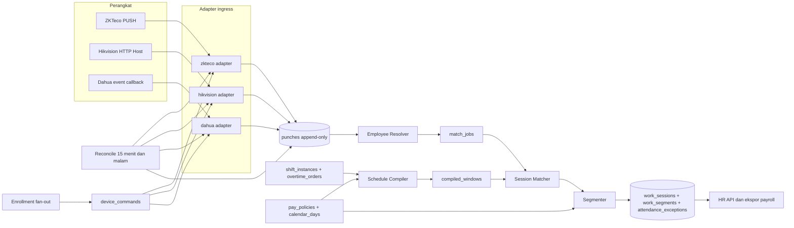
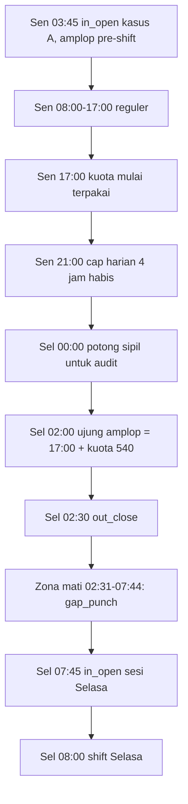
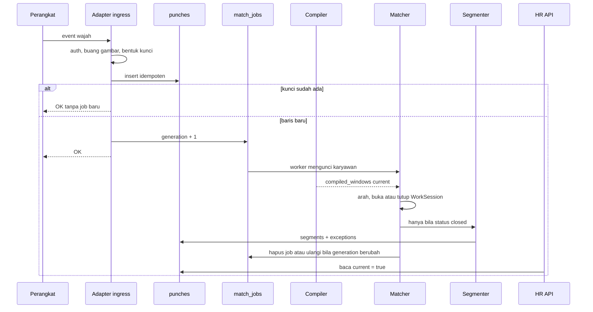

# Sistem Absensi Multi-Vendor (Dahua, ZKTeco, Hikvision) dengan Strategi Lembur Dua Hari Berturut-turut

| | |
|---|---|
| **Author** | TBD |
| **Tanggal** | 2026-09-30 |
| **Status** | Draft rev 7 (lihat Riwayat Revisi di akhir dokumen). Arsitektur proses, jalur NAT per vendor, dan stack: `arsitektur-dan-stack.md` |
| **Audiens** | Engineer senior yang akan mengimplementasikan mesin, serta HR dan operasi situs di Indonesia yang akan mengisi kebijakan dan menjalankan perangkat |
| **Lingkup kode** | Greenfield. Tidak ada modul absensi yang sudah ada. |

---

## Ikhtisar

Organisasi sudah memiliki terminal absensi Dahua, ZKTeco, dan Hikvision, sebagian besar berbasis pengenalan wajah, ditambah kartu, sidik jari, atau telapak tangan pada perangkat yang memang mendukungnya. Dokumen ini merancang satu sistem absensi yang menerima peristiwa dari ketiga merek itu, lalu menghitung jadwal, lembur, dan jam kerja di server. Perangkat hanya mencatat identitas dan waktu. Template wajah bersifat proprietary per vendor dan tidak pernah dikonversi.

Masalah yang tidak boleh diselesaikan dengan "tanggal kalender punch" adalah lembur yang menyentuh dua hari sipil berturut-turut: shift atau lembur melewati tengah malam, dua kuota lembur pada dua hari berurutan, dan lembur hari pertama yang jendela pulangnya bertabrakan dengan jendela masuk hari kedua. Mesin bekerja pada `WorkSession` yang terikat `attendance_date` (tanggal bisnis dari jadwal, biasanya tanggal mulai yang dijadwalkan di timezone situs), bukan pada tanggal sipil tiap punch. Kompilator jadwal memaksa jendela masuk dan pulang dua sesi bertetangga agar tidak tumpang tindih. Punch yang jatuh di zona mati di antara keduanya menjadi pengecualian `gap_punch`, bukan tebakan.

Dua keputusan bisnis yang mengikat desain ini (rev 3):

- **Lembur berbasis kuota dan wajib disetujui lebih dulu.** Supervisor mengajukan *jumlah menit* lembur untuk satu `attendance_date` (misalnya 180 menit hari Senin), bukan jam mulai dan jam selesai. Karyawan bebas memakai kuota itu kapan saja di luar jam shift pada tanggal bisnis tersebut: sebelum shift, sesudah shift, melewati tengah malam, atau di hari tanpa shift. Hanya menit yang dikerjakan **setelah** persetujuan dan masih di dalam sisa kuota yang menjadi lembur. Sisanya tercatat sebagai menit tak dibayar dengan kode yang menjelaskan alasannya.
- **Semua perangkat berada di belakang NAT (rev 5).** Server tidak pernah membuka koneksi ke perangkat. Setiap vendor memakai mekanisme resmi yang dimulai perangkat: ZKTeco PUSH/ADMS, Hikvision ISUP 5.0 (HCISUPSDK), Dahua Auto Register (NetSDK). Rinciannya di `arsitektur-dan-stack.md`.
- **Topologi pintu dapat diatur per perangkat dan per pembaca.** Tiap perangkat, atau tiap pembaca pada perangkat multi-pintu, diset `in`, `out`, atau `both` (gabungan satu pintu untuk masuk dan pulang). Situs boleh memakai pintu terpisah, pintu gabungan, atau campuran keduanya.

Asumsi beban, yang dipakai di seluruh angka kapasitas dokumen ini dan belum diukur di lapangan: 50 situs, 2.000 karyawan, 300 perangkat, puncak 20 punch per detik saat pergantian shift, sekitar 50.000 punch per hari. Rata-rata harian hanya sekitar 0,6 punch/detik. Puncak kira-kira 30 kali rata-rata dan bersifat burst, bukan beban berkelanjutan.

---

## Latar Belakang dan Motivasi

Repositori ini (`attenceMultiVendor`) belum berisi kode, hanya dokumen desain dan mockup UI di `Doc/`. Tidak ada layanan absensi, skema basis data, adapter perangkat, maupun dokumen domain sebelumnya. Ini desain greenfield. Path modul di bawah adalah **usulan**, belum ada di repositori, dan tidak boleh dibaca sebagai kode yang sudah berjalan.

Praktik yang ingin diganti adalah menggantungkan status masuk/keluar pada tombol atau field perangkat, lalu memasukkan setiap punch ke ember tanggal kalender saat punch itu terjadi. Itu gagal pada lima situasi yang umum di situs Indonesia:

1. Shift atau lembur melewati tengah malam, misalnya reguler 22:00–06:00 atau lembur sampai 02:00.
2. Lembur disetujui pada dua tanggal kalender berturut-turut. Dua kuota persetujuan adalah dua sesi pada dua `attendance_date`, dan kuota satu hari tidak boleh dipakai untuk hari lain.
3. Punch pulang lembur hari pertama jatuh di dalam jendela masuk hari kedua, sehingga mesin menutup sesi yang salah atau membuka keterlambatan palsu.
4. Pengali upah berubah di tengah malam sipil (hari kerja menjadi istirahat mingguan, atau hari biasa menjadi hari libur). Jam harus dipotong di batas itu walaupun orangnya tidak pulang.
5. Rentang waktu lembur yang mungkin dipakai dua hari saling tumpang tindih, sehingga menit yang sama teratribusi ke dua hari, atau jam istirahat yang seharusnya memisahkan keduanya tertelan.

Field status ZKTeco (check-in, check-out, break, OT-in, OT-out) tidak konsisten di armada campuran dan sering salah karena karyawan menekan status sembarang atau firmware memakai default yang berbeda. Status itu disimpan untuk ditampilkan ke HR, tetapi **bukan** sumber kebenaran arah. Arah yang dipakai matcher adalah `door_direction` dari topologi yang kita kelola. Jika arah fisik tidak diketahui, matcher memakai jendela yang sudah dikompilasi. Jika tetap ambigu, punch masuk antrean pengecualian. Mesin tidak menebak.

Wajah tidak portabel. Algoritma Dahua, ZKTeco, dan Hikvision berbeda. Yang portabel hanyalah nomor kartu bila format pembacanya sama (umumnya Wiegand 26 atau 34) dan sudah diuji sekali per merek. Satu karyawan punya satu foto referensi. Tiap perangkat mengekstrak template sendiri dari foto itu.

Middleware pabrik (ZKBio Time / BioTime, HikCentral Professional, Dahua DSS / DSS Pro) boleh tetap dipakai situs yang sudah membelinya, tetapi bukan sumber kebenaran payroll. Adapter langsung ke perangkat adalah jalur default supaya situs tanpa lisensi middleware tetap jalan. Tiga laporan vendor tidak boleh menjadi tiga kebenaran jam lembur.

---

## Tujuan dan Bukan Tujuan

### Tujuan

- Satu pipeline punch dari ZKTeco (PUSH/ADMS), Hikvision (ISUP 5.0 lewat HCISUPSDK), dan Dahua (Auto Register lewat NetSDK). Semua jalur dimulai perangkat karena semua situs di belakang NAT; isi-ulang dikirim sebagai perintah lewat kanal yang sama, bukan tarikan dari server.
- Model kanonik `PunchEvent` yang idempoten, dengan waktu perangkat dan waktu absolut terpisah.
- Kompilator jadwal murni yang menggabungkan shift dan amplop kuota `OvertimeOrder`, memotong jendela yang bertabrakan, dan menerbitkan peringatan istirahat minimum sebelum hari berjalan.
- Lembur kuota yang disetujui lebih dulu: menit sebelum persetujuan tidak pernah dibayar, dan menit di atas kuota tidak pernah dibayar, tetapi keduanya terlihat di ekspor.
- Topologi pintu `in` / `out` / `both` per perangkat dan per pembaca, dengan aturan pencocokan yang tetap deterministik pada pintu gabungan.
- Matcher dan segmenter yang dapat diimplementasikan dan diuji dari dokumen ini saja, termasuk kasus A, B, dan C.
- Hitung ulang idempoten ketika lembur disetujui atau dibatalkan setelah punch sudah masuk. Punch tidak pernah diubah.
- Kebijakan upah berversi, dapat diubah HR tanpa rilis kode. Angka default bukan nasihat hukum.
- Fan-out pendaftaran wajah per perangkat, dengan kegagalan parsial yang terlihat.
- Ekspor jam untuk payroll (menit dan `rate_code`), plus antrean pengecualian untuk operasi.

### Bukan tujuan

- Mengganti DSS atau HikCentral di situs yang sudah menstandarkan keduanya. Adapter di atas platform itu bisa menyusul, di belakang kontrak `PunchEvent` yang sama.
- Absensi GPS ponsel. Disebut hanya sebagai opsi nanti.
- Transfer bank, hitung rupiah, atau pembagi upah sejam (misalnya 1/173). Mesin mengeluarkan menit dan kode tarif.
- Konversi template wajah antar vendor, dan penyimpanan blob template di basis data kita.
- Penegakan jadwal di perangkat sebagai sumber kebenaran. Perangkat boleh menampilkan nama. Keterlambatan dan lembur diputuskan server.
- Libur parsial (libur yang mulai pukul 14:00). Hari libur adalah satu `civil_date` penuh.
- Antarmuka piksel. Desain ini sampai ke API yang cukup untuk UI HR.
- Multi-tenant SaaS penuh. Lihat pertanyaan terbuka. Skema v1 menyisakan `company_id` dan `site_id` supaya keputusan itu tidak memaksa migrasi besar.

---

## Desain yang Diusulkan

### Bentuk deploy v1

Satu modular monolith `attendance-core` (API + worker di biner yang sama) ditambah **tiga gateway vendor** sebagai proses terpisah: `zk-gateway`, `hik-gateway` (HCISUPSDK), dan `dahua-gateway` (NetSDK). Hanya gateway yang terbuka ke internet; SDK native diisolasi supaya crash-nya tidak menjatuhkan core. Gateway tidak berisi logika absensi: mereka membentuk `PunchEvent` kanonik, menyimpannya di spool lokal, lalu meneruskannya ke core lewat API internal (`/internal/v1`, mTLS). Bukan Kafka. Pada asumsi 20 punch/detik burst dan sekitar 2.000 karyawan, Postgres dengan antrean `SKIP LOCKED` cukup. Kontrak gateway ↔ core, praktik keandalan, dan stack (Java 25, PostgreSQL) ada di `arsitektur-dan-stack.md`. Semua path berikut **usulan** dan belum ada:

```text
attendance/                      # usulan, belum ada
  db/migrations/
  policy/                        # PayPolicy, kalender, braket tarif
  roster/                        # materialize_roster → shift_instances
  compiler/                      # compile() murni
  matcher/                       # match() murni
  segmenter/                     # segment() murni
  sweeper/                       # missing_out wall-clock
  ingress/                       # API internal /internal/v1: punches:batch, presence, commands:lease
  gateways/zkteco/               # proses zk-gateway: /iclock/*, DATA QUERY ATTLOG
  gateways/hikvision/            # proses hik-gateway: ISUP 5.0 + ISAPI passthrough
  gateways/dahua/                # proses dahua-gateway: NetSDK auto register
  inbox/                         # insert idempoten, match_jobs
  resolver/
  enrollment/
  reconcile/
  api/
```

Mesin `compile`, `match`, dan `segment` tidak mengimpor HTTP perangkat. Itu syarat agar kasus A/B/C diuji tanpa terminal.

### Topologi

`Site` → `Checkpoint` → `Device` → pembaca (reader). Satu checkpoint boleh punya perangkat masuk merek A dan perangkat keluar merek B. Arah efektif disalin ke punch pada saat ingest (`door_direction`). Perubahan konfigurasi perangkat kemudian tidak menulis ulang riwayat. Koreksi arah adalah aksi teraudit yang memicu rematch, bukan efek samping edit master perangkat.

#### Konfigurasi arah pintu

Arah pintu adalah **pengaturan**, bukan asumsi desain. Tiga pola yang didukung, boleh dicampur dalam satu situs:

| Pola | Konfigurasi | Contoh |
|---|---|---|
| Pintu masuk dan pintu keluar terpisah | Perangkat A `direction = in`, perangkat B `direction = out` | Turnstile lobby masuk, turnstile pulang di sisi lain |
| Pintu gabungan | Satu perangkat `direction = both` | Satu terminal wajah di pintu karyawan |
| Satu perangkat, dua pembaca | `devices.direction` sebagai default, `reader_directions` per pembaca | Hikvision DS-K1T dengan pembaca luar (`cardReaderNo = 1` → `in`) dan dalam (`2` → `out`); Dahua dengan dua channel pintu |

Resolusi `door_direction` saat ingest, urutan ketat:

```text
1. devices.reader_directions[reader_id]    bila perangkat mengirim nomor pembaca/channel
                                           dan kuncinya ada di peta
2. devices.direction                       default perangkat
3. unknown                                 hanya bila perangkat belum dikonfigurasi
```

`unknown` adalah keadaan **belum dikonfigurasi**, bukan pilihan operasi. `PATCH /api/sites/{id}/flags` menolak `matcher_live = true` dengan 409 `topology_incomplete` selama situs itu masih punya perangkat aktif ber-`direction = unknown`. Mode shadow tetap boleh jalan dengan `unknown` supaya komisioning bisa mengamati pola punch sebelum arah diputuskan.

Mengubah arah perangkat lewat `PATCH /api/devices/{id}` hanya berlaku untuk punch yang di-ingest **setelahnya**. Bila arah salah sejak komisioning, operator memakai `POST /api/devices/{id}/reclassify-direction` dengan rentang waktu. Aksi itu menulis ulang `door_direction` pada punch perangkat tersebut di rentang itu, menulis `audit_log` beserta nilai lama per punch, lalu enqueue rematch untuk setiap karyawan yang terdampak.

Zona waktu disimpan sebagai nama IANA per situs (`Asia/Jakarta`, `Asia/Makassar`, `Asia/Jayapura`). Contoh di dokumen ini memakai `Asia/Jakarta` (WIB, UTC+7). Mesin tidak pernah memakai zona waktu proses server. Indonesia tidak memakai DST; offset tetap tidak menjadi alasan untuk menyimpan "jam lokal tanpa zona" sebagai satu-satunya waktu.

### Arsitektur



Kanal perintah (daftar wajah, reboot, sinkron pengguna) terpisah dari pipeline punch. ZKTeco mengantarkan perintah pada poll berikutnya (`getrequest` / `devicecmd`), bukan RPC sinkron. Hikvision dan Dahua boleh request/response dengan retry, tetapi tetap dicatat di `device_commands` supaya kegagalan parsial terlihat.

### Kontrak waktu dan idempotensi

Setiap punch menyimpan:

- `device_local_time`: waktu sipil persis seperti yang dilaporkan perangkat, tanpa zona, tidak dinormalisasi.
- `occurred_at`: `timestamptz`. Jika perangkat mengirim waktu sipil tanpa offset (ZKTeco), nilai itu ditafsirkan dengan `devices.timezone`. Jika perangkat mengirim ISO-8601 dengan offset (umum pada Hikvision), offset itu dipakai untuk `occurred_at`, lalu dibandingkan dengan offset IANA situs pada saat itu. Selisih lebih dari `max_clock_skew_seconds` (default 30) menimbulkan pengecualian `clock_skew` tingkat peringatan. Punch tetap masuk.

Kunci idempotensi, selalu di-hash, unik di tabel `punches`:

```text
if vendor_event_id is present:
    key = vendor + "|" + device_sn + "|" + vendor_event_id
else:
    key = vendor + "|" + device_sn + "|" + employee_pin
          + "|" + device_local_time_as_reported
          + "|" + raw_verify_code
```

Kunci memakai kode verifikasi mentah, bukan hasil pemetaan ke `face` / `card`. Mengganti peta firmware tidak menggandakan punch lama. Push dan tarikan rekonsiliasi memakai kunci yang sama sehingga isi-ulang adalah no-op.

Foto kejadian yang ikut dalam payload (field bertipe gambar, base64 panjang, `picture`, `faceImage`, `photo`) dibuang di ingress sebelum disimpan. `snapshot_discarded = true`. Log aplikasi tidak pernah memuat gambar atau blob template.

### Arah efektif

`device_reported_direction` hanya bahan tampilan. Matcher tidak membacanya.

Prioritas:

1. Jika `door_direction` pada punch adalah `in` atau `out`, itu arah efektif.
2. Jika `both` atau `unknown`, lihat jendela terkompilasi (algoritma di bawah).
3. Jika tetap tidak unik, pengecualian. Tidak ada fallback ke status perangkat.

Pintu gabungan (`both`) memakai aturan **punch terakhir menang** untuk pulang. Selama sesi terbuka, punch `both` di dalam jendela OUT **tidak langsung menutup sesi**. Punch itu dicatat sebagai *kandidat OUT*, dan punch `both` berikutnya yang masih di dalam jendela OUT menggantikannya. Sesi baru ditutup dengan kandidat terakhir ketika (a) jam dinding atau punch berikutnya melewati `out_close`, atau (b) punch berikutnya membuka sesi hari berikutnya. Alasannya: pada pintu gabungan, orang yang keluar untuk makan siang atau mengambil barang di parkiran akan punch di tengah hari. Kalau punch pertama di jendela OUT langsung menutup sesi, jam sore hilang. Punch `out` yang eksplisit (pintu keluar khusus) tetap menutup sesi saat itu juga, karena arah fisiknya pasti.

Konsekuensinya: sesi dengan pintu gabungan baru berstatus `closed` setelah `out_close` lewat (default 30 menit setelah ujung rencana), bukan tepat saat karyawan pulang. Sebelum itu, API menampilkan sesi `open` dengan `provisional_out_at` supaya HR tetap melihat jam pulang sementara.

Punch berulang dalam `duplicate_punch_seconds` (default 120) pada **perangkat yang sama**, PIN yang sama, dan kode verifikasi yang sama diabaikan, termasuk bila pintu fisik sama dan orang berdiri sampai bip dua kali. Punch dalam 120 detik di perangkat lain tidak dianggap duplikat: itu bisa jadi pintu keluar yang sungguhan.

### Model kerja

`attendance_date` adalah properti `ShiftInstance` atau `OvertimeOrder`: tanggal sipil dari **mulai yang dijadwalkan** di timezone situs (untuk order: tanggal bisnis yang dipilih pemohon). Bukan tanggal tiap punch, dan bukan tanggal segmen.

- `ShiftInstance` adalah satu jadwal untuk satu karyawan pada satu `attendance_date`. `scheduled_end` boleh jatuh pada hari sipil berikutnya (shift malam).
- `OvertimeOrder` adalah satu persetujuan **kuota**: `quota_minutes` untuk satu `attendance_date`, tanpa jam mulai dan jam selesai. Kuota hanya bisa dipakai untuk menit yang dikerjakan setelah `effective_from` (sama dengan `approved_at`, dibulatkan ke bawah ke menit). Boleh ada lebih dari satu order pada tanggal yang sama; kuotanya dijumlahkan, masing-masing aktif sejak waktu persetujuannya sendiri. **Dua hari lembur berturut-turut adalah dua order**, dan sisa kuota Senin tidak pernah dipakai untuk Selasa.
- **Amplop lembur** adalah rentang waktu, diturunkan kompilator dari shift dan kuota, tempat menit kuota *boleh* jatuh. Amplop bukan persetujuan jam. Amplop hanya membatasi jendela pencocokan supaya dua hari tidak bertabrakan.
- `WorkSession` adalah interval nyata. Dibuka oleh IN yang diterima, ditutup oleh OUT atau oleh auto-close `missing_out` (dari punch berikutnya **atau** dari sweeper jam dinding). Milik tepat satu rencana jendela: satu shift atau nol, plus nol atau lebih order kuota pada `attendance_date` yang sama. Paling banyak satu sesi terbuka per karyawan.
- `WorkSegment` adalah irisan bayar setelah sesi tertutup.

### Roster / materialisasi `shift_instances`

Kompilator **tidak** membaca `shift_templates` langsung saat match. Ia hanya menerima `shift_instances` yang sudah dimaterialisasi (plus `overtime_orders` dan kalender). Tanpa langkah ini, kasus A/B/C hanya hidup di fixture unit.

Resolusi template untuk karyawan `e` pada civil_date `d` (urutan prioritas ketat):

```text
resolve_template(e, d, assignments, templates, site):
  # site.default_template_id adalah FK nullable ke shift_templates (lihat model data).
  1. Baris shift_assignments dengan employee_id=e AND civil_date=d
     (override satu hari; menang atas rentang; hari kerja template DIABAIKAN
      karena override adalah pilihan eksplisit untuk tanggal itu)
  2. Else baris shift_assignments dengan employee_id=e
     AND start_date <= d AND (end_date is null OR d <= end_date)
     AND civil_date is null
     Jika lebih dari satu rentang cocok: yang start_date paling akhir menang;
     jika masih seri → exception roster_ambiguous severity=error
     (pada materialize time, bukan matcher; jangan tebak).
     Template pemenang hanya berlaku bila ISO-DOW(d) ∈ T.days_of_week (rev 6).
     Bila tidak cocok → tidak ada shift, dan TIDAK jatuh ke langkah 3:
     assignment rentang adalah roster karyawan itu, termasuk hari liburnya.
  3. Else jika site.default_template_id IS NOT NULL:
        T = templates[site.default_template_id]
        bila T.site_id == site.id AND ISO-DOW(d) ∈ T.days_of_week: return T
        # Template default situs yang DOW-nya tidak cocok → anggap tidak ada shift
  4. Else: tidak ada shift hari itu (lewati materialisasi; bukan exception)
```

```text
materialize_roster(site, employee_ids, from_date, to_date, templates, assignments) -> instances

Untuk setiap karyawan dan setiap civil_date d di [from_date, to_date]:
  template = resolve_template(...)
  bila null: lewati
  start = combine(d, template.start_local) di timezone situs → timestamptz
  if template.end_local <= template.start_local:
      # Shift malam / melewati tengah malam
      end = combine(d + 1 civil day, template.end_local) di timezone situs
  else:
      end = combine(d, template.end_local) di timezone situs
  attendance_date = d   # tanggal sipil mulai yang dijadwalkan
  upsert shift_instances unik (employee_id, attendance_date, template_id)
      scheduled_start, scheduled_end, break_windows, timezone
      source_assignment_id nullable (untuk audit)
```

Impor CSV pilot memetakan ke `shift_assignments`: kolom `employee_no,template_code,civil_date` → override harian; atau `employee_no,template_code,start_date,end_date` → rentang (`civil_date` null).

- **Siapa yang memanggil:** (1) job malam situs: materialisasi `today .. today+N` (default N=14) idempoten; (2) API HR saat assignment/roster berubah untuk rentang terdampak; (3) impor CSV admin untuk pilot.
- **Pemicu rematch:** insert/update/delete `shift_assignments` atau `shift_instances` yang mengubah jadwal → enqueue rematch dari `attendance_date` terdampak (sama seperti order).
- **Bukan tujuan v1:** engine rotasi kompleks (2-2-3, pola kustom multi-minggu) di luar `days_of_week` + override assignment. Pola itu diimpor sebagai deretan `shift_assignments`.

### Aturan batas jendela (inclusive-per-minute) — wajib dihormati implementasi

Keanggotaan jendela dihitung pada **menit sipil yang sudah dibulatkan ke bawah**, dan **inklusif di kedua ujung** (bukan setengah-terbuka):

```text
menit t masuk jendela IN  ⇔  in_open  <= t <= in_close
menit t masuk jendela OUT ⇔  out_open <= t <= out_close
```

**Konsekuensi yang sering salah diimplementasikan (off-by-one):**

- Punch tepat pada `out_close` **harus** match sebagai OUT segmen tersebut. Contoh kasus A: punch `02:30` masih OUT Senin; **bukan** `missing_out`.
- Punch tepat pada `in_open` **harus** match sebagai IN. Contoh kasus A: punch `07:45` masih IN Selasa.
- Jangan menulis predikat `t < out_close` atau `t ∈ [out_open, out_close)`. Bentuk half-open itu memindahkan menit `out_close` ke `missing_out` / zona mati dan merusak payroll.
- Auto-close `missing_out` hanya bila menit dinding atau punch **setelah** `out_close` (`P > out_close` atau `now_floor > out_close`), bukan `P >= out_close`.

Invarian kompilator: `prev.out_close < next.in_open`, selisih minimal satu menit. Menit yang sama tidak pernah milik dua jendela. Zona mati adalah menit `t` dengan `prev.out_close < t < next.in_open`. Irisan segmen bayar tetap setengah-terbuka `[start, end)` supaya 08:00–12:00 berdurasi 240 menit; itu **bukan** aturan keanggotaan jendela.

### Sweeper `missing_out` berbasis jam dinding

`match()` hanya melihat punch. Karyawan yang tidak pernah punch lagi (tidak ada IN besok, tidak ada event rekonsiliasi) meninggalkan sesi `open` selamanya bila tidak ada jalur lain. Karena itu ada job periodik terpisah:

```text
missing_out_sweeper(now):
  # Jadwal default: setiap 2 menit (boleh 1–5 menit; parameter ops).
  now_floor = floor_minute(now, site_tz)   # per situs saat memproses karyawan situs itu
  for each (employee, run_mode) with a current WorkSession status=open:
      # run_mode live dan shadow disapu terpisah; keduanya punya current sendiri.
      under per-employee advisory lock:
          open = that session (re-read under lock)
          win  = compiled window for open (current=true)
          if now_floor > win.out_close:
              # Hanya jalur supersede — dilarang update in-place pada status
              # (selaras Key Decision 9/17/23 dan Alternatif 5).
              # Sweeper TIDAK menulis sesi sendiri. Ia menjalankan rebuild() yang sama
              # dengan worker match_jobs (reason = missing_out_sweeper), dengan
              # now_floor sebagai batas jam dinding. rebuild() lalu:
              #   - sesi dengan kandidat OUT pintu gabungan → closed memakai kandidat
              #     terakhir, lalu disegmentasi seperti OUT biasa;
              #   - sesi tanpa kandidat → missing_out + exception severity error,
              #     tanpa out_punch dan tanpa WorkSegment.
              enqueue_and_run rebuild(employee, open.attendance_date, ..., open.run_mode,
                                      wall_clock = now_floor)
              # Tidak ada OUT sintetis. Tidak ada segmen bayar untuk missing_out.
```

`match()` tetap fungsi murni: jam dinding masuk sebagai argumen `wall_clock`, bukan dibaca dari sistem. Pada akhir loop punch, setiap sesi yang masih terbuka dengan `wall_clock > out_close` diperlakukan persis seperti bila ada punch sesudah `out_close`. Satu jalur kode untuk penutupan, bukan dua.

Uji wajib: (1) IN tanpa OUT, tidak ada punch berikutnya, setelah `now_floor > out_close` → satu baris `current` berstatus `missing_out` + exception, tanpa segmen; (2) punch tepat pada `out_close` tetap `closed` sebagai OUT (sweeper tidak boleh menang sebelum menit itu lewat); (3) race: sweeper menandai `missing_out`, lalu job OUT tiba → rematch terbatas menghasilkan tepat satu sesi `current` berstatus `closed` (versi `missing_out` tersupersede); (4) pintu gabungan: punch `both` 12:00 dan 17:05, lalu tidak ada punch lagi → setelah `out_close` sesi `closed` dengan OUT 17:05, bukan 12:00, dan bukan `missing_out`. Sweeper dan worker `match_jobs` memakai kunci karyawan yang sama supaya tidak race.

### Parameter kebijakan yang dipakai contoh

Semua contoh memakai `PayPolicy` versi `pp35-default-2026` dan timezone `Asia/Jakarta`. Angka ini **bukan nasihat hukum**. Ini nilai awal yang bisa diubah HR. Jangan menyalinnya sebagai konstanta di matcher.

| Parameter | Default contoh | Peran |
|---|---|---|
| `in_grace_minutes` | 15 | `in_open = expected_start - grace` |
| `out_grace_minutes` | 30 | `out_close = expected_end + grace`, kecuali jendela sudah dipotong paksa |
| `in_late_limit_minutes` | 180 | `in_close = anchor + batas ini` (anchor = `scheduled_start` shift) |
| `late_tolerance_minutes` | 0 | Hanya untuk exception `late_in` (info). `late_minutes` mentah selalu disimpan |
| `min_span_before_out_minutes` | 30 | `out_open = anchor + nilai ini` |
| `duplicate_punch_seconds` | 120 | Debounce satu perangkat |
| `continuous_threshold_minutes` | 60 | Dua **shift** pada tanggal bisnis sama dengan celah lebih kecil dari ini digabung ke satu rencana (shift terbelah). Order kuota tidak memakai ambang ini karena selalu menempel ke tanggalnya |
| `min_rest_hours` | 1 | Keputusan perusahaan (rev 4). Ambang **peringatan**, bukan pasal yang dikodekan. Diukur dari ujung rencana hari pertama ke mulai shift hari kedua |
| `min_rest_action` | `warn` | Tidak menahan matcher |
| `truncation_buffer_minutes` | 30 | Jarak minimum antara ujung amplop lembur yang dipotong dan `in_open` rencana berikutnya |
| `count_early_in_as_work` | false | Menit sebelum `scheduled_start` tidak dibayar, kecuali dipakai sebagai lembur kuota |
| `quota_pre_shift_max_minutes` | 240 (nilai seed, **diatur manual HR**, rentang 0–720) | Seberapa jauh sebelum `scheduled_start` amplop lembur boleh dimulai. 0 = lembur hanya sesudah shift |
| `quota_min_block_minutes` | 30 (nilai seed, **diatur manual HR**, rentang 0–240) | Rentang kerja di luar shift yang lebih pendek dari ini tidak memakan kuota. 0 = setiap menit di luar shift boleh memakan kuota |
| `max_quota_per_day_minutes` | 960 | Batas validasi API untuk jumlah kuota satu `attendance_date`. Di atas ini 422. Ini batas kewajaran input, bukan cap upah; cap tetap `daily_ot_cap_minutes` |
| `retroactive_approval` | `deny` | `deny`: menit sebelum `approved_at` tidak pernah lembur. `admin_only`: `attendance_admin` boleh memundurkan `effective_from` dengan alasan dan audit |
| `unquoted_ot_notice_minutes` | 15 | Menit kerja di luar shift yang tidak dibayar (tanpa kuota, sebelum persetujuan, atau di atas kuota) ≥ nilai ini memunculkan exception info untuk supervisor |
| `deduct_scheduled_unpaid_break` | true | Istirahat terjadwal dipotong tanpa punch istirahat |
| `split_rate_at_civil_midnight` | `on_day_type_change` | Tengah malam selalu memotong segmen; braket tarif di-reset hanya bila jenis hari berubah |
| `max_session_span_hours` | 20 | Batas inferensi arah, bukan penolakan OUT yang sah di dalam jendela |
| `daily_ot_cap_minutes` | 240 | 4 jam, per `attendance_date` |
| `weekly_ot_cap_minutes` | 1080 | 18 jam, pekan ISO Senin–Minggu menurut `attendance_date` |
| `cap_action` | `segment_and_exception` | Kelebihan menjadi `OT_OVER_CAP`, tidak dihapus |
| `max_clock_skew_seconds` | 30 | Peringatan, punch tetap masuk |
| `week_start` | `monday` | Benih penghitung pekan |

Istirahat tak dibayar pada contoh shift pagi: `[12:00, 13:00)`.

`quota_pre_shift_max_minutes` dan `quota_min_block_minutes` **diatur manual oleh HR** (keputusan rev 4), bebas di dalam rentang validasinya, lewat versi `PayPolicy` baru. Nilai di tabel hanya isi awal seed supaya mesin punya angka sejak hari pertama, dan wajib ditinjau HR saat komisioning situs. Mengubah nilainya memicu rematch `policy_changed` untuk tanggal yang terdampak. Rentang validasi ada karena dua nilai ekstrem punya efek samping yang perlu diketahui HR sebelum memilihnya:

| Nilai | Efek |
|---|---|
| `quota_min_block_minutes = 0` | Datang 5 menit lebih awal atau pulang 5 menit terlambat pada hari yang punya kuota langsung memakan kuota. Kuota sore bisa berkurang tanpa disadari karyawan |
| `quota_min_block_minutes` besar (mis. 120) | Lembur singkat yang sah (60–90 menit) tidak pernah terbayar, walaupun kuota tersedia |
| `quota_pre_shift_max_minutes = 0` | Kuota hanya bisa dipakai sesudah shift. Kuota besar lebih cepat bertabrakan dengan hari berikutnya dan lebih sering ditolak 409 (kasus C2) |
| `quota_pre_shift_max_minutes` besar (mis. 720) | Amplop pagi melebar jauh ke malam sebelumnya. Kompilator tetap memotongnya bila menabrak hari sebelumnya, jadi tidak ada data rusak; yang bertambah adalah punch malam hari yang bisa terbaca sebagai IN lebih awal |

Rentang di luar batas validasi ditolak API dengan 422, bukan dipotong diam-diam.

Butir waktu untuk segmenter: batas sesi yang dipakai segmenter adalah `occurred_at` yang **dibulatkan ke bawah ke menit sipil situs**. Detik asli tetap di baris punch. Semua jam contoh sudah genap menit, jadi pembulatan tidak mengubah angkanya. Selisih paling besar 59 detik per tepi diterima karena payroll memakai menit.

### Kompilator jadwal

Fungsi murni. Dipanggil saat pola shift diubah, saat order disetujui atau dibatalkan, dan saat rematch butuh jendela mutakhir.

```text
compile(employee, date_range, policy, shifts, orders, calendar) -> (windows, exceptions)

Masukan:
  shifts = shift_instances pada rentang
  orders = overtime_orders berstatus approved pada rentang
  # Order requested TIDAK membentuk amplop di kompilasi produksi. Kuota yang belum
  # disetujui tidak memperlebar jendela. preview_compile() memasukkan order yang
  # sedang diajukan seolah approved, hanya untuk pratinjau.

Langkah 1 — rencana per attendance_date:
  Shift pada attendance_date yang sama dengan celah < continuous_threshold_minutes
  digabung menjadi satu rencana (gap == 60 TIDAK digabung). Shift terbelah dengan celah
  lebih besar menjadi dua rencana pada tanggal yang sama.
  Q(d) = jumlah quota_minutes semua order approved pada attendance_date d.
         approved_at TIDAK dipakai di sini; kompilator hanya menentukan di mana menit
         kuota boleh jatuh. Kapan menit mulai dihitung adalah urusan segmenter.
  Amplop pre-shift menempel ke rencana PERTAMA tanggal itu, amplop post-shift ke
  rencana TERAKHIR. Tanggal dengan Q(d) > 0 tetapi tanpa shift membentuk rencana
  tanpa shift.

Langkah 2 — amplop dan jendela mentah (timestamptz, sejajar menit, ujung inklusif):
  Rencana dengan shift:
      anchor    = scheduled_start shift pertama        # titik ukur terlambat
      hard_end  = scheduled_end shift terakhir
      pre       = min(Q(d), quota_pre_shift_max_minutes)
      expected_start = anchor - pre
      expected_end   = hard_end + Q(d)
      in_open   = expected_start - in_grace_minutes
      in_close  = anchor + in_late_limit_minutes
      out_open  = expected_start + min_span_before_out_minutes
      out_close = expected_end + out_grace_minutes
  Rencana tanpa shift (hari istirahat, libur, atau hari kosong karyawan) dengan Q(d) > 0:
      day0      = 00:00 tanggal d di timezone situs
      anchor    = null                                 # tidak ada terlambat
      hard_end  = null
      expected_start = day0
      expected_end   = day0 + 24 jam + Q(d)            # IN paling lambat 23:59, lalu kuota
      in_open   = day0
      in_close  = day0 + 24 jam - 1 menit
      out_open  = expected_start + min_span_before_out_minutes
      out_close = expected_end + out_grace_minutes
  Tanpa kuota, amplop sama dengan shift: pre = 0 dan expected_end = hard_end.
  Satu amplop, bukan dua jendela: reguler dan lembur di sekitarnya selalu satu sesi.

Langkah 3 — OverlapPolicy untuk setiap pasangan rencana bertetangga (S, N):
  # Batas shift itu keras. Amplop lembur itu lunak dan mengalah lebih dulu.
  # Urutan mengalah: pre-shift N, lalu post-shift S.

  a. Peringatan istirahat, memakai ujung RENCANA:
     planned_end(S)   = S.hard_end + Q(S)  bila S punya shift, selain itu lewati
     planned_start(N) = N.anchor           bila N punya shift, selain itu lewati
     # Asumsi terburuk: seluruh kuota S dipakai sesudah shift. Pre-shift N opsional.
     rest_minutes = planned_start(N) - planned_end(S)
     if rest_minutes < min_rest_hours * 60:
         exception min_rest_violation, severity warning   # tidak memblokir apa pun

  b. Pre-shift N mengalah:
     if N.pre > 0 and N.in_open <= S.out_close:
         limit = S.out_close + 1 menit + in_grace_minutes
         N.expected_start = min(N.anchor, limit)
         N.in_open  = N.expected_start - in_grace_minutes
         N.out_open = N.expected_start + min_span_before_out_minutes
         N.flags += pre_shift_envelope_clamped         # bukan exception

  c. Post-shift S mengalah bila masih bertabrakan:
     if S.out_close >= N.in_open:
         cut = N.in_open - truncation_buffer_minutes
         if S.expected_end > cut:
             S.expected_end = cut
             S.out_close    = cut                      # tidak ada grace melewati potongan
             S.flags += post_shift_envelope_clamped
             # Clamp amplop BUKAN pelanggaran. Pelanggaran hanya bila kuota tidak lagi
             # muat di sisa amplop (lihat usable_quota di bawah).
         else:
             # Grace saling menimpa tetapi ujung amplop sendiri tidak menabrak.
             # Belah di titik tengah; ganjil → floor agar deterministik.
             rest = N.expected_start - S.expected_end
             boundary = S.expected_end + floor(rest / 2)
             S.out_close = min(S.out_close, boundary)
             N.in_open   = max(N.in_open, boundary)
         if S.out_close >= N.in_open:
             S.out_close = N.in_open - 1 menit          # jaring pengaman inklusif
  if S.in_close >= N.in_open:
     S.in_close = N.in_open - 1 menit

  d. Kuota yang tidak lagi muat:
     usable_quota(S) = (S.expected_end - S.hard_end)            # sisa post-shift
                     + (S.anchor - S.expected_start)            # sisa pre-shift
     # Rencana tanpa shift memakai rumus lain, lihat catatan di bawah blok ini.
     if usable_quota(S) < Q(S):
         S.flags += ot_truncated_by_next_shift
         exception ot_truncated_by_next_shift, severity warning,
                   detail = {quota: Q(S), usable: usable_quota(S)}
         # API menolak persetujuan seperti ini dengan 409 schedule_conflict kecuali
         # override_truncate. Kompilator tetap memotong supaya jendela tidak pernah
         # bertabrakan, termasuk bila order masuk lewat jalur lain.
     Bila shift S sendiri (hard_end) sudah melewati cut, itu kesalahan roster: tetap
     dipotong dengan aturan yang sama, flag roster_overlap, exception
     ot_truncated_by_next_shift dengan detail.reason = roster_overlap.

Zona mati antara S dan N = menit t dengan S.out_close < t < N.in_open.
Punch di zona itu nanti menjadi gap_punch, termasuk bila pintu fisik mengatakan in atau out.
Tidak menempel ke salah satu hari.

Catatan rencana tanpa shift: usable_quota = expected_end - (in_close + 1 menit), yaitu
kuota yang masih bisa dipakai oleh orang yang IN pada menit terakhir yang diizinkan.
Nilai ini konservatif; orang yang IN lebih pagi punya ruang lebih banyak.

Terbitkan compiled_windows versi baru, current = true.
Jendela versi lama current = false. Tidak dihapus.
```

Mengapa grace tidak ditambahkan setelah pemotongan kasus C: `cut + out_grace` akan menyentuh atau masuk ke `in_open` hari berikutnya. Buffer 30 menit menggantikan grace di ujung yang dipotong.

Peringatan `min_rest` memakai ujung **jadwal**, sebelum hari berjalan, supaya pengawas memperbaiki roster. Setelah sesi nyata tertutup, pemeriksaan kedua `actual_rest_short` membandingkan `closed_at` sesi sebelumnya dengan `opened_at` sesi berikutnya. Keduanya peringatan. Keduanya tidak mengubah segmen.

### Tiga kasus

Semua jam di bawah adalah waktu sipil `+07:00`. Shift reguler kedua hari, bila ada: 08:00–17:00, istirahat tak dibayar 12:00–13:00. Senin 2026-09-28 dan Selasa 2026-09-29 sama-sama hari kerja (`weekday`), kecuali varian libur yang dinyatakan terpisah. Semua order kuota pada contoh disetujui Jumat 2026-09-25 pukul 14:00, jadi seluruh menit kerja Senin dan Selasa berada **setelah** persetujuan. Kuota tidak menentukan jam; tabel jendela di bawah hanya menunjukkan amplop tempat menit kuota boleh jatuh.

#### Kasus A — Lembur kontinu melewati tengah malam

Satu rentang kerja, dua tanggal sipil. Order kuota Senin: `quota_minutes = 540` (9 jam). Selasa tidak punya kuota. Shift Selasa mulai 08:00. Reguler dan lembur di sekitarnya selalu satu rencana, jadi karyawan tidak perlu punch di antara keduanya.

Amplop Senin: `pre = min(540, 240) = 240`, sehingga `expected_start = 08:00 − 240 = 04:00`. `expected_end = 17:00 + 540 = 02:00` Selasa. `in_close` dan `out_open` memakai rumus Langkah 2.

Jendela hasil kompilasi:

| Rencana | attendance_date | expected_start | expected_end | in_open | in_close | out_open | out_close |
|---|---|---|---|---|---|---|---|
| Senin + kuota 540 | 2026-09-28 | 09-28 04:00 | 09-29 02:00 | 09-28 03:45 | 09-28 11:00 | 09-28 04:30 | 09-29 02:30 |
| Selasa reguler | 2026-09-29 | 09-29 08:00 | 09-29 17:00 | 09-29 07:45 | 09-29 11:00 | 09-29 08:30 | 09-29 17:30 |

Zona mati adalah menit 02:31 sampai 07:44 inklusif. Punch pada 02:30 masih OUT Senin. Punch pada 07:45 masih IN Selasa. Jendela tidak bertabrakan, jadi tidak ada potongan. Istirahat rencana dihitung dengan asumsi terburuk bahwa seluruh kuota dipakai sesudah shift: 02:00 → 08:00 = 6 jam, di atas `min_rest_hours` (1 jam), jadi tidak ada `min_rest_violation`. Bila ambangnya kelak dinaikkan HR, misalnya menjadi 8 jam, rencana ini memunculkan warning **sebelum** hari berjalan, dan matcher tetap jalan.

Punch:

| Waktu | Pintu | Hasil |
|---|---|---|
| 09-28 07:55 | in | Membuka sesi Senin. Lima menit sebelum 08:00 lebih pendek dari `quota_min_block_minutes` (30), jadi tidak memakan kuota dan tidak dibayar. |
| 09-29 01:50 | out | Menutup sesi Senin. Masih di dalam jendela OUT inklusif, dari 08:30 Senin sampai 02:30 Selasa. |
| 09-29 07:58 | in | Membuka sesi Selasa. Tidak menyentuh sesi Senin. |

Satu punch tidak menutup Senin dan membuka Selasa. Sesi Selasa tidak disegmentasikan di contoh ini (belum ada OUT).

Segmen sesi Senin, `attendance_date` semuanya 2026-09-28. Total durasi 07:55 → 01:50 = 1.075 menit.

| start | end | menit | kind | civil_date | rate_code | within_cap | Catatan |
|---|---|---:|---|---|---|---|---|
| 09-28 07:55 | 09-28 08:00 | 5 | unpaid | 09-28 | `UNPAID_EARLY` | n/a | Blok pre-shift 5 < 30 menit, kuota tidak terpakai |
| 09-28 08:00 | 09-28 12:00 | 240 | regular | 09-28 | `REG` | n/a | |
| 09-28 12:00 | 09-28 13:00 | 60 | break | 09-28 | `UNPAID_BREAK` | n/a | Istirahat terjadwal, tanpa punch |
| 09-28 13:00 | 09-28 17:00 | 240 | regular | 09-28 | `REG` | n/a | Reguler terkumpul 480 menit |
| 09-28 17:00 | 09-28 18:00 | 60 | ot | 09-28 | `OT_WD_1_5` | true | Jam pertama lembur hari kerja; kuota mulai terpakai |
| 09-28 18:00 | 09-28 21:00 | 180 | ot | 09-28 | `OT_WD_2_0` | true | Cap harian 240 menit habis pukul 21:00 |
| 09-28 21:00 | 09-29 00:00 | 180 | ot | 09-28 | `OT_OVER_CAP` | false | Tidak dihapus |
| 09-29 00:00 | 09-29 01:50 | 110 | ot | 09-29 | `OT_OVER_CAP` | false | Tetap `attendance_date` Senin |

Cek: 5+240+60+240+60+180+180+110 = 1.075. Lembur = 530 menit, semuanya di dalam kuota 540. Sisa kuota 10 menit hangus dan tidak pindah ke Selasa. Di dalam cap = 240. Di luar cap = 290. Exception `daily_ot_cap_exceeded` severity warning, `minutes = 290`, satu baris per sesi bukan per segmen. Pekan contoh ini baru 530 menit lembur, di bawah 1.080, jadi tidak ada exception pekan.

Aturan yang mudah salah implementasi: cap harian **tidak** di-reset di tengah malam. Menit 00:00–01:50 tetap memakan cap Senin karena `attendance_date` sesi adalah Senin. Kedua potongan tetap ada supaya audit sipil bisa melihat bahwa 110 menit itu secara sipil jatuh pada Selasa. Karena Senin dan Selasa sama-sama `weekday`, braket 1,5 lalu 2,0 **tidak** di-reset; pada contoh ini braket sudah tidak relevan setelah pukul 21:00 karena cap sudah habis.

Seandainya Selasa adalah hari libur, menit setelah 21:00 pada contoh ini **tetap** `OT_OVER_CAP`. Pengali hari libur tidak menghidupkan kembali menit yang sudah di luar cap.

Varian singkat supaya reset braket terlihat, terpisah dari angka kasus A. Shift selesai 22:00, kuota 180 menit, OUT pada 01:00, cap belum terlewati (lembur 3 jam).

| start | end | menit | Bila Selasa weekday | Bila Selasa hari libur |
|---|---|---:|---|---|
| 22:00 | 23:00 | 60 | `OT_WD_1_5` | `OT_WD_1_5` (masih hari Senin) |
| 23:00 | 24:00 | 60 | `OT_WD_2_0` | `OT_WD_2_0` |
| 00:00 | 01:00 | 60 | `OT_WD_2_0` braket lanjut | `OT_HOL_2_0` braket di-reset, jam pertama skala libur |

`split_rate_at_civil_midnight = on_day_type_change` berarti baris tetap terbelah di tengah malam untuk audit, tetapi `rate_code` hanya berpindah keluarga bila `day_type` berubah.

Auto-close kasus A: jika tidak ada OUT pada menit `<= 02:30`, sesi menjadi `missing_out` begitu matcher melihat punch atau jam dinding **setelah** 02:30. Punch tepat pada 02:30 tetap sah sebagai OUT. Tidak ada OUT sintetis pada 02:30, tidak ada segmen bayar untuk `missing_out`, exception severity error. IN Selasa 07:58 tetap membuka sesi Selasa. Sesi Senin yang `missing_out` tidak menelan IN itu.

#### Kasus B — Lembur hari pertama dan hari kedua, dengan istirahat di antaranya

Dua order kuota: Senin `quota_minutes = 300` dan Selasa `quota_minutes = 300`, plus shift reguler masing-masing hari. Kuota Senin tidak bisa dipakai hari Selasa, dan sebaliknya. Istirahat rencana (asumsi seluruh kuota Senin dipakai sesudah shift) 22:00 → 08:00 = 10 jam, di atas `min_rest`. Pre-shift Selasa (`in_open` 03:45) tidak menabrak `out_close` Senin (22:30), jadi tidak ada clamp.

| Rencana | Amplop | out_close | in_open rencana berikutnya | Istirahat rencana |
|---|---|---|---|---|
| Senin, kuota 300 | 09-28 04:00 – 22:00 | 09-28 22:30 | 09-29 03:45 | 10 jam, tidak ada warning |
| Selasa, kuota 300 | 09-29 04:00 – 22:00 | 09-29 22:30 | (hari berikutnya, tidak relevan) | |

Zona mati 22:31 – 03:44.

Risiko dua hari berturut-turut di kasus ini bukan atribusi punch. Risikonya kelelahan, istirahat minimum, dan cap pekan. Cap diperiksa saat kuota **disetujui** (pratinjau: kuota 300 > cap harian 240 memunculkan peringatan, bukan penolakan) dan lagi saat segmen ditulis. Menit tidak dibuang diam-diam.

Punch Senin: IN 08:02, OUT 21:40. Durasi 818 menit. Terlambat 2 menit dicatat di sesi sebagai `late_minutes = 2`, bukan sebagai segmen.

| start | end | menit | kind | rate_code | within_cap |
|---|---|---:|---|---|---|
| 09-28 08:02 | 09-28 12:00 | 238 | regular | `REG` | n/a |
| 09-28 12:00 | 09-28 13:00 | 60 | break | `UNPAID_BREAK` | n/a |
| 09-28 13:00 | 09-28 17:00 | 240 | regular | `REG` | n/a |
| 09-28 17:00 | 09-28 18:00 | 60 | ot | `OT_WD_1_5` | true |
| 09-28 18:00 | 09-28 21:00 | 180 | ot | `OT_WD_2_0` | true |
| 09-28 21:00 | 09-28 21:40 | 40 | ot | `OT_OVER_CAP` | false |

Lembur Senin = 280 menit. Exception harian `minutes = 40`. Reguler = 478 menit.

Punch Selasa: IN 07:58, OUT 22:05. Durasi 847 menit. OUT 22:05 masih di dalam grace (`out_close` 22:30) jadi sah menutup sesi. Menit sesudah shift 17:00 → 22:05 = 305, tetapi kuota hanya 300. Kuota dialokasikan secara kronologis, jadi 17:00–22:00 menjadi lembur dan 5 menit terakhir berada di atas kuota.

| start | end | menit | kind | rate_code | within_cap |
|---|---|---:|---|---|---|
| 09-29 07:58 | 09-29 08:00 | 2 | unpaid | `UNPAID_EARLY` | n/a |
| 09-29 08:00 | 09-29 12:00 | 240 | regular | `REG` | n/a |
| 09-29 12:00 | 09-29 13:00 | 60 | break | `UNPAID_BREAK` | n/a |
| 09-29 13:00 | 09-29 17:00 | 240 | regular | `REG` | n/a |
| 09-29 17:00 | 09-29 18:00 | 60 | ot | `OT_WD_1_5` | true |
| 09-29 18:00 | 09-29 21:00 | 180 | ot | `OT_WD_2_0` | true |
| 09-29 21:00 | 09-29 22:00 | 60 | ot | `OT_OVER_CAP` | false |
| 09-29 22:00 | 09-29 22:05 | 5 | unpaid | `UNPAID_OVER_QUOTA` | n/a |

Lembur Selasa yang dihitung ke cap = 300 menit (bukan 305). Exception harian `minutes = 60`. Lima menit di atas kuota berada di bawah `unquoted_ot_notice_minutes` (15), jadi tidak ada exception `ot_without_quota`. Penghitung pekan = 280 + 300 = 580 ≤ 1.080, tidak ada exception pekan. Istirahat nyata 21:40 → 07:58 = 10 jam 18 menit, tidak ada `actual_rest_short`.

Dua `WorkSession`, dua `OvertimeOrder`, dua `attendance_date`.

#### Kasus C — Kuota hari pertama tidak muat sebelum shift hari kedua

Order kuota Senin: `quota_minutes = 960` (16 jam, tepat di batas validasi `max_quota_per_day_minutes`). Selasa tanpa kuota, shift 08:00, `in_open` Selasa 07:45.

Kompilasi Senin, Langkah 2: `expected_start = 04:00` (pre 240), `expected_end` mentah = 17:00 + 960 = 09:00 Selasa, `out_close` mentah 09:30. Nilai ini bertabrakan dengan `in_open` Selasa 07:45.

Langkah 3c: `cut = 07:45 − 30 = 07:15`. Amplop post-shift Senin dipotong menjadi `expected_end = out_close = 07:15`, dengan flag `post_shift_envelope_clamped`.

Langkah 3d: `usable_quota` = post-shift 17:00 → 07:15 (855 menit) + pre-shift 04:00 → 08:00 (240 menit) = 1.095 ≥ 960. Kuota masih bisa dipakai penuh, jadi tidak ada `ot_truncated_by_next_shift`. Persetujuan lolos dengan **201 plus peringatan** `envelope_clamped` yang memuat `latest_post_shift_out = 07:15`, supaya supervisor tahu karyawan harus pulang paling lambat 07:15 atau memakai sebagian kuota sebelum shift. Istirahat rencana 09:00 → 08:00 bernilai negatif, di bawah 1 jam: `min_rest_violation` warning.

Varian C2, situs dengan `quota_pre_shift_max_minutes = 0`: `usable_quota` = 855 < 960. Layanan persetujuan **menolak** dengan HTTP 409 `schedule_conflict` (badan: `usable_quota_minutes = 855`, `cut = 07:15`) tanpa menulis order, kecuali `attendance_admin` mengirim `override_truncate = true`. Dengan override, order tersimpan bersama flag `ot_truncated_by_next_shift` dan exception warning `detail = {quota: 960, usable: 855}`.

Pada kedua varian, jendela hasilnya sama di sisi pulang:

| Rencana | expected_end | out_close | flags |
|---|---|---|---|
| Senin | 09-29 07:15 | 09-29 07:15 | `post_shift_envelope_clamped` (C2: + `ot_truncated_by_next_shift`) |
| Selasa | 09-29 17:00 | 09-29 17:30 | tidak berubah, `in_open` tetap 07:45 |

Zona mati adalah menit 07:16 sampai 07:44 inklusif. Punch pada 07:15 menutup Senin. Punch pada 07:45 membuka Selasa. Grace tidak melewati 07:15. Kedua sesi tidak pernah terbuka bersamaan.

Punch yang diharapkan contoh:

| Waktu | Hasil |
|---|---|
| 09-28 08:00 in | Buka sesi Senin |
| 09-29 06:40 out | Tutup sesi Senin. Masih di dalam jendela OUT inklusif, dari 08:30 Senin sampai 07:15 Selasa. |
| 09-29 07:50 in | Buka sesi Selasa saja |

Segmen sesi Senin, durasi 08:00 → 06:40 = 1.360 menit. Menit sesudah shift 17:00 → 06:40 = 820, masih di dalam kuota 960, jadi tidak ada `UNPAID_OVER_QUOTA`. OUT 06:40 lebih awal dari ujung amplop yang dipotong (07:15). Flag clamp tetap melekat pada **rencana** walaupun punch ini tidak mencapai ujung potongan.

| start | end | menit | kind | civil_date | rate_code | within_cap |
|---|---|---:|---|---|---|---|
| 09-28 08:00 | 09-28 12:00 | 240 | regular | 09-28 | `REG` | n/a |
| 09-28 12:00 | 09-28 13:00 | 60 | break | 09-28 | `UNPAID_BREAK` | n/a |
| 09-28 13:00 | 09-28 17:00 | 240 | regular | 09-28 | `REG` | n/a |
| 09-28 17:00 | 09-28 18:00 | 60 | ot | 09-28 | `OT_WD_1_5` | true |
| 09-28 18:00 | 09-28 21:00 | 180 | ot | 09-28 | `OT_WD_2_0` | true |
| 09-28 21:00 | 09-29 00:00 | 180 | ot | 09-28 | `OT_OVER_CAP` | false |
| 09-29 00:00 | 09-29 06:40 | 400 | ot | 09-29 | `OT_OVER_CAP` | false |

Lembur = 820 menit. Di dalam cap = 240. Di luar = 580. Exception harian `minutes = 580`. Sisa cap pekan pada contoh ini 1.080 − 820 = 260 menit. Rentang sesi 22 jam 40 menit melewati `max_session_span_hours` (20): exception `long_session` warning. Karena pintu OUT dan punch berada di dalam jendela pulang, sesi **tetap ditutup dan disegmentasi**. `max_session_span` tidak membatalkan OUT yang sah. Span hanya menahan inferensi arah bila pintu tidak diketahui dan punch berada di luar jendela.

Punch 09-29 07:30, yaitu di dalam zona mati, dengan sesi Senin masih terbuka karena tidak ada OUT:

1. `occurred_at` sudah melewati `out_close` 07:15. Matcher lebih dulu menandai sesi `missing_out` **tanpa** memakai punch 07:30 sebagai OUT.
2. Punch 07:30 tidak masuk jendela IN Selasa (`in_open` 07:45). Exception `gap_punch`.
3. Tidak ada sesi Selasa yang terbuka.

Satu punch tidak pernah sekaligus menutup Senin dan membuka Selasa.

Tanpa order yang disetujui (C2 tanpa override, atau order yang masih `requested`), tidak ada amplop. Jendela Senin berhenti di shift: `expected_end` 17:00, `out_close` 17:30. Punch 06:40 Selasa menjadi `gap_punch` atau `unresolved_direction`, bukan lembur terselubung.

### Linimasa jendela melewati tengah malam



Pada kasus C, kuota 960 menit mendorong ujung amplop Senin sampai 09:00, lalu kompilator memotongnya ke 07:15. Zona mati kasus C adalah 07:16–07:44, bukan 02:31–07:44.

### Matcher

`match()` adalah fungsi murni: memproses punch satu karyawan terurut `occurred_at`, mulai dari `open = null`, memakai `compiled_windows` dengan `current = true`. Masukan sama menghasilkan keluaran sama. Fungsi ini **tidak** membaca baris `work_sessions` yang sudah ada.

#### Kontrak operasional worker `match_jobs`

Setiap eksekusi job punch-triggered **bukan** mutasi inkremental atas sesi `open` yang tersimpan. Itu adalah **rematch terbatas** (supersede + rebuild) agar restart proses, OUT yang datang berjam-jam kemudian, dan rematch overlap tidak menduplikasi atau kehilangan state:

```text
run_match_job(employee):
  under per-employee advisory lock:
      gen = match_jobs.generation
      # Batas bawah rentang:
      open_dates = attendance_date dari work_sessions current status=open untuk employee
      punch_hint = civil dates dari jendela yang memotong occurred_at punch baru
                   (atau today di site_tz bila belum terpetakan)
      from = min(open_dates ∪ punch_hint ∪ {today - match_lookback_days})
             # match_lookback_days default = ceil(max_session_span_hours/24) + 1  → 2
      range_end = akhir jendela sesi berikutnya setelah from, atau from + 2 hari
      # Kaskade pekan: bila sudah ada sesi current pada attendance_date setelah range_end
      # di pekan ISO yang sama, perluas range_end sampai attendance_date terakhir itu.
      # Tanpa ini, perubahan menit OT hari Senin tidak menggeser cap pekan hari Kamis
      # yang sudah tersegmentasi. Paling jauh 6 hari tambahan; murah pada skala ini.
      range_end = max(range_end,
                      last attendance_date with current session (run_mode = mode)
                      in iso_week(range_end))
      # Rentang SELALU berupa attendance_date utuh [from, range_end] (tanggal, bukan jam).
      # Semua sesi pada satu tanggal bisnis ikut dihitung ulang bersama, sehingga
      # cap harian tidak butuh benih dari database.
      mode = site.flags.matcher_live ? live : shadow
      sessions, exceptions = rebuild(employee, from, range_end, mode)
      supersede work_sessions current (run_mode = mode) pada rentang itu;
          insert versi baru bila result_hash berubah
      if match_jobs.generation != gen: ulangi
      else: hapus job

rebuild(employee, from, range_end, mode):
  compile ulang jendela pada [from, range_end]
  load semua punch employee dengan occurred_at memotong jendela itu, terurut
  sessions, exceptions = match(employee, punches, windows, policy,
                               wall_clock = now_floor)          # murni, open=null
  daily  = {}                                     # attendance_date -> menit ot
  quota  = {}                                     # attendance_date -> menit kuota terpakai
  weekly = {iso_week(from): seed_weekly(employee, from, mode)}
  for s in sessions where status = closed, urut (attendance_date, opened_at):
      w = iso_week(s.attendance_date, week_start)
      weekly.setdefault(w, 0)     # pekan berikutnya di dalam run mulai 0:
                                  # semua attendance_date pekan itu ada di dalam run
      orders_d = overtime_orders approved pada s.attendance_date   # (effective_from, quota)
      segs, exc, used = segment(s, policy, calendar, orders_d,
                                quota.get(s.attendance_date, 0),
                                daily.get(s.attendance_date, 0), weekly[w])
      ot = sum(minutes for seg in segs if seg.kind = ot)   # termasuk OT_OVER_CAP
      daily[s.attendance_date] = daily.get(s.attendance_date, 0) + ot
      quota[s.attendance_date] = used
      weekly[w] += ot
  return sessions (+segs), exceptions

seed_weekly(employee, from, mode):
  jumlah menit kind = ot (termasuk OT_OVER_CAP) dari sesi current, run_mode = mode,
  dengan iso_week(attendance_date) = iso_week(from) dan attendance_date < from
```

Akibatnya: IN lalu OUT sebagai dua job terpisah keduanya rebuild dari `from` yang mencakup sesi open; punch saat rematch in-flight menaikkan `generation` dan memaksa ulangi; sesi `open` “bertahan” restart karena digambarkan ulang dari punch + jendela, bukan karena row di-update di tempat oleh worker setengah jalan. `POST rematch` memakai kontrak yang sama dengan `from` eksplisit dari pemanggil.

Uji PR 3 wajib: (1) job1 = IN, job2 = OUT berjam-jam kemudian → satu sesi `closed`; (2) generation bump saat rematch jalan; (3) kill proses setelah IN, jalankan ulang job → sesi `open` muncul lagi tanpa duplikat `current`; (4) shift terbelah: dua sesi pada `attendance_date` sama, sesi kedua menerima `daily_ot_already` dari sesi pertama; (5) rematch Jumat–Senin melintasi batas pekan → penghitung pekan Senin mulai dari 0, bukan dari sisa Jumat; (6) kaskade pekan: order Senin disetujui belakangan setelah Kamis sudah tersegmentasi → segmen Kamis ikut dihitung ulang dan `within_cap` Kamis berubah bila cap pekan terlewati.

`match()` tidak memanggil `segment()`. Segmentasi terjadi di `rebuild()` setelah seluruh sesi rentang tersusun, dalam urutan `(attendance_date, opened_at)`. Itu satu-satunya tempat penghitung cap diakumulasi, jadi rematch, sweeper, dan job punch memakai aritmetika cap yang sama.

```text
match(employee, punches_sorted, windows, policy, wall_clock) -> sessions, exceptions
# wall_clock = now_floor dari pemanggil (worker, sweeper, rematch). match() tidak
# membaca jam sistem sendiri, supaya tetap murni dan bisa diuji.

open = null
last_raw_by_device = {}   # device_sn -> occurred_at timestamptz terakhir yang tidak di-debounce

for raw in punches_sorted:
    P = floor_minute(raw.occurred_at, site_tz)   # HANYA untuk keanggotaan jendela

    # Debounce memakai waktu absolut mentah, bukan P yang sudah di-floor menit.
    prev_at = last_raw_by_device.get(raw.device_sn)
    if prev_at != null
       and same pin and same raw verify
       and (raw.occurred_at - prev_at) < duplicate_punch_seconds:   # default 120s
        mark duplicate_ignored
        continue
    last_raw_by_device[raw.device_sn] = raw.occurred_at

    # Pintu gabungan/unknown tepat setelah IN: orang yang men-scan ulang, bukan pulang.
    if open != null and raw.door_direction not in (in, out)
       and P < max(open.out_open, open.opened_at + min_span_before_out_minutes):
        mark early_reprobe
        continue

    # Zona mati mengalahkan arah pintu. Punch tidak menempel ke salah satu hari.
    prev = adjacent window with greatest out_close < P
    nxt  = adjacent window with smallest in_open > P
    if prev and nxt and prev.out_close < P < nxt.in_open:
        if open != null and open.window == prev:
            close_expired(open)          # kandidat OUT → closed; tanpa kandidat → missing_out
            open = null
            # P sendiri bukan punch OUT sesi itu
        exception gap_punch, severity error
        continue

    # Lewat ujung pulang, tetapi P sudah masuk jendela hari berikutnya (bukan zona mati).
    if open != null and P > open.out_close:
        close_expired(open)
        open = null

    d = direction(raw, P, open, windows)

    if d == in:
        if open != null:
            if open.candidate_out != null and raw.door_direction == in:
                # Keluar lewat pintu gabungan, masuk lagi lewat pintu masuk khusus
                # (mis. istirahat makan di luar gedung). Kandidat pulang dibatalkan.
                open.candidate_out = null
                open.provisional_out_at = null
                mark reentry
                continue
            exception unexpected_in, severity error
            continue
        cands = windows where in_open <= P <= in_close
                 and window not already opened in this run
        if len(cands) == 0:
            exception in_outside_window, severity error
            continue
        if len(cands) > 1:
            exception ambiguous_in, severity error
            continue
        w = cands[0]
        open = WorkSession(
            window = w,
            attendance_date = w.attendance_date,
            shift_instance_id = w.shift_instance_id,
            overtime_order_ids = w.overtime_order_ids,
            in_punch = raw,
            opened_at = P,
            status = open,
            candidate_out = null,
            # Terlambat diukur terhadap mulai SHIFT (anchor), bukan awal amplop:
            # lembur pre-shift itu opsional.
            late_minutes = w.anchor != null ? max(0, P - w.anchor) : 0,
        )
        if open.late_minutes > late_tolerance_minutes:
            exception late_in, severity info, detail.minutes = open.late_minutes

    else if d == out:
        if open == null:
            exception unexpected_out, severity error
            continue
        if not (open.out_open <= P <= open.out_close):
            exception out_outside_window, severity error
            continue
        if raw.door_direction == out:
            # Pintu keluar khusus: arah fisik pasti, tutup sekarang.
            close(open, raw, P)
            open = null
        else:
            # Pintu gabungan atau unknown: punch terakhir menang.
            open.candidate_out = raw
            open.provisional_out_at = P

    else:
        exception unresolved_direction, severity error

# Jam dinding: sesi yang ujung pulangnya sudah lewat ditutup dengan jalur yang sama.
if open != null and wall_clock > open.out_close:
    close_expired(open)
    open = null
# Sesi yang masih terbuka dikembalikan berstatus open (boleh membawa provisional_out_at).

close(s, raw, P):
    s.out_punch = raw
    s.closed_at = P
    s.status = closed
    # Pulang sebelum kuota habis BUKAN early leave; hanya menit lembur yang berkurang.
    s.early_leave_minutes = s.window.hard_end != null ? max(0, s.window.hard_end - P) : 0
    if s.closed_at - s.opened_at > max_session_span:
        exception long_session, severity warning
    # segment() TIDAK dipanggil di sini. match() hanya menghasilkan sesi;
    # segmentasi dijalankan oleh rebuild() setelah semua sesi rentang itu
    # tersusun, supaya penghitung kuota dan cap diakumulasi berurutan.

close_expired(s):
    if s.candidate_out != null:
        close(s, s.candidate_out, s.provisional_out_at)
    else:
        s.status = missing_out
        exception missing_out, severity error
        # Tidak ada OUT sintetis, tidak ada segmen bayar.

direction(raw, P, open, windows):
    # Dipanggil hanya bila P tidak berada di zona mati.
    if raw.door_direction == in: return in
    if raw.door_direction == out: return out
    out_hit = open != null and open.out_open <= P <= open.out_close
    in_hits = windows where in_open <= P <= in_close and window is not open
    if out_hit and len(in_hits) == 0: return out
    if open == null and len(in_hits) == 1: return in
    if open == null and len(in_hits) > 1: return unresolved
    if out_hit and len(in_hits) > 0: return unresolved   # OverlapPolicy gagal → overlap_unresolved
    return unresolved
```

`max_session_span` tidak menambah jalur "OUT di luar jendela tetapi masih di dalam span". OUT di luar jendela adalah pengecualian. Span hanya menghasilkan peringatan pada OUT yang memang sah, dan mencegah inferensi liar pada pintu `unknown`.

Status break perangkat tidak membuka dan tidak menutup sesi. Istirahat tak dibayar datang dari jadwal. Tombol break di firmware campuran terlalu kotor untuk menjadi sumber kebenaran. Jika pintu keluar fisik dipakai saat seseorang meninggalkan gedung, itu punch `out` biasa dan akan menutup sesi sebagai pulang lebih awal. Itu disengaja.

Jika lebih dari satu sesi terbuka terlihat (data rusak), jalankan karyawan itu berhenti dengan exception `invariant_broken`. Jangan ditutup secara heuristik.

`late_minutes` diukur terhadap `anchor` rencana, yaitu `scheduled_start` shift pertama pada tanggal itu, **bukan** terhadap awal amplop. Kuota boleh dipakai sebelum shift, tetapi itu pilihan, bukan kewajiban. Karena itu orang yang datang 07:55 untuk shift 08:00 tidak terlambat walaupun amplop pre-shift dimulai 04:00. Rencana tanpa shift tidak punya `anchor`, jadi `late_minutes = 0`. `early_leave_minutes` hanya diukur terhadap `hard_end` (ujung shift terakhir). Pulang sebelum kuota habis tidak dihitung sebagai pulang cepat. Kasus B: IN 08:02 → `late_minutes = 2`, `early_leave_minutes = 0`. Kasus A dan C: keduanya 0. Nilai ini atribut sesi, bukan segmen, dan tidak memotong menit bayar.

Pintu gabungan dan pintu terpisah memakai matcher yang sama; bedanya hanya di cabang OUT. Tabel perilaku ringkas:

| Punch saat sesi terbuka | `door_direction = out` | `door_direction = both` / `unknown` |
|---|---|---|
| Di dalam jendela OUT | Tutup sesi sekarang | Jadi kandidat OUT, menggantikan kandidat sebelumnya |
| Sebelum `out_open` atau < `min_span` sejak IN | `out_outside_window` | `early_reprobe`, diabaikan |
| Sesudah `out_close` | Sesi lama ditutup dulu (kandidat atau `missing_out`), lalu punch diproses untuk hari berikutnya | Sama |
| Punch `in` khusus setelah ada kandidat | tidak berlaku | Kandidat batal (`reentry`), sesi tetap terbuka |

### Segmenter

Berjalan hanya untuk sesi `closed`. Sesi `missing_out` tidak menghasilkan segmen bayar.

```text
segment(session, policy, calendar, orders, quota_used_already,
        daily_ot_already, weekly_ot_already) -> segments, exceptions
# orders = order approved pada session.attendance_date, masing-masing
#          (effective_from, quota_minutes). quota_used_already = menit kuota yang
#          sudah dipakai sesi lebih awal pada attendance_date yang sama.

tz = session.timezone
a0 = session.opened_at          # sudah floor menit
b0 = session.closed_at
cuts = {a0, b0}

for each unpaid break that intersects (a0, b0): add both edges
for each shift in session plan:
    add scheduled_start and scheduled_end if they lie in (a0, b0)
for order in orders:
    add order.effective_from if it lies in (a0, b0)      # kuota "menyala" di titik ini
t = next civil midnight of tz strictly after a0
while t < b0:
    add t
    t = t + 1 civil day
# Libur dan istirahat mingguan di v1 berubah pada tengah malam sipil.

sort unique cuts
slices = consecutive pairs [a, b)

# --- Tahap 1: jenis dasar tiap irisan ---
for [a, b) in slices:
    if [a, b) inside an unpaid scheduled break:           base = break
    else if inside a shift:
        if rest_day_full_premium(civil_date(a)):          base = premium_scheduled
            # Shift yang dijadwalkan pada hari istirahat/libur: roster adalah
            # persetujuannya, jadi TIDAK memakan kuota.
        else:                                             base = regular
    else:                                                 base = outside
        side = pre bila b <= anchor, selain itu post      # rencana tanpa shift: post

# --- Tahap 2: blok minimum ---
# stretch = rangkaian maksimal irisan outside yang bersambung.
for stretch in stretches(outside):
    if length(stretch) < quota_min_block_minutes:
        tandai semua irisannya below_min_block
        # Datang 10 menit lebih awal atau pulang 10 menit terlambat bukan lembur.

# --- Tahap 3: alokasi kronologis + braket + cap ---
used    = quota_used_already
daily   = daily_ot_already
weekly  = weekly_ot_already
bracket_offset   = daily_ot_already      # braket berlanjut lintas sesi tanggal yang sama
current_day_type = null
unquoted = {before_approval: 0, no_quota: 0, over_quota: 0}

for [a, b) in slices, urut waktu:
    switch base:
      break:             emit kind=break,  rate=UNPAID_BREAK;  continue
      regular:           emit kind=regular, rate=REG;          continue
      premium_scheduled: ot_walk([a, b)); continue              # tanpa kuota
      outside:
        # early(): menit pra-shift yang bukan lembur. count_early_in_as_work = false → UNPAID_EARLY;
        #          true → kind=regular, rate=REG (rev 7)
        if side == pre and (below_min_block or b <= anchor - quota_pre_shift_max_minutes):
            early(); continue          # rev 7: batas pra-shift juga dijaga segmenter, bukan hanya jendela
        if below_min_block:
            emit kind=unpaid, rate=UNPAID_BELOW_MIN_BLOCK
            continue
        pool = sum(o.quota_minutes for o in orders if o.effective_from <= a)
        # effective_from ada di cuts, jadi pool konstan di dalam satu irisan.
        if pool == 0:
            if any(o.effective_from > a for o in orders):
                emit kind=unpaid, rate=UNPAID_BEFORE_APPROVAL; unquoted.before_approval += len
            else if side == pre:
                early()
            else:
                emit kind=unpaid, rate=UNPAID_NO_QUOTA;        unquoted.no_quota += len
            continue
        room = max(0, pool - used)
        take = min(len([a, b)), room)
        ot_walk([a, a + take)); used += take
        # [a, a + take) dibelah lagi di titik kuota satu order habis dan order berikut
        # (FIFO menurut effective_from) mulai dipakai; tiap potongan membawa
        # overtime_order_id order yang kuotanya terpakai.
        if take < len([a, b)):
            emit kind=unpaid, rate=UNPAID_OVER_QUOTA for [a + take, b)
            unquoted.over_quota += len - take

ot_walk([a, b)):
    # Menit lembur (atau premium hari istirahat). Sama seperti rev 2.
    walk [a, b) from the left, splitting on bracket room and cap room:
        civil = civil_date(cursor, tz)
        day_type = calendar.day_type(civil)   # weekday | weekly_rest | public_holiday
        # Tengah malam selalu ada di cuts (segmen terbelah). Braket di-reset HANYA
        # bila jenis hari berubah — bukan di setiap midnight weekday→weekday.
        if current_day_type != null and day_type != current_day_type:
            bracket_offset = 0
        current_day_type = day_type
        while cursor < b:
            if daily >= daily_ot_cap or weekly >= weekly_ot_cap:
                take until next structural cut
                emit kind=ot, rate=OT_OVER_CAP, within_cap=false
                daily += take; weekly += take
                cap_exception = true
            else:
                room_bracket = remaining minutes in current bracket at bracket_offset
                room_daily = daily_ot_cap - daily
                room_weekly = weekly_ot_cap - weekly
                take = min(slice_left, room_bracket, room_daily, room_weekly)
                emit kind=ot, rate=bracket.rate_code, within_cap=true
                bracket_offset += take
                daily += take; weekly += take

if cap_exception:
    one exception daily_ot_cap_exceeded and/or weekly_ot_cap_exceeded
    detail.minutes = minutes emitted as OT_OVER_CAP for that scope
    severity = warning
if sum(unquoted) >= unquoted_ot_notice_minutes:
    exception ot_without_quota, severity info, detail = unquoted
    # Untuk supervisor: ada orang bekerja di luar shift tanpa kuota yang berlaku.

return segments, exceptions, used      # used diteruskan rebuild() ke sesi berikutnya

attendance_date pada setiap segmen = session.attendance_date
civil_date = tanggal sipil start segmen di tz
```

Kode tarif tak dibayar dan artinya:

| `rate_code` | Kapan | Contoh |
|---|---|---|
| `UNPAID_EARLY` | Kerja sebelum shift yang tidak memakan kuota: blok lebih pendek dari minimum, atau tidak ada kuota sama sekali | Kasus A 07:55–08:00 |
| `UNPAID_BELOW_MIN_BLOCK` | Kerja sesudah shift lebih pendek dari `quota_min_block_minutes` | Pulang 17:10 dengan kuota tersedia |
| `UNPAID_BEFORE_APPROVAL` | Ada kuota untuk tanggal itu, tetapi disetujui **setelah** menit dikerjakan | Kuota disetujui 18:30, kerja lembur sejak 17:00 |
| `UNPAID_NO_QUOTA` | Kerja di luar shift tanpa order approved sama sekali | Pulang 19:00 tanpa pengajuan |
| `UNPAID_OVER_QUOTA` | Kuota habis | Kasus B Selasa 22:00–22:05 |
| `UNPAID_BREAK` | Istirahat terjadwal | 12:00–13:00 |

Semua kode di atas `kind = unpaid`, tetapi **tetap ada di ekspor**, supaya sengketa "saya lembur tetapi tidak dibayar" bisa dijawab dengan data, bukan dengan ketiadaan data.

Aturan alokasi yang mudah salah implementasi:

- Kuota dipakai **berurutan menurut waktu**, lintas sisi pre dan post. Orang yang memakai 60 menit kuota sebelum shift hanya punya sisa kuota sesudah shift. Situs yang ingin lembur hanya sesudah shift menyetel `quota_pre_shift_max_minutes = 0`.
- Kuota dipakai lintas sesi pada `attendance_date` yang sama (shift terbelah), lewat `quota_used_already` dari `rebuild()`, sama seperti cap harian.
- Blok minimum dinilai pada rentang kerja **fisik** di luar shift, sebelum kuota dialokasikan. Blok 45 menit yang separuhnya jatuh sebelum persetujuan tetap lolos blok minimum. Hanya menit sesudah `effective_from` yang menjadi lembur.
- Kuota yang tidak terpakai hangus pada tanggal itu. Tidak ada saldo lintas hari.
- Pembatalan order yang kuotanya sudah terpakai memicu rematch. Menit yang tadinya lembur berubah menjadi `UNPAID_NO_QUOTA`, dan audit mencatat siapa yang membatalkan.

Prioritas jenis bila satu menit secara naif masuk dua kategori: istirahat terjadwal menang atas reguler; reguler menang atas lembur di dalam shift pada hari kerja; di luar shift, menit hanya menjadi lembur bila lolos blok minimum, berada setelah `effective_from`, dan masih ada sisa kuota. Selain itu menit tersebut adalah `unpaid` dengan kode yang menjelaskan alasannya.

`rest_day_treatment` default `full_day_premium`: pada `civil_date` bertipe `weekly_rest` atau `public_holiday`, tidak ada segmen `REG`. Semua menit kerja memakai braket istirahat/libur, dan menit itu masuk penghitung cap. Akibat operasionalnya: kerja 8 jam pada hari istirahat akan melewati cap 4 jam dan menghasilkan `OT_OVER_CAP` plus exception, bukan menghapus jam. Jika perusahaan tidak menginginkan itu, HR mengubah `PayPolicy` (menaikkan cap, atau beralih ke mode `schedule_plus_premium_ot` yang mengeluarkan `REG_HOL` untuk jam terjadwal dan braket libur hanya setelah `scheduled_end`). Mode kedua bukan default. Keduanya bukan nasihat hukum.

Cap harian dijumlahkan per `attendance_date`, lintas sesi pada tanggal bisnis yang sama (shift terbelah), dengan mengirim `daily_ot_already` dari sesi yang `opened_at`-nya lebih awal. Karena rentang rematch selalu memuat `attendance_date` utuh, `daily_ot_already` dihitung di dalam run (`rebuild()`), tidak pernah dibaca dari database. Cap pekan memakai `attendance_date` dan `week_start`, bukan `civil_date` segmen. Rematch yang mulai di tengah pekan **tidak** menulis ulang hari **sebelumnya**: benih pekan adalah jumlah menit `kind = ot` (termasuk `OT_OVER_CAP`) dari sesi `current` pada pekan yang sama dengan `attendance_date` lebih awal. Hari **sesudahnya** di pekan yang sama ikut dihitung ulang lewat kaskade pekan. Bila run melintasi `week_start`, penghitung pekan baru mulai dari 0.

`OT_OVER_CAP` tetap `kind = ot` supaya total lembur tidak hilang dari ekspor. `within_cap = false`. Payroll manusia yang memutuskan apakah kelebihan itu dibayar, ditolak, atau dikompensasi. Mesin tidak menjatuhkan menit.

### Braket default

**Bukan nasihat hukum.** Jangan mengunci nomor pasal di kode. Angka berikut adalah isi awal baris `pay_policies.config`, disimpan sebagai data berversi.

Praktik HR yang umum, dan yang diikuti nilai awal ini:

- Batas durasi lembur 4 jam dalam 1 hari dan 18 jam dalam 1 minggu biasa dikaitkan dengan aturan waktu kerja (umum dirujuk ke PP 35/2021).
- Pengali upah biasa dikaitkan dengan rezim pengupahan (historis Kepmenakertrans No. 102/MEN/VI/2004 dan ketentuan pengupahan sesudahnya, termasuk yang dituangkan di PP 36/2021), bukan sebagai konstanta di dalam PP 35. Brief yang menempelkan pengali langsung ke "PP 35/2021" terlalu disederhanakan. Dokumen ini memisahkan keduanya.
- Pola 5 hari kerja: hari istirahat mingguan, 8 jam pertama pengali 2, jam ke-9 pengali 3, selebihnya 4. Ini default karena angka di brief memakai 8 jam.
- Pola 6 hari kerja: 7 jam pertama pengali 2, jam ke-8 pengali 3, selebihnya 4. Tersedia sebagai preset `six_day`, bukan default.
- Counsel perusahaan harus mengonfirmasi angka ini sebelum ekspor payroll dipakai untuk membayar orang.

```json
{
  "name": "pp35-default-2026",
  "version": 1,
  "presets": {
    "five_day": {
      "weekly_rest_dows": [6, 7],
      "weekday_ot": [
        {"upto_minutes": 60, "multiplier": 1.5, "rate_code": "OT_WD_1_5"},
        {"upto_minutes": null, "multiplier": 2.0, "rate_code": "OT_WD_2_0"}
      ],
      "weekly_rest_ot": [
        {"upto_minutes": 480, "multiplier": 2.0, "rate_code": "OT_REST_2_0"},
        {"upto_minutes": 60, "multiplier": 3.0, "rate_code": "OT_REST_3_0"},
        {"upto_minutes": null, "multiplier": 4.0, "rate_code": "OT_REST_4_0"}
      ]
    },
    "six_day": {
      "weekly_rest_dows": [7],
      "weekly_rest_ot": [
        {"upto_minutes": 420, "multiplier": 2.0, "rate_code": "OT_REST_2_0"},
        {"upto_minutes": 60, "multiplier": 3.0, "rate_code": "OT_REST_3_0"},
        {"upto_minutes": null, "multiplier": 4.0, "rate_code": "OT_REST_4_0"}
      ]
    }
  },
  "active_preset": "five_day",
  "public_holiday_ot": "same_as_weekly_rest",
  "public_holiday_rate_prefix": "OT_HOL",
  "regular_rate_code": "REG",
  "over_cap_rate_code": "OT_OVER_CAP",
  "rest_day_treatment": "full_day_premium",
  "dow_numbering": "iso8601"
}
```

**Penomoran hari dalam `weekly_rest_dows` adalah ISO-8601: Monday=1, Tuesday=2, …, Saturday=6, Sunday=7.** Bukan Sunday=0 dan bukan Monday=0. Jadi `[6, 7]` = Sabtu dan Minggu. Generator `calendar_days` default dan semua fixture segmenter/compiler memakai konvensi yang sama. Uji wajib: `attendance_date` jatuh pada Sabtu dengan preset `five_day` → `day_type = weekly_rest` (bila tidak ada baris `public_holiday`).

`upto_minutes` adalah lebar braket, bukan titik absolut pada jam dinding. `null` berarti sisa. Hari libur menyalin braket istirahat mingguan tetapi `rate_code` memakai awalan `OT_HOL` (`OT_HOL_2_0`, `OT_HOL_3_0`, `OT_HOL_4_0`) supaya ekspor bisa membedakan libur nasional dari istirahat mingguan bila kebijakan nanti berubah.

Hari libur dan istirahat mingguan hidup di `calendar_days`, diisi HR, bukan di-hardcode. Default pola lima hari: Sabtu dan Minggu adalah `weekly_rest` bila tidak ada baris libur. Libur nasional menimpa keduanya menjadi `public_holiday`.

Urutan resolusi `day_type(site, d)`, ketat:

```text
1. Baris calendar_days dengan site_id = site.id AND civil_date = d      (khusus situs; boleh menimpa libur nasional, mis. cuti bersama lokal atau hari kerja pengganti)
2. Else baris dengan site_id IS NULL AND company_id = site.company_id AND civil_date = d   (nasional)
3. Else ISO-DOW(d) ∈ preset aktif.weekly_rest_dows → weekly_rest
4. Else weekday
```

Baris situs dengan `day_type = weekday` sengaja diizinkan: itu cara menyatakan hari kerja pengganti yang jatuh di hari Sabtu.

### Rematch

Lembur sering disetujui setelah punch tiba. Punch immutable.

```text
POST rematch(employee, from_attendance_date, reason):
    advisory-lock employee sampai transaksi selesai
    gen = match_jobs.generation
    mode = site.flags.matcher_live ? live : shadow
    range_end = akhir jendela sesi berikutnya setelah from_attendance_date
                atau from + 2 hari bila tidak ada
    range_end = kaskade pekan (sama seperti run_match_job)
    sessions, exceptions = rebuild(employee, from_attendance_date, range_end, mode)
    bila result_hash kanonik sesi+segmen sama dengan versi current sebelumnya:
        jangan menulis apa pun (no-op)
    selain itu, dalam satu transaksi:
        untuk tiap sesi current (run_mode = mode) di [from_attendance_date, range_end]:
            current = false, superseded_at = now, superseded_by_run_id = match_run_id baru
            # tautan ke run, bukan ke sesi: rematch bisa memecah satu sesi jadi dua atau sebaliknya
            # status TIDAK diubah; open/closed/missing_out lama tetap terbaca audit
        insert sesi version+1, current = true, run_mode = mode, match_run_id baru
    jika match_jobs.generation != gen: ulangi
    selain itu hapus job
```

Ekspor payroll hanya membaca `current = true` dan `run_mode = live`. Versi lama tetap untuk audit.

Semantik versi sesi, satu aturan untuk matcher, sweeper, dan rollback:

- `status` adalah hasil bisnis (`open`, `closed`, `missing_out`) dan **tidak pernah diubah** setelah baris ditulis. Tidak ada status `superseded`.
- Siklus versi hidup di kolom terpisah: `current`, `superseded_at`, `superseded_by_run_id`. Satu-satunya UPDATE yang diizinkan pada `work_sessions` adalah `current: true → false` sambil mengisi dua kolom `superseded_*`, dan kebalikannya saat rollback.
- Rollback rilis matcher: untuk `match_run_id` R yang salah, set `current = false` pada sesi hasil R, lalu set `current = true` pada sesi yang `superseded_by_run_id = R` (sekaligus mengosongkan `superseded_*`). Dijalankan per karyawan di bawah kunci yang sama. Karena status lama utuh, tidak ada yang perlu direkonstruksi.
- `work_segments` mengikuti `current` sesinya lewat FK. Tidak disalin, tidak di-update.

Exception **tidak** ikut versi sesi. Banyak exception tidak punya sesi (`gap_punch`, `unresolved_employee`, `in_outside_window`), dan HR sudah bisa menyelesaikannya. Bila setiap rematch menulis baris baru, antrean HR akan dobel dan exception yang sudah `resolved` terbuka lagi. Aturannya:

```text
exception_key = hash(employee_id, run_mode, code, attendance_date,
                     anchor)
  anchor:
    exception tentang satu punch (gap_punch, unexpected_*, *_outside_window,
        unresolved_*, ambiguous_in, clock_skew)            → punch_id
    exception tentang sesi (missing_out, long_session, late_in,
        actual_rest_short, ot_without_quota)               → in_punch_id sesi
    exception kompilator (min_rest_violation,
        ot_truncated_by_next_shift)                        → plan_key
    exception cap (daily_/weekly_ot_cap_exceeded)          → scope + attendance_date
                                                             (pekan: tanggal week_start)
Setelah rebuild() pada rentang [from, range_end]:
  untuk tiap exception hasil run:
      bila exception_key sudah ada: perbarui detail dan last_seen_run_id;
          status TIDAK diubah (resolved tetap resolved, ignored tetap ignored)
          kecuali detail.minutes berubah pada exception cap → status kembali open
          dan audit mencatat nilai lama/baru
      bila belum ada: insert status = open
  untuk tiap exception open/resolved di rentang itu yang TIDAK dihasilkan run ini:
      status = obsolete, obsoleted_by_run_id = run.id   # tidak dihapus
```

Ekspor payroll menahan sesi bila ada exception severity `error` berstatus `open` yang (a) menunjuk sesi itu atau punch IN/OUT-nya, atau (b) tidak menunjuk sesi mana pun tetapi `attendance_date`-nya sama dengan sesi itu (karyawan dan `run_mode` sama). `obsolete` tidak menahan apa pun. `attendance_date` untuk exception yang tidak punya sesi: `gap_punch` memakai `attendance_date` jendela **sebelum** zona mati (hari yang kemungkinan kehilangan OUT); exception punch lain memakai `attendance_date` jendela terdekat, atau tanggal sipil punch bila tidak ada jendela sama sekali.

Kunci dipegang seutuhnya selama hitung ulang satu karyawan. Pada skala asumsi ini hitung ulang beberapa hari adalah milidetik sampai beberapa detik, bukan menit. Insert punch **tidak** mengambil kunci itu. Insert menaikkan `match_jobs.generation` lalu commit. Worker yang sudah selesai akan melihat generasi baru, atau insert job baru bila baris job sudah terhapus. ACK ke perangkat tidak menunggu matcher.

Pemicu rematch (nilai `match_runs.reason` dalam kurung): punch baru (`punch`), order disetujui (`ot_approved`), order dibatalkan (`ot_cancelled`), shift instance atau assignment berubah (`roster_changed`), baris `calendar_days` berubah (`calendar_changed`, mulai `civil_date - 1`), punch manual masuk (`manual_punch`), arah pintu pada punch dikoreksi (`direction_reclassified`), punch `unresolved_employee` terpetakan (`re_resolve`), `PayPolicy` yang sedang efektif berubah (`policy_changed`, terbatas pada karyawan yang sesinya memotong masa berlaku baru). Setiap pemicu berjalan lewat kaskade pekan yang sama.

### Rekaman kanonik dan adapter

`PunchEvent` yang ditulis inbox:

| Field | Isi |
|---|---|
| `id` | UUID |
| `vendor` | `zkteco`, `hikvision`, `dahua`, atau `manual` |
| `device_sn` | Serial perangkat. `manual` untuk punch HR |
| `vendor_event_id` | Nullable. Serial event Hikvision / RecNo Dahua bila ada |
| `employee_pin` | PIN atau person id seperti yang dikirim perangkat |
| `employee_id` | Hasil resolver, null bila belum terpetakan |
| `occurred_at` | timestamptz |
| `device_local_time` | timestamp tanpa zona, mentah |
| `verify_mode` | `face`, `fingerprint`, `card`, `palm`, `password`, `qr`, `multi`, `manual` |
| `device_reported_direction` | `in`, `out`, `break`, `unknown` |
| `door_direction` | Salinan topologi saat ingest: `in`, `out`, `both`, `unknown` |
| `similarity`, `liveness` | Nullable, hanya bila perangkat mengirim |
| `raw_payload` | JSON setelah gambar dibuang |
| `ingested_at` | Waktu server |
| `idempotency_key` | Unik |

Resolver: cari `employee_device_identities` pada `(vendor, device_id, pin)`. Jika tidak ada, cari baris dengan `device_id` null pada `(vendor, pin)` untuk ruang PIN bersama ZKTeco. Jika tetap tidak ada, simpan punch dengan `employee_id` null dan exception `unresolved_employee`. Jangan membuang punch.

Peta kode verifikasi adalah data per `devices.model`, diisi saat komisioning dari satu sampel ATTLOG / event nyata. Default awal di bawah hanya titik mulai, karena firmware berbeda.

ZKTeco, field verify pada ATTLOG, default yang harus dikonfirmasi:

| Kode mentah | `verify_mode` usulan |
|---|---|
| 1 | fingerprint |
| 3 | password |
| 4 | card |
| 15 | face |
| 25 | palm |

Status ATTLOG, hanya untuk `device_reported_direction`, tidak untuk matcher: 0 in, 1 out, 2 break, 3 break, 4 in, 5 out. Nilai lain: unknown. Status 4 dan 5 (OT pada firmware ZK) tetap tidak membuat lembur. Lembur hanya ada bila ada `OvertimeOrder`.

Hikvision: peristiwa sukses access control `major = 5`. Minor sukses wajah yang umum pada DS-K1T adalah 75; kegagalan wajah sering 76. Hanya minor yang ada di allow-list perangkat menjadi punch. Kegagalan autentikasi menjadi metrik `device_auth_failures`, bukan punch, supaya tidak masuk payroll. `cardReaderNo` disimpan sebagai `reader_id` dan dipetakan ke `door_direction` lewat `devices.reader_directions`, dengan `devices.direction` sebagai cadangan. `attendanceStatus` disimpan sebagai arah yang dilaporkan perangkat saja.

Dahua: peristiwa `AccessControl` yang lolos (bukan ditolak) menjadi punch. `Door` atau channel dipetakan ke `door_direction`. Kode metode buka (kartu, wajah, sidik) lewat peta per model. Angka metode tidak di-hardcode sebagai satu-satunya kebenaran di luar peta itu.

### Ingress ZKTeco

Satu-satunya jalur: perangkat menghubungi `zk-gateway` (ADMS / PUSH, iClock) lewat HTTPS. Semua perangkat di belakang NAT, jadi server tidak pernah membuka TCP 4370 ke perangkat, dan SDK standalone ZKTeco (`zkemkeeper`) tidak dipakai. PUSH/ADMS adalah mekanisme auto register resmi ZKTeco. Firmware tanpa HTTPS hanya boleh dipasang di situs ber-VPN.

Handshake, perangkat memanggil:

```text
GET /iclock/cdata?SN={serial}&options=all&pushver=2.4.1
```

Server menjawab hanya bila serial terdaftar, IP sumber ada di allowlist, dan comm key cocok bila firmware perangkat memakainya. Serial tidak dikenal ditolak 403. Tidak ada auto-provision.

```text
GET OPTION FROM: {serial}
ATTLOGStamp=0
TimeZone={offset jam dari devices.timezone, mis. 7}
TransInterval=1
Realtime=1
```

Upload log:

```text
POST /iclock/cdata?SN={serial}&table=ATTLOG&Stamp={n}
Content-Type: text/plain

{pin}\t{YYYY-MM-DD HH:MM:SS}\t{status}\t{verify}\t{workcode}\t{reserved}\t{reserved}
```

Contoh baris: `1001\t2026-09-28 08:02:00\t0\t15\t0\t0\t0`.

Parser memakai tab, minimal empat field (pin, waktu, status, verify). `workcode` disimpan di `raw_payload` dan tidak mempengaruhi tanggal atau arah. Respons `OK` segera setelah insert idempoten dan enqueue job. Jangan menunggu matcher. Target operasional: p99 handler ingress di bawah 300 ms pada asumsi puncak, supaya perangkat tidak menumpuk ulang. Ini target desain, bukan hasil benchmark.

Perintah, perangkat mem-poll:

```text
GET /iclock/getrequest?SN={serial}
```

Jawaban `OK` bila antrean kosong, selain itu satu atau lebih baris:

```text
C:{command_id}:DATA UPDATE USERINFO PIN=1001\tName=...\t
```

Hasil perintah:

```text
POST /iclock/devicecmd?SN={serial}
```

Body berisi id perintah dan kode kembali. Perintah dianggap acknowledged hanya setelah POST ini, bukan setelah `getrequest` mengirimkannya.

Respons `OK` untuk `ATTLOG` dikirim setelah baris ditulis ke spool lokal gateway (fsync), bukan setelah core menerima. Pengirim spool meneruskan ke core secara terpisah.

`ATTPHOTO` dan foto pada OPERLOG diabaikan di v1 (dibuang, dihitung metrik). Template tidak diminta kembali dari perangkat.

#### Isi-ulang ZKTeco lewat kanal PUSH

Tidak ada pull TCP 4370. Isi-ulang dijadwalkan core sebagai perintah biasa di `device_commands`, lalu diserahkan `zk-gateway` ke perangkat pada `getrequest` berikutnya:

```text
C:{command_id}:DATA QUERY ATTLOG StartTime={YYYY-MM-DD HH:MM:SS}\tEndTime={YYYY-MM-DD HH:MM:SS}
```

Perangkat mengirim ulang log yang cocok lewat `POST /iclock/cdata?table=ATTLOG` biasa. Kunci idempotensi sama dengan PUSH real-time, jadi baris yang sudah ada menjadi `duplicate` dan segmen tidak berubah. Waktu pada perintah memakai waktu lokal perangkat (`devices.timezone`). Format parameter persis dikonfirmasi dari manual PUSH versi firmware saat komisioning.

Bila situs menjalankan BioTime/ZKBio Time, `protocol_family = middleware` (+ adapter BioTime) adalah jalur alternatif di belakang kontrak `PunchEvent` yang sama; **bukan** default v1.

Perilaku rekonsiliasi ZK (`protocol_family = zkteco_adms`):

| Kondisi | Perilaku |
|---|---|
| Perangkat online, perintah `acked` | Insert idempoten; metrik `duplicate` naik saat replay, segmen tidak berubah. Watermark maju |
| Perangkat offline | Perintah tetap di antrean; tidak ada status `unreachable` palsu. Begitu perangkat kembali, buffer ATTLOG-nya ter-flush sendiri dan isi-ulang dari watermark dijadwalkan |
| Perintah `failed` / tidak didukung firmware | Alert `reconcile_devices_failed`; komisioning harus mengganti firmware atau memverifikasi flush buffer |

### Ingress Hikvision

**Jalur v1 (rev 5): ISUP 5.0.** Perangkat didaftarkan dengan Device ID + ISUP key dan menghubungi `hik-gateway` (listener CMS + alarm dari HCISUPSDK). Event access control datang lewat alarm ISUP; semua permintaan ISAPI di bawah (`AcsEvent`, `UserInfo`, `FDLib`, `System/time`) dikirim **di dalam** sesi ISUP (ISAPI passthrough), bukan ke IP perangkat. Storage server ISUP untuk gambar tidak diaktifkan. Model tanpa ISUP 5.0 tidak dipasang langsung ke internet; situs itu memakai VPN dan jalur cadangan `isapi` (HTTP Host) di bawah.

Jalur cadangan `isapi` (hanya situs ber-VPN): perangkat dikonfigurasi ke HTTP Host Notification:

```text
POST /ingress/hikvision/events
```

Autentikasi: mTLS atau rahasia per perangkat pada header, plus allowlist IP. TLS wajib. XML atau JSON diterima; adapter menormalisasi. Nama field mentah bergantung firmware dan diisolasi di adapter; **setiap fixture uji harus memetakan ke bentuk kanonik di bawah** sebelum menjadi `PunchEvent`.

Bentuk kanonik dinormalisasi (wajib ada di repositori uji sebagai kontrak PR 5):

```json
{
  "person_id": "1001",
  "device_local_time": "2026-09-28T08:02:00",
  "occurred_at": "2026-09-28T01:02:00Z",
  "vendor_event_id": "752341",
  "door_or_reader": "1",
  "auth_success": true,
  "verify_hint": "face",
  "device_reported_direction": "in",
  "similarity": null,
  "liveness": null
}
```

Field wajib sebelum insert punch: `person_id`, waktu (`device_local_time` atau `occurred_at`), `auth_success=true`. `vendor_event_id` wajib bila firmware mengirim `serialNo` (masuk kunci idempotensi). `door_or_reader` dipetakan lewat topologi perangkat ke `door_direction`. `similarity` dan `liveness` opsional. `auth_success=false` → metrik `device_auth_failures`, bukan punch.

Isi-ulang historis. Pada jalur ISUP permintaan ini dikirim sebagai ISAPI passthrough di sesi perangkat; pada jalur cadangan dikirim langsung:

```text
POST /ISAPI/AccessControl/AcsEvent?format=json
```

```json
{
  "AcsEventCond": {
    "searchID": "reconcile-1",
    "searchResultPosition": 0,
    "maxResults": 30,
    "major": 5,
    "minor": 0,
    "startTime": "2026-09-28T00:00:00+07:00",
    "endTime": "2026-09-29T12:00:00+07:00"
  }
}
```

`minor = 0` pada tarikan berarti semua minor, lalu allow-list diterapkan di adapter. Paginasi memakai `searchResultPosition` sampai habis. `serialNo` peristiwa, bila ada, menjadi `vendor_event_id`.

`alertStream` (`GET /ISAPI/Event/notification/alertStream`) dimulai server, jadi tidak dipakai di situs NAT.

Waktu: NTP, dan dapat diset lewat ISAPI `System/time` serta server NTP. Provisioning menulis zona perangkat dari baris `devices.timezone`.

Pendaftaran orang dan wajah: `POST /ISAPI/AccessControl/UserInfo/Record?format=json` lalu unggah gambar ke FDLib (`/ISAPI/Intelligent/FDLib`, umumnya `FaceDataRecord` atau `FDSetUp` sesuai profil model). Perangkat mengekstrak template lokal. Bila API mengembalikan blob model, blob itu dibuang, tidak disimpan. Profil endpoint per model ada di `devices.enroll_profile` karena seri DS-K1T341/342/343 dan DS-K1T671/673 tidak seragam.

HikCentral tidak diperlukan. Bila kelak dipakai, adapter lain mengisi `PunchEvent` yang sama. v1 tidak bergantung padanya.

### Ingress Dahua

**Jalur v1 (rev 5): Auto Register lewat NetSDK** (`protocol_family = dahua_autoreg`). `dahua-gateway` membuka listener auto register. Perangkat menghubunginya dengan device ID; gateway mencocokkan ke `devices`, login di atas koneksi itu dengan kredensial dari secret store, lalu:

- Berlangganan event access control (callback SDK). Callback hanya menyalin struct ke antrean memori berbatas; tidak ada I/O di thread SDK.
- Isi-ulang: pencarian record access control untuk rentang waktu di sesi yang sama.
- Pendaftaran: layanan pengguna dan wajah access control; blob template yang dikembalikan dibuang.

NetSDK mencakup seri CGI maupun seri ASI yang hanya RPC2, jadi mode `dahua_rpc2` tidak lagi menjadi follow-up terpisah. Nama fungsi SDK diambil dari manual NetSDK versi yang dipin di image gateway. Model tanpa dukungan auto register untuk event access control tidak dipasang langsung ke internet.

Jalur cadangan `dahua_cgi` (hanya situs ber-VPN, karena dimulai server):

- Event/callback masuk: `POST /ingress/dahua/events` (perangkat mengirim AccessControl yang lolos). Autentikasi: TLS, rahasia per perangkat atau mTLS, allowlist IP.
- Langganan opsional dari server: `/cgi-bin/eventManager.cgi?action=attach&codes=[AccessControl]`.
- Isi-ulang: `/cgi-bin/recordFinder.cgi?action=find&name=AccessControlCardRec` dengan `condition.StartTime` / `condition.EndTime`.
- Pendaftaran: `AccessUser` / `AccessFace` (unggah gambar); blob template dibuang.

Channel pintu disimpan sebagai `reader_id` dan dipetakan ke arah lewat `devices.reader_directions`, sama seperti Hikvision. Pustaka wajah per perangkat atau, bila situs punya DSS, per DSS. v1 tidak mewajibkan DSS. Template tidak dibaca untuk disimpan. Hasil enroll per perangkat dicatat di `employee_device_identities`.

### Pendaftaran lintas vendor

Satu karyawan, satu foto referensi di object storage terenkripsi. Gerbang mutu: wajah depan, resolusi minimum (ketentuan operasional: sisi pendek minimal 300 piksel, wajah tidak terpotong), dan liveness bila diambil di stasiun pendaftaran. Unggahan HR tanpa liveness berstatus `pending_review` sampai seorang `attendance_admin` menerima.

Job fan-out per pasangan karyawan–perangkat yang boleh ia pakai:

- Hikvision: gambar ke FDLib.
- Dahua: gambar ke pustaka wajah.
- ZKTeco: antrean perintah ADMS (foto/wajah) atau BioTime bila situs itu memang sudah berlangganan. Bukan panggilan sinkron.

Tiap job mengembalikan status `enrolled` atau `failed` plus pesan perangkat. Kegagalan satu merek tidak membatalkan merek lain. Pendaftaran ulang mengirim foto baru. Tidak ada langkah konversi template.

Nomor kartu boleh sama bila uji gesek sekali per merek lolos. Kegagalan uji gesek (site code Wiegand berbeda) dicatat; sistem tidak berpura-pura kartu selalu portabel.

### Rekonsiliasi dan pemulihan offline

Lembur melewati tengah malam berarti "kemarin" belum tertutup pukul 00:00. Lookback default 36 jam. Rumusnya, supaya angkanya tidak magis:

```text
reconcile_lookback = max_session_span_hours + in_grace_minutes + truncation_buffer_minutes + 12 jam slack
                    = 20 jam + 15 menit + 30 menit + 12 jam
                    ≈ 33 jam, dibulatkan menjadi 36 jam
```

Bila kebijakan menaikkan `max_session_span_hours`, lookback ikut naik.

Isi-ulang tidak lagi ditarik server. Core menjadwalkan perintah isi-ulang di `device_commands`; gateway yang memegang sesi perangkat mengeksekusinya lewat kanal yang dibuka perangkat (ZK `DATA QUERY ATTLOG`, Hikvision ISAPI `AcsEvent` di dalam ISUP, Dahua pencarian record NetSDK). Dua irama (perangkat dengan `reconcile_enabled = true`, default):

- Setiap 15 menit: tarik dari watermark perangkat minus 5 menit sampai sekarang. Bukan 36 jam penuh tiap seperempat jam.
- Tiap malam: bandingkan ulang `[now - 36 jam, now]` untuk perangkat aktif yang `reconcile_enabled`.
- Saat presence berubah `offline → online`: isi-ulang langsung dari watermark, tanpa menunggu irama 15 menit.

Perangkat offline tidak bisa direkonsiliasi sampai terhubung lagi; perintahnya menunggu di antrean dan tidak dicatat sebagai kegagalan. `last_reconcile_status` = `ok` | `pending_offline` | `failed` | `disabled`.

Dedup memakai kunci idempotensi. Job malam yang tidak selesai dalam 60 menit membangunkan alert. Tiga ratus perangkat dengan tarikan inkremental adalah beban kecil dibanding 50.000 punch harian; yang mahal adalah perangkat offline atau kredensial salah, dan itu yang di-alert (`reconcile_devices_failed`). Alert juga bila perangkat yang biasanya aktif tidak terhubung ke gateway lebih dari 15 menit pada jam shift.

#### Matriks jalur online vs offline

| Vendor | Jalur online | Pemulihan setelah offline 10+ menit |
|---|---|---|
| ZKTeco PUSH/ADMS | Perangkat → `zk-gateway` `/iclock/cdata` ATTLOG | Buffer ATTLOG perangkat ter-flush saat reconnect, ditambah `DATA QUERY ATTLOG` dari watermark. Dedup idempotensi. |
| Hikvision ISUP 5.0 | Perangkat → `hik-gateway` (alarm ISUP) | Perangkat registrasi ulang; `AcsEvent` via ISAPI passthrough dari watermark. |
| Dahua Auto Register | Perangkat → `dahua-gateway` (callback NetSDK) | Perangkat registrasi ulang; pencarian record access control dari watermark. |
| Gateway kita yang restart | — | Spool lokal gateway meneruskan event yang sudah di-ACK; perangkat registrasi ulang; isi-ulang menutup celah. |
| Cadangan situs VPN (`isapi`, `dahua_cgi`) | HTTP Host / callback | Tarikan langsung `AcsEvent` / `recordFinder`. |
| Middleware (BioTime / HikCentral / DSS) | Opsional, follow-up | Adapter middleware mengisi `PunchEvent` yang sama; bukan default v1. |

Komisioning 10 menit offline harus menguji jalur pemulihan yang sesuai merek di atas, bukan hanya “nyalakan lagi dan berharap PUSH”.

### Urutan satu punch sampai menjadi segmen



### Kapasitas

Semua angka berikut diturunkan dari asumsi di ikhtisar, bukan dari uji beban.

| Besaran | Perkiraan | Dasar |
|---|---|---|
| Rata-rata ingest | ~0,6 punch/detik | 50.000 / 86.400 |
| Puncak ingest | 20 punch/detik | Asumsi pergantian shift |
| Tulis inbox | p99 handler < 300 ms | Insert unik + ACK, match tidak ikut |
| Lag matcher | p95 < 5 detik dari `ingested_at` ke sesi current | Pool worker default 32; job digabung per karyawan lewat satu baris `match_jobs` |
| Payload punch | ~1,5 KB tanpa gambar | Perencanaan, harus diukur dari sampel nyata |
| Simpanan punch | ~27 GB/tahun payload, kasar 50–80 GB/tahun dengan indeks | 50.000 × 1,5 KB × 365, indeks perencanaan 1× |
| Foto referensi | di bawah 1 GB | 2.000 orang × ~250 KB, plus satu versi sebelumnya |
| Foto per punch | tidak disimpan | 50.000 × 40 KB ≈ 2 GB/hari bila seseorang menyalakannya |
| Sesi | puluhan MB per bulan | ~2.000 orang × hari kerja × sedikit versi |

Satu primary Postgres cukup pada asumsi ini. Tinjau ulang bila puncak berkelanjutan melewati kira-kira 200 punch/detik atau bila snapshot wajah mulai disimpan.

Target lag 5 detik adalah target desain supaya HR melihat sesi saat shift berubah, bukan SLO kontrak. Alert baru berbunyi bila p95 lag melewati 30 detik selama 10 menit, supaya burst singkat tidak membangunkan orang.

---

## Perubahan API dan Antarmuka

Tidak ada API lama. Semua path berikut baru.

### Perangkat ke server

| Method | Path | Pemanggil | Perilaku |
|---|---|---|---|
| GET, POST | `/iclock/cdata` | ZKTeco | Handshake `options=all` dan upload `table=ATTLOG` |
| GET | `/iclock/getrequest` | ZKTeco | Ambil perintah antrean atau `OK` |
| POST | `/iclock/devicecmd` | ZKTeco | Ack perintah |
| POST | `/ingress/hikvision/events` | Hikvision HTTP Host | Event masuk atau ditolak auth |
| POST | `/ingress/dahua/events` | Dahua | Event masuk atau ditolak auth |

Respons sukses ingress adalah ack protokol perangkat (`OK` untuk ZKTeco, 200 untuk yang lain) setelah commit insert. Duplikat juga 200 / `OK`. Auth gagal 403. Payload tidak ter-parse 400, dan perangkat akan mengirim ulang; parser harus longgar pada field cadangan tetapi ketat pada pin dan waktu.

### API HR dan payroll

Autentikasi: OIDC ke IdP perusahaan. Desain ini tidak membuat IdP baru.

Peran: `supervisor` (ajukan **dan setujui** kuota lembur untuk karyawan di tim/situsnya sendiri, lihat situs sendiri), `attendance_admin` (setujui lintas situs, override potong, persetujuan retroaktif bila diaktifkan, punch manual, rematch, tutup exception), `payroll` (baca ekspor), `device_admin` (perangkat dan enroll), `auditor` (baca audit).

`POST /api/overtime-orders`

```json
{
  "employee_id": "uuid",
  "attendance_date": "2026-09-28",
  "quota_minutes": 540,
  "reason": "stok opname",
  "override_truncate": false
}
```

Tidak ada `approved_start` atau `approved_end`. Pemohon hanya menentukan tanggal bisnis dan jumlah menit. Kapan menit itu dikerjakan diputuskan karyawan di lapangan, dibatasi amplop hasil kompilasi.

- 201: order `requested`, atau langsung `approved` bila pemanggil berhak menyetujui dan pratinjau bersih. Pada kebijakan v1 supervisor berhak, jadi order supervisor untuk timnya langsung `approved` dengan `approved_at` = waktu commit pembuatan. 403 `self_approval_forbidden` bila `employee_id` adalah pemanggil sendiri; 403 `out_of_scope` bila karyawan di luar cakupan situs supervisor. Badan respons selalu memuat hasil `preview_compile()`: `envelope_start`, `latest_post_shift_out`, `usable_quota_minutes`, dan `warnings[]`. Isi `warnings[]` bisa `envelope_clamped`, `daily_cap_preview` (kuota tanggal itu melebihi sisa cap harian), `weekly_cap_preview`, atau `min_rest_preview`. Peringatan tidak menolak; cap tetap berupa `OT_OVER_CAP` + exception, sesuai KD 8.
- 409 `schedule_conflict`: `usable_quota_minutes` lebih kecil dari total kuota tanggal itu (varian kasus C2). Badan memuat `usable_quota_minutes`, `cut`, dan `next_plan_in_open`. Order tidak ditulis, kecuali `attendance_admin` mengirim `override_truncate = true`. Ini **kode error HTTP**, bukan kode exception.
- 409 `approval_window_closed`: order dibuat atau disetujui setelah `out_close` rencana tanggal itu lewat. Kuota tidak akan pernah bisa dipakai, jadi tidak disimpan sebagai `approved`. Satu-satunya pengecualian adalah persetujuan retroaktif di bawah (hanya pada mode `admin_only`).
- 422: `quota_minutes <= 0`, total kuota tanggal itu (termasuk order approved lain) melebihi `max_quota_per_day_minutes`, atau karyawan tidak aktif.

`POST /api/overtime-orders/{id}/decision` dengan `{ "action": "approve" | "reject" | "cancel", "effective_from": "opsional" }`.

- `approve` menjalankan `preview_compile()` yang sama dengan kompilator, di bawah kunci karyawan. Bila lolos: `status = approved`, `approved_at = now()` (waktu server saat commit), `effective_from = floor_minute(approved_at)`, kompilasi, lalu rematch dari `attendance_date` order. Menit yang dikerjakan sebelum `effective_from` menjadi `UNPAID_BEFORE_APPROVAL`.
- `effective_from` yang lebih awal dari `approved_at` hanya diterima bila `PayPolicy.retroactive_approval = admin_only`, pemanggil `attendance_admin`, dan `reason` diisi. Nilainya tidak boleh lebih awal dari `in_open` rencana tanggal itu. Order diberi flag `retroactive` dan `audit_log` mencatat selisihnya. Pada default `deny`, field ini ditolak dengan 422.
- `cancel` pada order yang kuotanya sudah terpakai tetap diizinkan (misalnya salah input), memicu rematch, dan menit yang kehilangan kuota menjadi `UNPAID_NO_QUOTA`. Order yang sudah `approved` tidak diedit. Untuk menambah kuota, buat order baru; kuota tambahan itu berlaku sejak persetujuannya sendiri. Untuk mengurangi, batalkan lalu buat order baru.
- Order `requested` yang tidak diputuskan sampai `out_close` rencananya lewat diubah menjadi `expired` oleh sweeper yang sama dengan `missing_out`. Tidak ada persetujuan diam-diam.

`POST /api/employees/{id}/rematch`

```json
{ "from_attendance_date": "2026-09-28", "reason": "ot_approved" }
```

202 dengan `match_run_id`. Tidak berjalan sinkron di permintaan HTTP bila rentangnya panjang; pada satu karyawan beberapa hari, worker tetap sasaran selesai di bawah 5 detik. Klien mem-poll `GET /api/match-runs/{id}`.

`GET /api/attendance?employee_id=&from=&to=&date_basis=attendance_date`

`from` dan `to` inklusif. Default `date_basis=attendance_date`: sesi Senin yang pulang Selasa muncul pada kueri Senin, tidak pada kueri Selasa saja. `date_basis=civil_date` mengembalikan sesi yang punya segmen dengan `civil_date` di rentang itu. Hanya versi `current`.

```json
{
  "employee_id": "uuid",
  "date_basis": "attendance_date",
  "sessions": [
    {
      "id": "uuid",
      "attendance_date": "2026-09-28",
      "version": 3,
      "status": "closed",
      "opened_at": "2026-09-28T00:55:00Z",
      "closed_at": "2026-09-28T18:50:00Z",
      "shift_instance_id": "uuid",
      "overtime_order_ids": ["uuid"],
      "late_minutes": 0,
      "segments": [
        {
          "kind": "ot",
          "attendance_date": "2026-09-28",
          "civil_date": "2026-09-29",
          "start_at": "2026-09-28T17:00:00Z",
          "end_at": "2026-09-28T18:50:00Z",
          "minutes": 110,
          "rate_code": "OT_OVER_CAP",
          "within_cap": false,
          "overtime_order_id": "uuid"
        }
      ],
      "exceptions": [
        {"code": "daily_ot_cap_exceeded", "severity": "warning", "minutes": 290}
      ]
    }
  ]
}
```

Cuplikan di atas hanya menunjukkan segmen terakhir sesi kasus A (00:00–01:50 WIB = 110 menit), bukan daftar segmen lengkap. `opened_at` 00:55Z adalah 07:55 WIB. Waktu API dalam UTC. UI mengonversi dengan timezone situs.

`GET /api/employees/{id}/windows?from=&to=` mengembalikan jendela current, termasuk zona mati, supaya HR bisa melihat mengapa sebuah punch menjadi `gap_punch`.

`GET /api/attendance/exceptions?status=open&site_id=&code=`

`POST /api/attendance/exceptions/{id}/resolve` dengan catatan. Tidak mengubah punch.

`POST /api/punches` untuk punch manual: `employee_id`, `occurred_at`, `door_direction` (`in` atau `out` saja), alasan. `vendor = manual`. Lalu rematch. Punch di zona mati tetap `gap_punch` sampai order atau shift diubah. Tidak ada parameter "paksa tempel ke hari ini".

`POST /api/punches/{id}/reclassify-direction` mengubah `door_direction` yang tersalin, menulis audit, rematch. Tidak menyentuh baris perangkat.

#### Ekspor payroll

`GET /api/attendance` adalah permukaan baca HR/UI. Payroll memakai endpoint terpisah:

```text
GET /api/payroll/export?from=&to=&site_id=&date_basis=attendance_date&format=json
```

- `from` / `to` inklusif pada `date_basis` (default `attendance_date`).
- Hanya `work_sessions.current = true` dan `run_mode = live`.
- **Mengeluarkan** (omit) sesi yang masih punya exception severity `error` berstatus `open` (`missing_out`, `gap_punch`, `ambiguous_in`, `unresolved_direction`, `unexpected_in`, `unexpected_out`, `invariant_broken`, …), menurut aturan tautan exception di bagian Rematch. Sesi yang ditahan tercantum di `held_sessions[]` beserta kode exception-nya, supaya payroll tahu ada yang menunggu, bukan mengira karyawan itu tidak masuk.
- Sesi dengan warning saja (cap, istirahat, pemotongan, sesi panjang) **ikut**, dengan `rate_code` (termasuk `OT_OVER_CAP`) dan daftar exception terlihat.
- Response JSON: array per karyawan → sesi → segmen (`minutes`, `rate_code`, `within_cap`, `attendance_date`, `civil_date`, `kind`) + `exceptions[]`. `format=csv` adalah flatten segmen satu baris per segmen (kolom yang sama).
- Flag situs `payroll_export` harus hidup; selain itu 403.
- Peran `payroll` read-only; tidak bisa resolve exception error (itu `attendance_admin`).
- Uji kontrak: sesi `missing_out` tidak muncul; sesi dengan hanya `daily_ot_cap_exceeded` muncul lengkap.

#### API admin minimal (komisioning)

Tanpa endpoint ini, mesin murni jalan di CI tetapi situs percontohan macet. Peran `device_admin` / `attendance_admin`:

| Method | Path | Isi singkat |
|---|---|---|
| CRUD | `/api/sites`, `/api/checkpoints`, `/api/devices` | Sites: `name`, `timezone`, `default_template_id` (nullable FK template situs yang sama). Devices: `vendor`, `serial`, `protocol_family`, `reconcile_enabled`, `device_identity`, `timezone`, `direction`, `reader_directions`, `allowlist_cidrs`, `enroll_profile`, `verify_map`; rahasia lewat `shared_secret_ref` (tulis secret store, bukan body GET). |
| CRUD | `/api/employees`, `/api/employee-device-identities` | PIN/kartu per vendor/perangkat; status enroll. |
| POST | `/api/employees/{id}/photo` | Unggah foto referensi ke object storage terenkripsi; set `photo_object_key`; gerbang mutu; boleh `pending_review`. |
| POST | `/api/roster/materialize` | Body: `site_id`, `from`, `to`, opsional `employee_ids` — menjalankan materialisasi idempoten. |
| CRUD/import | `/api/shift-templates`, `/api/shift-assignments`, `/api/shift-instances` | Override harian; perubahan instance memicu rematch. |
| PUT | `/api/calendar-days` | Upsert `civil_date` + `day_type` (+ `site_id` nullable). |
| GET/PATCH | `/api/sites/{id}/flags` | `vendor_ingress_*`, `matcher_live`, `payroll_export`. |

Object bucket foto + kunci enkripsi disediakan infrastruktur sebelum PR 7; API photo hanya menulis key dan memicu fan-out. Seed perangkat via SQL untuk pilot **boleh**, tetapi bukan non-goal diam-diam: tabel di atas adalah kontrak API v1.

`GET /healthz` dan `GET /readyz` untuk proses.

Kode exception yang dikenal v1. Menambah kode baru, atau mengubah severity, adalah perubahan kontrak ekspor.

| Kode | Severity | Sumber | Anchor | Menahan ekspor |
|---|---|---|---|---|
| `unresolved_employee` | error | ingress / resolver | punch | Tidak ada sesi; antrean ops |
| `unresolved_direction` | error | matcher | punch | Ya |
| `ambiguous_in` | error | matcher | punch | Ya |
| `overlap_unresolved` | error | matcher (`direction()` melihat OUT dan IN sekaligus) | punch | Ya, plus alert halaman |
| `gap_punch` | error | matcher | punch | Ya (hari sebelum zona mati) |
| `unexpected_in` | error | matcher | punch | Ya |
| `unexpected_out` | error | matcher | punch | Ya |
| `in_outside_window` | error | matcher | punch | Ya |
| `out_outside_window` | error | matcher | punch | Ya |
| `missing_out` | error | matcher / sweeper | sesi | Ya |
| `invariant_broken` | error | matcher / segmenter | sesi atau punch | Ya, plus alert halaman |
| `roster_ambiguous` | error | materialize (`resolve_template` langkah 2 seri) | assignment + tanggal | Tidak ada instance hari itu sampai assignment diperbaiki |
| `daily_ot_cap_exceeded` | warning | segmenter | cap harian | Tidak |
| `weekly_ot_cap_exceeded` | warning | segmenter | cap pekan | Tidak |
| `min_rest_violation` | warning | kompilator | rencana | Tidak |
| `actual_rest_short` | warning | rebuild (antar sesi tertutup) | sesi | Tidak |
| `ot_truncated_by_next_shift` | warning | kompilator | rencana | Tidak |
| `long_session` | warning | matcher | sesi | Tidak |
| `clock_skew` | warning | ingress | punch | Tidak |
| `late_in` | info | matcher | sesi | Tidak |
| `ot_without_quota` | info | segmenter (menit di luar shift tanpa kuota, sebelum persetujuan, atau di atas kuota ≥ `unquoted_ot_notice_minutes`) | sesi | Tidak |

Kode yang dihapus di rev 3: `overlapping_ot_orders` (order kuota tidak punya rentang waktu, jadi tidak bisa tumpang tindih) dan `missing_in` (`require_ot_transition_punch` dihapus; reguler dan lembur selalu satu amplop).

`schedule_conflict` **bukan** kode exception. Itu kode error HTTP 409 pada `POST /api/overtime-orders`, dan order yang ditolak tidak pernah ditulis.

`unresolved_employee` yang diselesaikan belakangan: saat baris `employee_device_identities` baru dibuat atau PIN diperbaiki, job `re_resolve` mencari punch `employee_id IS NULL` dengan `(vendor, pin)` yang cocok (dan `device_sn` bila identitasnya per perangkat), mengisi `punches.employee_id`, menulis `audit_log`, lalu enqueue rematch dari `attendance_date` punch tertua yang terdampak. `employee_id` adalah field turunan resolver, bukan fakta perangkat; bersama `door_direction` (lewat reclassify) dan `match_status`, hanya field ini yang boleh berubah pada baris punch. Waktu, PIN, dan payload mentah tidak pernah berubah.

---

## Perubahan Model Data

Greenfield. Tidak ada migrasi dari tabel lama. Usulan mesin: Postgres. Nama di bawah adalah tabel yang akan dibuat migrasi pertama, bukan tabel yang sudah ada.

`companies` — `id`, `name`. Satu baris sampai pertanyaan tenant dijawab.

`sites` — `id`, `company_id`, `name`, `timezone` (IANA, wajib), `default_template_id` uuid nullable FK → `shift_templates` (ON DELETE SET NULL; harus milik `site_id` yang sama — dicek di API/aplikasi), `flags` jsonb not null default `'{}'`. Isi flag yang dikenal: `vendor_ingress_zk`, `vendor_ingress_hik`, `vendor_ingress_dahua`, `matcher_live`, `payroll_export` — semua default **false** (mati) bila kunci absen. `GET/PATCH /api/sites/{id}/flags` hanya membaca/menulis `flags`. `default_template_id` di-CRUD lewat `/api/sites`. Bila null, langkah 3 `resolve_template` dilewati (hanya assignment yang menghasilkan instance).

`checkpoints` — `id`, `site_id`, `name`.

`devices` — `id`, `site_id`, `checkpoint_id`, `vendor` (`zkteco` | `hikvision` | `dahua`), `model`, `serial`, `ip`, `protocol_family` (`zkteco_adms` | `hik_isup` | `dahua_autoreg` sebagai jalur NAT default; `isapi` | `dahua_cgi` hanya untuk situs ber-VPN; `middleware`), `reconcile_enabled` boolean not null default true (isi-ulang lewat perintah di kanal yang dibuka perangkat; menggantikan `pull_enabled` rev 4), `device_identity` (Device ID ISUP / device ID auto register Dahua; SN untuk ZK), `timezone`, `direction` (`in` | `out` | `both` | `unknown`; default `unknown` sampai komisioning), `reader_directions` jsonb not null default `'{}'` (peta nomor pembaca / channel pintu → `in` | `out` | `both`; menimpa `direction` untuk pembaca itu), `credential_types` (array), `shared_secret_ref` (penunjuk ke secret store, bukan rahasia itu sendiri), `allowlist_cidrs`, `enroll_profile`, `verify_map` (jsonb), `event_minor_allowlist` (jsonb, Hikvision), `ntp_server`, `last_seen_at`, `attlog_stamp`, `last_reconcile_status` (`ok` | `pending_offline` | `failed` | `disabled` | null), `reconcile_watermark`, `active`. Unik `(vendor, serial)`.

Catatan: kolom `protocol_mode` dan `pull_enabled` **tidak** dipakai. `ip` hanya informatif (alamat sumber terakhir yang terlihat); server tidak pernah menghubungi alamat itu.

`device_sessions` — `device_id` (PK), `gateway_instance`, `remote_addr`, `firmware`, `connected_at`, `last_heartbeat_at`, `status` (`online` | `offline`). Satu baris per perangkat; ditulis gateway lewat API presence. Dipakai untuk merutekan perintah ke instance gateway yang memegang sesi.

`employees` — `id`, `company_id`, `employee_no` unik per company (`UNIQUE (company_id, employee_no)`, bukan global, supaya keputusan tenant nanti tidak memaksa migrasi kunci), `full_name`, `status` (`active` | `exited`), `home_site_id`, `exited_at`, `photo_object_key`, `photo_retention_until`.

`employee_device_identities` — `id`, `employee_id`, `vendor`, `device_id` nullable, `pin`, `card_no`, `enroll_status` (`pending_review` | `pending` | `enrolled` | `failed` | `removed`), `last_enroll_at`, `last_error`. Keunikan **tidak** boleh ditulis sebagai `UNIQUE (vendor, device_id, pin)` biasa: Postgres menganggap dua NULL berbeda, sehingga PIN bersama (`device_id` null) bisa terduplikasi dan resolver menemukan dua karyawan. Dua partial index:

```sql
CREATE UNIQUE INDEX uq_edi_per_device ON employee_device_identities (vendor, device_id, pin)
  WHERE device_id IS NOT NULL AND enroll_status <> 'removed';
CREATE UNIQUE INDEX uq_edi_shared ON employee_device_identities (vendor, pin)
  WHERE device_id IS NULL AND enroll_status <> 'removed';
```

(Pada Postgres 15+ bentuk pertama boleh diganti `UNIQUE NULLS NOT DISTINCT`, tetapi dua partial index dipilih agar baris `removed` tidak memblokir PIN dipakai ulang.) Satu PIN boleh punya baris per-perangkat **dan** baris bersama untuk karyawan berbeda; resolver memprioritaskan baris per-perangkat, sesuai urutan di bagian Resolver.

`shift_templates` — `id`, `site_id`, `name`, `start_local` (time), `end_local` (time; bila `end_local <= start_local` maka berakhir hari berikutnya), `break_windows` jsonb, `days_of_week` (array ISO-8601 1=Mon … 7=Sun), `pay_policy_id`.

`shift_assignments` — `id`, `employee_id`, `template_id`, `civil_date` date nullable (override satu hari bila diisi), `start_date` date nullable, `end_date` date nullable, `created_at`, `updated_at`. Aturan: tepat satu bentuk — (a) override harian: `civil_date` wajib, `start_date`/`end_date` null; atau (b) rentang: `civil_date` null, `start_date` wajib, `end_date` nullable (= terbuka). Unik parsial: `(employee_id, civil_date) WHERE civil_date IS NOT NULL`. Indeks `(employee_id, start_date, end_date) WHERE civil_date IS NULL`. Resolusi: lihat `resolve_template` di bagian roster.

`shift_instances` — `id`, `employee_id`, `template_id`, `source_assignment_id` nullable FK ke `shift_assignments`, `attendance_date`, `timezone`, `scheduled_start`, `scheduled_end`, `break_windows`. Unik `(employee_id, attendance_date, template_id)`.

`overtime_orders` — `id`, `employee_id`, `attendance_date`, `quota_minutes` int not null check `> 0`, `reason`, `status` (`requested` | `approved` | `rejected` | `cancelled` | `expired`), `requested_by`, `requested_at`, `approved_by`, `approved_at`, `effective_from` (timestamptz, sejajar menit; sama dengan `floor_minute(approved_at)` kecuali persetujuan retroaktif), `pay_policy_id`, `flags` (array teks: `retroactive`, `ot_truncated_by_next_shift`, `override_truncate`), `cancelled_by`, `cancelled_at`, `created_at`. Constraint:

```sql
ALTER TABLE overtime_orders ADD CONSTRAINT ck_ot_approved_fields
  CHECK ((status = 'approved' AND approved_at IS NOT NULL AND effective_from IS NOT NULL)
      OR (status IN ('requested', 'rejected', 'expired') AND effective_from IS NULL)
      OR  status = 'cancelled');   -- boleh dari requested (tanpa approved_at) atau dari approved
CREATE INDEX ix_ot_date ON overtime_orders (employee_id, attendance_date) WHERE status = 'approved';
```

Order yang sudah `approved` tidak di-update selain transisi ke `cancelled`. Tidak ada kolom jam mulai atau jam selesai, dan tidak ada constraint tumpang tindih: beberapa order pada tanggal yang sama sah dan kuotanya dijumlahkan. Batas `max_quota_per_day_minutes` dicek di API di bawah kunci karyawan, bukan di constraint, karena nilainya berasal dari `PayPolicy` berversi.

`compiled_windows` — `id`, `employee_id`, `attendance_date`, `plan_key`, `shift_instance_ids`, `overtime_order_ids`, `quota_minutes_total`, `anchor` nullable (mulai shift pertama; null untuk rencana tanpa shift), `hard_end` nullable, `timezone`, `expected_start`, `expected_end`, `in_open`, `in_close`, `out_open`, `out_close`, `usable_quota_minutes`, `flags` (`pre_shift_envelope_clamped`, `post_shift_envelope_clamped`, `ot_truncated_by_next_shift`, `roster_overlap`), `compile_version`, `current`, `compiled_at`.

`punches` — field kanonik di bagian atas, ditambah `reader_id` nullable (nomor pembaca / channel dari perangkat, dasar resolusi `reader_directions`), `door_direction_source` (`reader` | `device` | `reclassified` | `manual`), `snapshot_discarded`, `match_status`. Unik `idempotency_key`. Indeks `(employee_id, occurred_at)`, `(device_sn, device_local_time)`.

`work_sessions` — `id`, `employee_id`, `attendance_date`, `run_mode` (`live` | `shadow`, not null), `shift_instance_id`, `overtime_order_ids`, `in_punch_id`, `out_punch_id`, `opened_at`, `closed_at`, `status` (`open` | `closed` | `missing_out`; tidak pernah diubah setelah insert), `version`, `current`, `superseded_at` nullable, `superseded_by_run_id` nullable FK → `match_runs`, `match_run_id`, `late_minutes`, `early_leave_minutes`, `candidate_out_punch_id` nullable dan `provisional_out_at` nullable (hanya pada sesi `open` di pintu gabungan: kandidat pulang yang belum final), `result_hash`. Tidak ada status `superseded` dan tidak ada `supersedes_id`: tautan versi adalah ke run, karena rematch bisa memecah atau menggabung sesi. Indeks:

```sql
CREATE UNIQUE INDEX uq_ws_one_open ON work_sessions (employee_id, run_mode)
  WHERE current AND status = 'open';
CREATE INDEX ix_ws_current ON work_sessions (employee_id, run_mode, attendance_date)
  WHERE current;
ALTER TABLE work_sessions ADD CONSTRAINT ck_ws_superseded
  CHECK ((current AND superseded_at IS NULL AND superseded_by_run_id IS NULL)
      OR (NOT current AND superseded_at IS NOT NULL));
```

`work_segments` — `id`, `work_session_id`, `employee_id`, `attendance_date`, `run_mode` (salinan dari sesi, untuk indeks ekspor), `civil_date`, `kind` (`regular` | `ot` | `break` | `unpaid`), `start_at`, `end_at`, `minutes`, `rate_code`, `within_cap`, `overtime_order_id` (order yang kuotanya dipakai segmen itu; bila beberapa order aktif, kuota dipakai FIFO menurut `effective_from`, dan segmen dibelah di titik pergantian order), `pay_policy_id`, `pay_policy_version`.

`attendance_exceptions` — `id`, `employee_id`, `attendance_date`, `run_mode`, `exception_key` (hash, lihat aturan di bagian Rematch), `punch_id` nullable, `work_session_id` nullable (versi sesi terakhir yang menghasilkannya; informatif, bukan kunci), `code`, `severity` (`info` | `warning` | `error`), `detail` jsonb, `status` (`open` | `resolved` | `ignored` | `obsolete`), `created_at`, `last_seen_run_id`, `obsoleted_by_run_id` nullable, `resolved_by`, `resolved_at`. Unik `(exception_key)` (sudah memuat `run_mode`). Exception yang dibuat di luar `rebuild()` (ingress `clock_skew`, `unresolved_employee`, materialize `roster_ambiguous`) memakai kunci yang sama dan tidak pernah di-`obsolete` oleh rematch.

`pay_policies` — `id`, `company_id`, `name`, `version`, `effective_from`, `config` jsonb. Unik `(company_id, name, version)`. Baris tidak di-update di tempat; versi baru menimpa secara efektif menurut tanggal.

`calendar_days` — `id` (PK), `company_id` not null, `site_id` nullable (null = nasional untuk company), `civil_date`, `day_type` (`weekday` | `weekly_rest` | `public_holiday`), `name`. `(civil_date, site_id)` **tidak bisa** menjadi primary key karena `site_id` nullable. Keunikan lewat dua partial index:

```sql
CREATE UNIQUE INDEX uq_cal_site     ON calendar_days (site_id, civil_date)    WHERE site_id IS NOT NULL;
CREATE UNIQUE INDEX uq_cal_national ON calendar_days (company_id, civil_date) WHERE site_id IS NULL;
```

Urutan resolusi `day_type` ada di bagian Braket default. Perubahan baris kalender memicu rematch karyawan situs terdampak dari `civil_date` itu (tanggal sipil yang berubah bisa menyentuh sesi `attendance_date` sehari sebelumnya, jadi rematch mulai `civil_date - 1`).

`match_jobs` — `employee_id` kunci primer, `generation`, `rematch_from` date nullable, `enqueued_at`. `rematch_from` (rev 6) adalah tanggal bisnis paling awal yang harus dihitung ulang, digabung dengan `LEAST` dari semua pemicu (perubahan roster minggu lalu, order yang dibatalkan, koreksi arah). Worker memakai `min(rematch_from, from hasil rumus lookback)`, lalu mengosongkannya setelah run sukses. Tanpa kolom ini, perubahan roster di luar jendela lookback 2 hari tidak pernah dihitung ulang.

`match_runs` — `id`, `employee_id`, `run_mode`, `from_attendance_date`, `to_attendance_date`, `reason` (`punch` | `ot_approved` | `ot_cancelled` | `roster_changed` | `calendar_changed` | `policy_changed` | `direction_reclassified` | `manual_punch` | `re_resolve` | `missing_out_sweeper` | `rollback` | `admin`), `matcher_version` (versi rilis kode matcher/segmenter, supaya rollback bisa memilih semua run dari rilis yang salah), `started_at`, `finished_at`.

`device_commands` — `id`, `device_id`, `command_type` (`enroll_user`, `enroll_face`, `delete_user`, `reconcile_range`, `set_time`, `reboot`, …), `payload` jsonb tanpa gambar (gambar lewat referensi objek), `status` (`queued` | `leased` | `sent` | `acked` | `failed`), `leased_by` (instance gateway), `lease_until`, `attempts`, `queued_at`, `sent_at`, `acked_at`, `last_error`. Gateway mengambil perintah dengan `FOR UPDATE SKIP LOCKED` hanya untuk perangkat yang sesinya ia pegang; lease kedaluwarsa mengembalikan perintah ke antrean.

`audit_log` — `id`, `actor_id`, `action`, `entity`, `entity_id`, `at`, `before` jsonb, `after` jsonb. Aksi yang wajib masuk: setujui/tolak/batalkan lembur, punch manual, reklasifikasi arah, rematch, ubah kebijakan, hapus foto, override truncate.

Rahasia perangkat tidak berada di kolom biasa. `shared_secret_ref` menunjuk secret manager.

---

## Alternatif yang Dipertimbangkan

### 1. Hanya mengintegrasikan ZKBio Time, HikCentral, dan DSS pada level laporan

Layak sebagai **sumber peristiwa opsional** di situs yang sudah membeli platform itu, karena pengguna, perangkat, dan jaringan sudah dikelola di sana. Ditolak sebagai desain utama. Tiga platform menghasilkan tiga kebenaran jam, dan aturan lembur dua hari tidak hidup di salah satunya secara konsisten. Membangun kembali OverlapPolicy tiga kali di tiga laporan lebih mahal dan lebih mudah menyimpang daripada satu segmenter. Lisensi HikCentral atau DSS juga tidak boleh menjadi syarat situs kecil yang hanya punya beberapa terminal.

Biaya menolak alternatif ini: kita harus merawat tiga adapter protokol dan peta firmware sendiri.

### 2. Memercayai status IN/OUT perangkat dan mengelompokkan punch menurut tanggal kalender

Ini bug yang desain ini ada untuk menghapus. Implementasinya pendek, dan untuk shift pagi yang rapi serta karyawan yang selalu menekan tombol yang benar, hasilnya kebetulan benar. Pada armada campuran, status ZKTeco tidak dapat dipercaya, pintu Hikvision dan Dahua lebih tahu arah daripada tombol, dan lembur sampai 02:00 akan menutup sesi hari berikutnya atau jatuh pada pengali hari yang salah. Tidak ada mitigasi kecil yang menyelamatkan pendekatan ini tanpa akhirnya menjadi kompilator jendela.

### 3. Menstandarkan satu vendor lalu memensiunkan yang lain

Sah sebagai arah jangka panjang. Satu protokol, satu model wajah, satu cara enroll. Ditolak untuk v1 karena perangkat yang sudah dimiliki harus tetap dipakai. Desain ini tidak menghalangi standar tunggal nanti: adapter yang tidak terpakai bisa dimatikan lewat flag tanpa mengubah matcher. Biaya menjaga tiga adapter diterima secara eksplisit sampai pembelian perangkat baru memang satu merek.

### 4. Jendela matching setengah-terbuka `[out_open, out_close)` (dan setara untuk IN)

Terlihat “lebih idiomatik” di kode interval dan selaras dengan segmen bayar `[start, end)`. **Ditolak untuk keanggotaan jendela.** Punch tepat pada `out_close` (kasus A: `02:30`) akan jatuh ke `missing_out` atau zona mati, padahal grace sengaja menutup menit itu. Implementasi harus inklusif di kedua ujung untuk membership; half-open tetap dipakai **hanya** pada irisan bayar supaya durasi 08:00–12:00 = 240 menit. Menyederhanakan kembali ke half-open membership adalah regresi yang dilarang CI (uji batas `out_close` / `in_open`).

### 5. Mutasi baris sesi di tempat vs rematch berversi pada setiap `match_jobs`

Event-sourced “update `open` row saat OUT tiba” lebih sedikit menulis. **Ditolak sebagai kontrak worker.** Restart proses, punch saat rematch, dan OT yang disetujui belakangan membutuhkan rebuild deterministik dari punch + jendela. Setiap job adalah rematch terbatas dengan supersede; `match()` murni selalu mulai `open = null`. Biaya tulis diterima pada skala asumsi ini.

### 6. Kafka / outbox terpisah vs antrean Postgres `SKIP LOCKED`

Pada puncak burst ~20 punch/detik, bus terpisah menambah operasional tanpa manfaat konsistensi rematch. **Ditolak untuk v1.** Tinjau ulang bila puncak berkelanjutan ≫ ~200 punch/detik.

Alternatif yang juga ditolak diam-diam: menghitung rupiah di mesin absensi, dan menyimpan template supaya "cadangan" bisa dipindah ke merek lain. Yang pertama menggandakan peraturan pengupahan di tempat yang salah. Yang kedua tidak mungkin secara teknis dan memperbesar paparan biometrik.

---

## Keamanan dan Privasi

Ancaman yang dianggap nyata: panggilan callback palsu yang menyuntikkan punch, perangkat yang salah tercatat sehingga PIN orang lain menempel, kebocoran foto wajah lewat log atau cadangan, admin yang menyetujui lembur tanpa jejak, dan dua worker rematch yang menulis sesi bersamaan.

- Callback perangkat: rahasia per perangkat atau mTLS, plus allowlist CIDR. Hikvision dan Dahua hanya lewat TLS. ZKTeco PUSH memakai comm key bila firmware mendukung, ditambah IP sumber dan serial terdaftar. Serial asing ditolak, tidak dibuat otomatis.
- Rahasia tidak masuk repositori, tidak masuk `raw_payload`, tidak masuk log.
- Foto referensi dienkripsi saat diam (kunci di secret manager, bukan di disk aplikasi). Akses foto lewat API yang menulis `audit_log`. Tidak ada URL publik permanen.
- Tujuan pemrosesan biometrik terbatas pada verifikasi kehadiran. Ini kewajiban pembatasan tujuan yang sejalan dengan UU PDP. Foto dihapus setelah karyawan keluar ditambah masa tahan payroll. Usulan operasional `photo_hold_months = 24` adalah titik awal untuk dikonfirmasi counsel, bukan kesimpulan hukum. Punch tanpa gambar boleh bertahan lebih lama; usulan 5 tahun, juga harus dikonfirmasi, karena sengketa upah tidak selalu selesai dalam satu tahun buku.
- Log aplikasi: id punch, id karyawan, serial perangkat, kode hasil. Tidak ada gambar, tidak ada template, tidak ada payload base64.
- Rematch dan persetujuan memakai kunci per karyawan supaya dua transaksi tidak menulis dua versi `current`.
- Supervisor boleh mengajukan dan menyetujui kuota sekaligus (keputusan rev 4), dengan tiga pagar: (1) hanya untuk karyawan yang `home_site_id`-nya berada dalam cakupan supervisor itu; (2) tidak pernah untuk dirinya sendiri, karena order dengan `employee_id` = akun pemanggil ditolak 403 `self_approval_forbidden` dan harus disetujui atasan atau `attendance_admin`; (3) setiap persetujuan masuk `audit_log`, dan laporan mingguan kuota per supervisor tersedia untuk `auditor`. Yang mengekspor (`payroll`) tetap terpisah dari yang menyetujui. Override kasus C2 dan persetujuan retroaktif hanya `attendance_admin`, dan selalu masuk audit beserta nilai `cut` atau selisih waktunya.
- Punch manual dan reklasifikasi arah tidak menghapus baris lama.
- Worker rekonsiliasi memakai kredensial perangkat yang sama ketatnya dengan ingress, disimpan sebagai referensi rahasia.

Risiko sisa: firmware ZKTeco lama mungkin tidak punya comm key yang layak. Mitigasi yang tersisa adalah allowlist IP dan jaringan manajemen yang tidak terbuka ke internet. Itu harus menjadi syarat pemasangan, bukan catatan kaki.

---

## Observabilitas

Log terstruktur JSON di stdout. Field wajib: `msg`, `vendor`, `device_sn`, `punch_id`, `employee_id`, `match_run_id`, `exception_code`. Field terlarang: body gambar, template, rahasia, `raw_payload` utuh.

Metrik:

| Nama | Label | Untuk apa |
|---|---|---|
| `ingress_punches_total` | vendor, result (`inserted`, `duplicate`, `rejected`) | Apakah perangkat masih bicara |
| `ingress_handler_seconds` | vendor | Target p99 < 300 ms |
| `match_lag_seconds` | | `ingested_at` sampai sesi current |
| `exceptions_open` | code, severity | Antrean HR |
| `ot_cap_exceeded_total` | scope (`daily`, `weekly`) | Bukan halaman error; ini sinyal operasi |
| `reconcile_devices_failed` | vendor | Kredensial, jaringan, firmware |
| `device_last_seen_age_seconds` | device_sn | Perangkat bisu |
| `enroll_jobs` | vendor, status | Kegagalan parsial |
| `rematch_duration_seconds` | reason | Kunci yang terlalu lama |
| `clock_skew_total` | device_sn | NTP rusak |

Alert:

- Perangkat aktif tidak terlihat lebih dari 15 menit pada jam situs yang dikonfigurasi punya shift.
- `match_lag_seconds` p95 di atas 30 detik selama 10 menit.
- Satu perangkat menolak auth lebih dari 20 kali dalam 5 menit (salah kunci, atau seseorang memukul endpoint).
- Job rekonsiliasi malam tidak selesai dalam 60 menit, atau lebih dari 5 persen perangkat gagal dalam satu siklus.
- Exception `invariant_broken` atau `overlap_unresolved` berapa pun jumlahnya: berarti OverlapPolicy bocor. Halaman ini dibangunkan, tidak digabung ke antrean HR biasa.
- Antrean `missing_out` sebuah situs melewati ambang yang diset operasi (usulan awal: 20 sesi open pada satu situs).

Jejak satu permintaan ingress membawa `device_sn` dan `idempotency_key` sampai `match_run_id`, supaya kasus "mengapa Senin tidak tertutup" bisa diikuti tanpa membuka payload.

---

## Rencana Peluncuran

Flag per situs, disimpan di `sites.flags` jsonb (default `{}` = semua mati), bukan satu saklar global atau file konfigurasi terpisah. `GET/PATCH /api/sites/{id}/flags` adalah satu-satunya permukaan tulis/baca aplikasi.

| Flag (kunci di `sites.flags`) | Default awal | Efek bila mati / absen |
|---|---|---|
| `vendor_ingress_zk` | mati | Endpoint iClock menolak serial situs itu |
| `vendor_ingress_hik` | mati | Callback Hikvision situs itu ditolak |
| `vendor_ingress_dahua` | mati | Callback Dahua situs itu ditolak |
| `matcher_live` | mati | Matcher jalan sebagai shadow: menulis sesi, segmen, dan exception dengan `run_mode = shadow`. Shadow punya rantai `current` sendiri, tidak masuk ekspor, dan tidak masuk antrean exception HR (hanya tampilan perbandingan). Saat flag dinyalakan: `POST rematch` mode live dari tanggal mulai pilot; baris shadow dipertahankan untuk diff |
| `payroll_export` | mati | API baca tersedia untuk HR; `GET /api/payroll/export` menolak 403 |

Urutan:

1. Migrasi skema, kebijakan, segmenter, dan uji kasus A/B/C di CI. Tidak ada perangkat.
2. Satu situs percontohan. Ingress satu merek yang paling banyak di situs itu (tidak diasumsikan mereknya; flag yang menentukan). `matcher_live` mati. Bandingkan shadow dengan spreadsheet atau mesin lama selama dua siklus lembur, termasuk satu lembur yang melewati tengah malam.
3. Hidupkan `matcher_live` di situs percontohan. Ekspor belum official. HR menyelesaikan antrean exception tiap pagi.
4. Hidupkan merek kedua dan ketiga di situs yang sama. Rekonsiliasi 36 jam harus menunjukkan duplikat push/pull = 0 selisih payroll.
5. `payroll_export` hidup hanya setelah HR menerima sampel kasus A, B, dan C dari situs itu secara tertulis.
6. Situs berikutnya satu per satu. Tidak ada big bang 50 situs.

Rollback: matikan `matcher_live` dan `payroll_export`. Punch tetap tersimpan. Versi sesi sebelumnya dapat dikembalikan menjadi `current` per `match_run_id` bila rilis matcher yang baru salah menghitung. Tidak ada rollback yang menghapus punch. Adapter ingress dapat dimatikan per merek tanpa mematikan yang lain.

Komisioning tiap perangkat, dijalankan operasi, sebelum flag situs dinyalakan: NTP benar, timezone IANA benar, satu karyawan uji, satu event nyata untuk mengisi `verify_map` atau allow-list minor, uji gesek kartu bila kartu dipakai, uji pintu masuk dan pintu keluar terpisah bila topologinya memang terpisah, dan uji perangkat offline 10 menit lalu pulih (punch harus muncul lewat buffer perangkat atau lewat rekonsiliasi, tidak dobel).

---

## Risiko dan Mitigasi

| Risiko | Severity | Mitigasi |
|---|---|---|
| Jendela hari pertama dan hari kedua tetap tumpang tindih karena bug kompilator, satu punch menutup hari yang salah | Tinggi | Invarian `out_close < in_open` (minimal satu menit) diuji di CI pada kasus A, B, dan C. `overlap_unresolved` menghentikan tebakan dan membangunkan alert, bukan antrean HR biasa |
| Status ZKTeco dipakai lagi sebagai arah "sementara" | Tinggi | Matcher tidak membaca `device_reported_direction`. Uji regresi dengan status perangkat yang sengaja terbalik |
| Cap harian di-reset di tengah malam sehingga 00:00–02:00 terbayar penuh pada hari kedua | Tinggi | Uji kasus A: 110 menit setelah tengah malam adalah `OT_OVER_CAP` dan `attendance_date` tetap Senin |
| Jam di luar cap dibuang diam-diam | Tinggi | `cap_action = segment_and_exception`. Ekspor tetap memuat `OT_OVER_CAP` |
| Rematch dan punch baru saling menimpa | Tinggi | Kunci per karyawan, generasi `match_jobs`, sesi berversi, ekspor hanya `current` |
| Callback palsu menambah kehadiran | Tinggi | Rahasia atau mTLS, allowlist, tidak ada auto-daftar serial, TLS pada Hikvision dan Dahua |
| Foto wajah masuk log atau cadangan SQL | Tinggi | Buang gambar di ingress, enkripsi objek, larangan field di review log |
| Template "disimpan sebentar" lalu bocor atau dipakai untuk merek lain | Tinggi | Adapter membuang blob model. Skema tidak punya kolom template |
| Zona waktu situs salah, seluruh tengah malam bergeser | Tinggi | IANA wajib per situs. Uji kompilator memakai `Asia/Jakarta`, bukan zona runner CI |
| Jam perangkat melayang, lembur pindah hari | Tinggi | NTP saat provisi, exception `clock_skew`, perangkat yang melayang terlihat di metrik |
| `missing_out` menelan IN besok | Tinggi | Auto-close pada `P > out_close` sebelum punch berikutnya diproses. Uji tanpa OUT lalu IN di jendela hari berikutnya |
| Sesi `open` yatim tanpa punch berikutnya | Tinggi | Sweeper jam dinding (`now_floor > out_close`) di PR 3; uji tanpa OUT sama sekali |
| Override kasus C memperpanjang grace sampai masuk jendela IN | Tinggi | `out_close = cut`, tanpa grace. Uji 07:15 / 07:45 |
| Menit kuota terhitung dua kali pada shift terbelah | Sedang | `quota_used_already` diakumulasi di `rebuild()` per `attendance_date`, sama seperti cap harian |
| Karyawan datang lebih awal setiap hari dan kuota sore tergerus pre-shift | Sedang | `quota_min_block_minutes` (30) menyaring datang awal biasa; situs yang tidak mau lembur pagi menyetel `quota_pre_shift_max_minutes = 0`; exception `ot_without_quota` memperlihatkan menit sore yang tidak terbayar |
| Supervisor menyetujui kuota setelah lembur berjalan, karyawan mengira seluruh jam dibayar | Sedang | `UNPAID_BEFORE_APPROVAL` terlihat di ekspor dan di UI sesi; `ot_without_quota` untuk supervisor; `retroactive_approval` default `deny` sesuai kebijakan "disetujui dulu" |
| Pintu gabungan menutup sesi saat karyawan keluar makan siang | Tinggi | Punch terakhir menang: punch `both` hanya menjadi kandidat OUT sampai `out_close`. Uji sweeper butir (4) |
| Situs dinyalakan live dengan perangkat yang arahnya belum diisi | Sedang | `matcher_live` ditolak 409 `topology_incomplete` selama ada perangkat aktif `unknown` |
| Push dan pull menggandakan jam | Sedang | Satu kunci idempotensi. Metrik `duplicate` diawasi saat komisioning, harus naik saat replay dan tidak mengubah segmen |
| Semua perangkat di belakang NAT; jalur yang dimulai server diam-diam gagal | Tinggi | Rev 5: hanya jalur yang dimulai perangkat (ADMS, ISUP 5.0, Auto Register). Isi-ulang lewat perintah di kanal perangkat. Jalur `isapi` / `dahua_cgi` hanya untuk situs ber-VPN |
| SDK native (HCISUPSDK, NetSDK) crash atau bocor memori | Tinggi | SDK hanya di gateway terpisah; restart otomatis; spool lokal; watchdog callback; uji soak 72 jam per model; versi SDK dipin |
| Port gateway terbuka ke internet diserang atau disalahgunakan | Tinggi | Kunci per perangkat (ISUP key, kredensial Dahua, comm key ZK), TLS, tidak ada auto-provision, rate limit, alert kegagalan auth; firmware tanpa ISUP 5.0 / auto register / HTTPS hanya lewat VPN |
| Peta verify firmware salah, wajah tercatat sebagai kartu | Sedang | Peta per model dari sampel komisioning. Kunci idempotensi memakai kode mentah |
| Kegagalan enroll satu merek tidak terlihat, orang tidak bisa masuk | Sedang | Status per perangkat di `employee_device_identities`, metrik `enroll_jobs` |
| Ambang istirahat 1 jam disalahpahami sebagai kepatuhan hukum otomatis | Sedang | Nilai 1 jam adalah keputusan perusahaan dan hanya ambang peringatan. Tidak ada nomor pasal di mesin. Counsel mengonfirmasi sebelum go-live, dan HR bisa menaikkannya lewat versi `PayPolicy` baru tanpa rilis kode |
| Supervisor menyetujui kuota berlebihan untuk timnya sendiri tanpa kontrol kedua | Sedang | Cakupan situs, larangan menyetujui diri sendiri, `max_quota_per_day_minutes`, peringatan cap pada pratinjau, audit setiap persetujuan, dan laporan kuota per supervisor untuk `auditor` |
| Mode `full_day_premium` membanjiri exception pada kerja Sabtu yang memang dijadwalkan | Sedang | Jam tidak hilang. HR mengubah kebijakan bila banjir itu tidak sesuai praktik mereka |
| Lookback 36 jam terlalu pendek bila seseorang menaikkan span sesi | Rendah | Lookback diturunkan dari rumus span, bukan konstanta terpisah |
| Beban di atas asumsi 20 punch/detik | Rendah pada angka ini | Tidak memasang Kafka lebih awal. Tinjau ulang di atas ~200 punch/detik berkelanjutan |
| Penyimpanan meledak bila snapshot diaktifkan | Sedang bila flag itu dinyalakan | Default mati. Perkiraan 2 GB/hari disebut di kapasitas supaya tidak "sementara saja" dinyalakan di produksi |
| Order yang disetujui belakangan mengubah cap pekan, tetapi hari berikutnya di pekan itu tidak dihitung ulang | Tinggi | Kaskade pekan: `range_end` diperluas sampai sesi current terakhir di pekan ISO yang sama. Uji PR 3 butir (6) |
| Rematch menggandakan exception atau membuka lagi exception yang sudah diselesaikan HR | Tinggi | `exception_key` deterministik, upsert tanpa mengubah status, `obsolete` untuk yang tidak lagi dihasilkan |
| PIN bersama terduplikasi karena NULL dianggap berbeda di unique index | Tinggi | Dua partial unique index pada `employee_device_identities`; pola yang sama untuk `calendar_days` |
| Hasil shadow bocor ke ekspor atau antrean HR | Tinggi | Kolom `run_mode` pada sesi, segmen, exception, dan run; semua indeks `current` memuat `run_mode`; uji kontrak ekspor dengan data shadow |
| Dua persetujuan paralel melewati `max_quota_per_day_minutes` | Sedang | Validasi total kuota di bawah kunci karyawan yang sama dengan rematch |

---

## Key Decisions

1. **Server adalah sumber kebenaran jadwal, arah, lembur, dan jam.** Perangkat hanya mengirim identitas dan waktu. Status firmware tidak dibaca matcher. Alasan: armada tiga merek tidak punya semantik status yang sama, dan bug yang ingin dihilangkan persis berasal dari memercayai status itu.

2. **`attendance_date` mengikuti mulai jadwal, bukan tanggal sipil punch.** Segmen tetap menyimpan `civil_date` untuk tarif. Alasan: lembur 00:00–02:00 Selasa dari kuota Senin harus tetap di hari bisnis Senin, sambil tetap bisa berganti pengali bila jenis hari berubah.

3. **Kompilator menghilangkan tumpang tindih jendela; matcher tidak menebak.** Zona mati menghasilkan `gap_punch`. Alasan: satu punch yang bisa menutup hari pertama dan membuka hari kedua adalah kerusakan data yang tidak bisa diperbaiki payroll dengan aman.

4. **Jendela matching inklusif per menit di kedua ujung (`in_open <= t <= in_close`, `out_open <= t <= out_close`).** Punch tepat pada `out_close` match OUT; auto-close `missing_out` hanya bila `P > out_close`. Alasan: half-open `[out_open, out_close)` menyebabkan off-by-one yang memindahkan menit batas ke `missing_out` dan merusak kasus A/C.

5. **Dua hari lembur berturut-turut adalah dua `OvertimeOrder` pada dua `attendance_date`.** Kuota tidak berpindah hari. Reguler dan lembur di sekitarnya pada tanggal yang sama selalu satu amplop; `continuous_threshold` hanya menggabungkan dua shift sehari. Alasan: audit persetujuan per tanggal bisnis, sementara interval fisik boleh melewati tengah malam.

6. **Kuota yang tidak muat di amplop ditolak API secara default (kasus C2).** Amplop yang dipotong tetapi kuotanya masih muat hanya menghasilkan peringatan `envelope_clamped`. Override memotong di `in_open` rencana berikutnya minus 30 menit, tanpa grace tambahan, dan membubuhkan `ot_truncated_by_next_shift`. Alasan: jadwal yang menabrak tidak boleh menjadi perilaku diam-diam matcher, tetapi amplop lunak yang mengalah bukan pelanggaran.

7. **Tengah malam selalu memotong segmen; braket tarif di-reset hanya bila jenis hari berubah.** Cap harian tidak di-reset di tengah malam. Alasan: audit sipil butuh potongan, tetapi jam pertama 1,5× tidak boleh muncul dua kali pada satu rentang hari kerja yang kontinu, dan menit setelah tengah malam tidak boleh lolos dari cap hari bisnis.

8. **Kelebihan cap disimpan sebagai `OT_OVER_CAP` plus exception, tidak dihapus.** Ekspor menahan hanya exception severity error. Alasan: membuang menit membuat sengketa tidak bisa dilihat. Menahan `missing_out` mencegah jam fiktif.

9. **Punch immutable, sesi berversi, rematch idempoten secara hash.** Alasan: persetujuan lembur datang terlambat. Menimpa sesi di tempat menghapus jejak yang dibutuhkan audit.

10. **Kebijakan upah adalah data berversi, bukan kode, dan bukan nasihat hukum.** Default mengikuti praktik yang umum (batas durasi yang dirujuk ke aturan waktu kerja, pengali yang dirujuk ke rezim pengupahan) plus pola 5 hari dari brief. Preset 6 hari tersedia. Nomor pasal tidak masuk mesin.

11. **Template wajah tidak disimpan dan tidak dikonversi.** Satu foto referensi, fan-out per perangkat, kegagalan parsial terlihat. Kartu adalah kredensial yang portabel setelah diuji. Alasan: template tidak interoperabel, dan menyimpannya memperbesar risiko UU PDP tanpa manfaat hitung jam.

12. **Integrasi langsung ke perangkat lewat mekanisme resmi yang dimulai perangkat adalah jalur default (rev 5): ZKTeco PUSH/ADMS, Hikvision ISUP 5.0 (HCISUPSDK), Dahua Auto Register (NetSDK). Middleware vendor opsional di belakang kontrak yang sama.** Alasan: semua situs di belakang NAT; tiga laporan vendor tidak menghasilkan satu kebijakan lembur, dan tidak setiap situs punya DSS atau HikCentral.

13. **Modular monolith `attendance-core` + tiga gateway vendor sebagai proses terpisah, dengan antrean Postgres, tanpa Kafka.** ACK ke perangkat setelah spool lokal gateway, tidak menunggu core atau matcher. Alasan: SDK native harus diisolasi dan hanya gateway yang boleh terbuka ke internet; 20 punch/detik burst tidak membutuhkan bus terpisah; konsistensi rematch lebih sederhana dalam satu basis data.

14. **`door_direction` disalin ke punch saat ingest.** Edit master perangkat tidak mengubah payroll historis. Koreksi adalah aksi audit plus rematch.

15. **Gambar per punch tidak disimpan.** Alasan kapasitas (~2 GB/hari) dan privasi. Foto referensi terenkripsi, dengan masa tahan yang harus dikonfirmasi counsel.

16. **v1 satu company, banyak situs, `company_id` dan `site_id` ada di skema.** Ini asumsi implementasi supaya pertanyaan tenant yang belum dijawab tidak memblokir tabel. Bukan keputusan bisnis bahwa perusahaan hanya satu.

17. **Setiap `match_jobs` adalah rematch terbatas (supersede + `match()` murni dari `open = null`), bukan mutasi inkremental row sesi.** Rentang dari min(sesi open, hint punch, today − lookback) sampai `range_end`. Alasan: OUT belakangan, restart proses, dan generation bump harus deterministik tanpa menduplikasi `current`.

18. **Sweeper jam dinding menutup sesi `open` bila `now_floor > out_close`, hanya lewat jalur supersede** (insert versi `missing_out` baru, `current=false` pada open lama) — dilarang update in-place. Interval default 2 menit, kunci karyawan sama dengan matcher, tanpa OUT sintetis dan tanpa segmen bayar. OUT yang datang kemudian di-rematch dan boleh men-supersede `missing_out` menjadi `closed`. Alasan: satu semantik tulis dengan rematch; karyawan tanpa punch berikutnya tidak meninggalkan sesi terbuka selamanya.

19. **`shift_instances` dimaterialisasi dari `shift_templates` + `shift_assignments` (job malam + API), bukan di-infer saat match.** Resolusi: override `civil_date` → rentang `start_date`/`end_date` → `sites.default_template_id` bila DOW cocok (kolom nullable; bila null, langkah ini dilewati). `end_local <= start_local` → `scheduled_end` hari sipil berikutnya. Perubahan assignment/instance/default template memicu rematch rentang terdampak. Alasan: kompilator dan kasus A/B/C membutuhkan instance nyata; default situs harus eksplisit di skema, bukan tebakan “template mana saja”.

20. **v1 Dahua = Auto Register lewat NetSDK (`dahua_autoreg`); `dahua_cgi` hanya cadangan untuk situs ber-VPN.** Menggantikan keputusan rev 4 (`dahua_cgi` saja, RPC2 follow-up). Alasan: NAT membuat CGI yang dimulai server mustahil, dan NetSDK mencakup seri CGI maupun RPC2.

21. **`protocol_family` dan `reconcile_enabled` dipisah pada `devices`; isi-ulang adalah perintah di kanal yang dibuka perangkat.** Menggantikan `pull_enabled` + `ZkPullClient` TCP 4370 rev 4. Alasan: di NAT, server tidak pernah bisa menarik data; isi-ulang harus menumpang sesi yang sudah ada.

22. **Feature flag per situs hidup di `sites.flags` jsonb (default semua mati).** Bukan file env global. `GET/PATCH /api/sites/{id}/flags` dan gate `payroll_export` membaca kolom itu saja.

23. **`status` sesi tidak pernah diubah; versi hidup di `current` + `superseded_at` + `superseded_by_run_id`.** Tidak ada status `superseded`. Alasan: rollback rilis cukup membalik `current`, tanpa merekonstruksi status lama, dan tautan ke run (bukan ke sesi) tetap benar ketika rematch memecah atau menggabung sesi.

24. **Shadow adalah `run_mode`, bukan status.** Live dan shadow punya rantai `current` masing-masing. Alasan: mode shadow harus bisa dibandingkan dengan live pada data yang sama tanpa satu pun baris shadow menyentuh ekspor atau antrean HR.

25. **Rentang rematch selalu `attendance_date` utuh dan diperluas sampai akhir pekan yang sudah punya sesi (kaskade pekan).** `match()` tidak memanggil `segment()`; `rebuild()` mengakumulasi cap harian dan pekan secara berurutan. Alasan: benih cap dari database adalah sumber drift; menghitung di dalam run membuat hasil deterministik dari punch + jendela saja.

26. **Lembur adalah kuota menit per `attendance_date`, bukan rentang jam, dan wajib disetujui lebih dulu.** Menit di luar shift menjadi lembur hanya bila (a) lolos `quota_min_block_minutes`, (b) dikerjakan setelah `effective_from` order, dan (c) masih ada sisa kuota; alokasinya kronologis. Kompilator menurunkan *amplop* dari shift dan kuota hanya untuk membatasi jendela pencocokan; amplop mengalah lebih dulu (pre-shift hari berikutnya, lalu post-shift hari sebelumnya) sebelum batas shift disentuh. Persetujuan retroaktif default `deny`. Alasan: keputusan bisnis bahwa jam lembur bebas tetapi persetujuannya tidak; kuota menghapus seluruh kelas masalah order tumpang tindih dan membuat "lembur tanpa izin" terlihat sebagai kode unpaid yang eksplisit, bukan menit yang hilang.

27. **Exception punya identitas stabil (`exception_key`) yang terpisah dari versi sesi.** Rematch meng-upsert, tidak menggandakan, dan tidak membuka lagi yang sudah diselesaikan HR, kecuali besaran menitnya berubah. Alasan: antrean HR yang dobel atau yang "hidup lagi" setiap persetujuan lembur akan diabaikan operator, dan exception penting ikut tenggelam.

28. **Keterlambatan dan pulang cepat adalah atribut sesi, bukan segmen.** `late_minutes` diukur terhadap `anchor` (mulai shift), bukan awal amplop; `early_leave_minutes` hanya terhadap `hard_end` shift. Pulang sebelum kuota habis bukan pulang cepat. Alasan: kuota lembur adalah izin, bukan kewajiban hadir.

29. **Arah pintu adalah konfigurasi per perangkat dan per pembaca (`in` / `out` / `both`).** Pintu gabungan memakai aturan punch terakhir menang untuk pulang; pintu `out` khusus menutup sesi seketika. `unknown` hanya status belum dikonfigurasi dan memblokir `matcher_live`. Alasan: situs memakai pintu terpisah, gabungan, atau campuran, dan menutup sesi pada punch pertama di pintu gabungan menghapus jam sore orang yang keluar makan siang.

30. **`match()` menerima `wall_clock` sebagai argumen, dan sweeper memanggil `rebuild()` yang sama.** Alasan: penutupan karena waktu habis (kandidat OUT pintu gabungan atau `missing_out`) harus lewat satu jalur kode yang murni dan bisa diuji, bukan logika kedua di sweeper.

31. **Supervisor menyetujui kuota lembur timnya secara langsung; parameter kuota diatur manual oleh HR.** Pagar pengganti pemisahan peran: cakupan situs, larangan menyetujui diri sendiri, batas kuota harian, audit, dan laporan per supervisor. `quota_min_block_minutes` dan `quota_pre_shift_max_minutes` tidak punya nilai "benar" di mesin; HR memilihnya per `PayPolicy` dalam rentang validasi. `min_rest_hours = 1` sebagai ambang peringatan. Alasan: keputusan bisnis rev 4; mesin hanya menjaga bahwa nilai apa pun tetap menghasilkan jendela yang tidak bertabrakan dan menit yang tidak hilang.

---

## Pertanyaan Terbuka

Belum diputuskan di desain ini, karena menjawabnya dari asumsi akan mengunci operasi yang salah:

1. ~~Apakah masuk dan keluar adalah dua pintu fisik, atau satu perangkat yang sama?~~ **Dijawab (rev 3):** dapat diatur per perangkat dan per pembaca: `in`, `out`, atau `both` (gabungan), boleh campuran dalam satu situs. Lihat Konfigurasi arah pintu. Sisa pekerjaan operasi: mengisi arah setiap perangkat saat komisioning; `matcher_live` terkunci sampai tidak ada `unknown`.
2. ~~Apakah lembur selalu disetujui sebelum dikerjakan?~~ **Dijawab (rev 3):** ya, wajib disetujui lebih dulu, dan jamnya bebas dalam bentuk kuota menit per tanggal. Menit sebelum persetujuan tidak dibayar (`retroactive_approval = deny`). **Dijawab (rev 4):** `supervisor` menyetujui langsung untuk timnya, bukan untuk dirinya sendiri. `quota_min_block_minutes` dan `quota_pre_shift_max_minutes` diatur manual oleh HR di `PayPolicy`, bebas dalam rentang validasi.
3. Satu perusahaan dengan banyak situs, atau banyak perusahaan sebagai tenant? Skema menyisakan `company_id`. Isolasi tenant, tagihan, dan admin lintas perusahaan tidak didesain.
4. Apakah ZKBio Time / BioTime, HikCentral, atau DSS sudah berjalan di sebagian situs? Jawaban ini hanya mengubah adapter sumber peristiwa, bukan matcher.
5. Apakah semua situs WIB, atau ada WITA dan WIT? Contoh memakai `Asia/Jakarta`. Kolom timezone sudah per situs.
6. ~~Berapa jam istirahat minimum yang diwajibkan perusahaan?~~ **Dijawab (rev 4):** 1 jam. `min_rest_hours = 1`, tetap sebagai ambang peringatan, bukan pemblokir, dan masih harus dikonfirmasi counsel sebelum go-live karena ini angka perusahaan, bukan kesimpulan hukum.

Butir 1, 2, dan 6 sudah dijawab. Rev 5 menambahkan fakta lapangan: semua perangkat di belakang NAT; hal yang harus diverifikasi di lab sebelum PR 5/6 tercantum di `arsitektur-dan-stack.md` §8. Tidak ada pertanyaan terbuka yang memblokir `matcher_live` di situs percontohan. Butir 3, 4, dan 5 tidak memblokir pilot: skema sudah menyisakan `company_id`, adapter middleware adalah follow-up, dan timezone sudah per situs.

---

## Referensi

- Protokol yang diikat adapter, bukan sebagai jaminan satu firmware: ZKTeco ADMS/PUSH iClock (`/iclock/cdata`, `/iclock/getrequest`, `/iclock/devicecmd`), protokol standalone TCP 4370 untuk isi-ulang bila rute ada; Hikvision ISAPI `POST /ISAPI/AccessControl/AcsEvent?format=json`, HTTP Host Notification, FDLib di `/ISAPI/Intelligent/FDLib`, `System/time`; Dahua event manager dan `recordFinder.cgi` nama `AccessControlCardRec`, plus RPC2 pada firmware yang tidak menyediakan CGI.
- Praktik pengali dan batas durasi yang menjadi **nilai awal kebijakan saja**: ketentuan waktu kerja yang umum dirujuk ke PP 35/2021 (batas 4 jam/hari dan 18 jam/minggu) dan ketentuan pengupahan yang umum dirujuk ke Kepmenakertrans No. 102/MEN/VI/2004 serta PP pengupahan sesudahnya termasuk PP 36/2021. Bukan nasihat hukum. Counsel mengonfirmasi sebelum go-live. Nomor pasal sengaja tidak dikodekan.
- UU Pelindungan Data Pribadi: pembatasan tujuan dan penghapusan foto biometrik setelah tujuan berakhir, dengan masa tahan sengketa upah yang masih harus ditetapkan perusahaan.
- Tidak ada dokumen internal atau kode absensi di repositori `attenceMultiVendor` yang bisa dirujuk. Setiap path modul di dokumen ini adalah usulan.

---

## PR Plan

Tiap PR bisa di-review dan di-merge sendiri. Tidak ada perangkat sungguhan sebelum PR 4. Kasus A, B, dan C harus sudah hijau di CI pada PR 2 dan PR 3, sebelum adapter mana pun ditulis. Tidak ada siklus dependensi.

### PR 1 — Schema, PayPolicy, roster materialization, and pure segmenter

Boleh di-split saat review menjadi **PR 1a** dan **PR 1b** tanpa mengubah urutan PR 2–10:

- **PR 1a (wajib sebelum 1b):** migrasi seluruh tabel termasuk `shift_assignments`, `sites.flags`, `sites.default_template_id`, `devices.protocol_family` + `reconcile_enabled`, `device_sessions`, lease pada `device_commands`; `run_mode`, `superseded_at`, `superseded_by_run_id`, `exception_key`; seluruh partial unique index (`employee_device_identities`, `calendar_days`, `work_sessions`), `ck_ws_superseded`, `ck_ot_approved_fields`; kolom kuota `overtime_orders` dan `devices.reader_directions`; seed `pay_policies` (`dow_numbering=iso8601`); modul `attendance/roster/` (`resolve_template`, `materialize_roster`, exception `roster_ambiguous`). Uji migrasi: dua baris PIN bersama `(zkteco, NULL, '1001')` ditolak; order `approved` tanpa `effective_from` ditolak; baris libur situs menimpa baris nasional.
- **PR 1b:** `segment()` murni + fixture A/B/C yang mengonsumsi **instance hasil materialisasi** (bukan jendela hand-built saja), plus uji Sabtu = `weekly_rest`, dan uji hari kerja pengganti (baris situs `weekday` pada Sabtu).

- **Files/components affected:** `attendance/db/migrations/`, `attendance/policy/`, `attendance/roster/`, `attendance/segmenter/`.
- **Dependencies:** tidak ada.
- **Description:** Lihat split di atas. Night-shift: `end_local <= start_local` → `scheduled_end` hari sipil berikutnya. Belum ada HTTP perangkat.

### PR 2 — Schedule compiler and OverlapPolicy

- **Files/components affected:** `attendance/compiler/`, fixture jendela dari **instance termaterialisasi**, uji invariannya.
- **Dependencies:** PR 1.
- **Description:** `compile()` dan `preview_compile()` dengan amplop kuota. Uji kasus A/B/C dan C2; dua shift sehari dengan gap 59 menit digabung / gap 60 tidak; belah grace dengan `floor(rest / 2)` plus clamp inklusif; pre-shift hari berikutnya mengalah sebelum post-shift hari sebelumnya; `usable_quota` < kuota → `ot_truncated_by_next_shift`; rencana tanpa shift (hari istirahat) dengan kuota; order `requested` tidak membentuk amplop; `quota_pre_shift_max_minutes = 0` menghapus amplop pre-shift.

### PR 3 — Session matcher, rematch, missing_out sweeper, exceptions

- **Files/components affected:** `attendance/matcher/`, `attendance/inbox/match_jobs`, `attendance/sweeper/missing_out`, penulisan `work_sessions` / `work_segments` / `attendance_exceptions`.
- **Dependencies:** PR 2.
- **Description:** `match()` murni; kontrak worker = rematch terbatas (supersede). Debounce pada `occurred_at` mentah (90s diabaikan, 121s tetap, dua perangkat tidak dedup). Sweeper setiap ~2 menit: **hanya supersede** ke `missing_out` (tanpa update in-place, tanpa segmen); punch tepat `out_close` tetap OUT. Uji IN lalu OUT dua job; generation bump; restart setelah IN; race sweeper→OUT → satu `closed` current; `gap_punch` 07:30 kasus C; status perangkat terbalik diabaikan. Tambahan rev 2: `late_minutes = 2` kasus B dan 0 pada A/C; shift terbelah menerima `daily_ot_already`; rematch melintasi batas pekan; kaskade pekan; rematch dua kali berturut-turut tidak menggandakan exception dan tidak membuka lagi exception `resolved`; exception yang tidak lagi dihasilkan menjadi `obsolete`; sesi shadow tidak mempengaruhi `current` live. Tambahan rev 3: pintu gabungan (punch terakhir menang, `reentry`, `early_reprobe` < `min_span` sejak IN); `late_minutes` diukur terhadap `anchor` walaupun amplop pre-shift ada; segmenter kuota: blok < 30 menit → `UNPAID_EARLY` / `UNPAID_BELOW_MIN_BLOCK`, kuota disetujui 18:30 → 17:00–18:30 `UNPAID_BEFORE_APPROVAL`, dua order pada tanggal sama dengan `effective_from` berbeda, kuota lintas dua sesi shift terbelah, pembatalan order → `UNPAID_NO_QUOTA`.

### PR 4 — Kontrak internal gateway dan zk-gateway (PUSH/ADMS)

- **Files/components affected:** `attendance/ingress/` (`/internal/v1/punches:batch`, `presence`, `commands:lease`, `commands/{id}/result`, `devices/{id}/config`), `gateways/zkteco/` (`/iclock/*`, parser ATTLOG, spool SQLite, terjemahan antrean perintah ke ADMS).
- **Dependencies:** PR 1 untuk tabel punch. Matcher tidak diubah di diff ini; flag situs menunggu PR 3 di lingkungan yang sama.
- **Description:** Kontrak internal mTLS yang dipakai ketiga gateway. `zk-gateway`: handshake serial terdaftar, HTTPS, ACK setelah spool, peta verify konfigurabel, buang foto, `DATA QUERY ATTLOG` untuk isi-ulang. Uji: replay ATTLOG → `duplicate`; isi-ulang menghasilkan kunci idempotensi yang sama dengan PUSH; core mati 10 menit → spool meneruskan tanpa kehilangan; lease perintah kedaluwarsa kembali ke antrean.

### PR 5 — hik-gateway: ISUP 5.0 lewat HCISUPSDK

- **Files/components affected:** `gateways/hikvision/` (P/Invoke HCISUPSDK: CMS, alarm, ISAPI passthrough), pemetaan event ke bentuk kanonik, `AcsEvent` via passthrough, enroll `UserInfo` + `FDLib`.
- **Dependencies:** PR 4; verifikasi lab butir 1 dan 4 di `arsitektur-dan-stack.md` §8.
- **Description:** Registrasi Device ID + ISUP key; event access control → kanonik → `PunchEvent`; allow-list minor; `cardReaderNo` → `reader_id` → arah; auth gagal ≠ punch. Uji ukuran struct terhadap header SDK yang dipin; uji soak 72 jam; restart gateway → registrasi ulang + isi-ulang tanpa duplikat. Jalur cadangan `isapi` (HTTP Host) ikut di PR ini, tetapi hanya untuk situs ber-VPN.

### PR 6 — dahua-gateway: Auto Register lewat NetSDK

- **Files/components affected:** `gateways/dahua/` (P/Invoke NetSDK: listener auto register, login di sesi, callback event, pencarian record, layanan user/face), jalur cadangan `dahua_cgi`.
- **Dependencies:** PR 4; verifikasi lab butir 2 dan 4. Boleh paralel dengan PR 5.
- **Description:** Callback tanpa I/O (antrean berbatas), spool, isi-ulang dari watermark, enroll dengan blob template dibuang, batas login paralel saat badai registrasi ulang. Uji seperti PR 5 per seri perangkat (CGI dan ASI/RPC2).

### PR 7 — Enrollment fan-out and photo API

- **Files/components affected:** `attendance/enrollment/`, `POST /api/employees/{id}/photo`, `device_commands`, klien FDLib / Dahua face / ZK USERINFO.
- **Dependencies:** PR 4, PR 5, PR 6; bucket objek terenkripsi dari infrastruktur.
- **Description:** Satu foto referensi, job per perangkat, status independen, tanpa blob template. Uji gagal satu vendor tidak menggagalkan yang lain.

### PR 8 — Reconciliation worker

- **Files/components affected:** `attendance/reconcile/`, watermark `devices`, jadwal 15 menit + job malam.
- **Dependencies:** PR 4, PR 5, PR 6, PR 3.
- **Description:** Penjadwal isi-ulang di core (15 menit, malam 36 jam, dan saat perangkat kembali online) yang menulis perintah `reconcile_range` ke `device_commands`; gateway mengeksekusi lewat kanal masing-masing. Watermark per perangkat; `last_reconcile_status`; alert perangkat tidak terhubung > 15 menit pada jam shift. Matriks offline diuji per vendor.

### PR 9 — HR/admin API, payroll export, manual punch, audit

- **Files/components affected:** `attendance/api/` (order, rematch, attendance, **`/api/payroll/export`**, exceptions, punches, devices, identities, roster/materialize, calendar-days, site flags), `audit_log`.
- **Dependencies:** PR 2 dan PR 3. Paralel terhadap adapter setelah PR 3.
- **Description:** Kontrak HTTP termasuk 409 `schedule_conflict` kasus C2, 409 `approval_window_closed`, 422 `max_quota_per_day_minutes`, `retroactive_approval`, job kedaluwarsa order `requested`, `PATCH /api/devices/{id}` dengan `reader_directions`, `POST /api/devices/{id}/reclassify-direction`, 409 `topology_incomplete` pada flag `matcher_live`; persetujuan langsung oleh `supervisor` dengan 403 `self_approval_forbidden` / `out_of_scope`; validasi rentang parameter kuota (422); `GET /api/payroll/export` menahan severity error dan menyertakan warning/`OT_OVER_CAP`; CRUD `shift-assignments`; `GET/PATCH /api/sites/{id}/flags` ↔ kolom `sites.flags` saja. OIDC middleware; bukan IdP baru.

### PR 10 — Observability, feature flags, and pilot rollout

- **Files/components affected:** metrik/alert, gate flag membaca `sites.flags`, `/healthz` `/readyz`, uji shadow ≠ `current`.
- **Dependencies:** PR 3, PR 4, PR 5, PR 6, PR 8, PR 9. PR 7 sebelum pilot mengandalkan enroll sistem ini.
- **Description:** Mode shadow (`run_mode`), alert `overlap_unresolved` / lag / reconcile, rollback per `match_run_id` atau per `matcher_version` (balik `current`, tanpa hapus punch), laporan diff shadow vs live per situs. Tidak menyalakan `payroll_export` produksi di merge ini (tetap false di `sites.flags`).

---

## Riwayat Revisi

### Rev 2 — 2026-09-30

Perbaikan hasil review desain. Tidak ada perubahan pada angka kasus A, B, dan C.

| # | Masalah di rev 1 | Perbaikan | Bagian |
|---|---|---|---|
| 1 | `UNIQUE (vendor, device_id, pin)` dan kunci `(civil_date, site_id)` memakai kolom nullable; Postgres menganggap NULL berbeda | Partial unique index; `calendar_days` diberi `id` + `company_id`; urutan resolusi `day_type` eksplisit | Model data, Braket default |
| 2 | Mode shadow disebut tetapi tidak ada di skema | Kolom `run_mode` pada sesi, segmen, exception, dan run; indeks `current` per mode | Model data, Rencana peluncuran |
| 3 | Enum status memuat `superseded`, bertentangan dengan "status tidak di-update" | Status immutable; versi lewat `current` + `superseded_at` + `superseded_by_run_id`; prosedur rollback | Rematch, Sweeper, KD 23 |
| 4 | Aturan gabung kompilator tidak mencakup order yang tumpang tindih (gap negatif) | Atom tumpang tindih selalu satu rencana; `effective_start`; API 409 + `EXCLUDE` | Kompilator, Segmenter, API, KD 26 |
| 5 | `late_minutes` / `early_leave_minutes` tidak punya rumus | Rumus di `match()` + parameter `late_tolerance_minutes` + exception `late_in` | Matcher, Parameter, KD 28 |
| 6 | Rematch tidak mengisi benih cap harian; hari sesudahnya di pekan yang sama tidak dihitung ulang | `rebuild()` mengakumulasi cap di dalam run; rentang `attendance_date` utuh; kaskade pekan; reset pekan di dalam run | Worker `match_jobs`, Rematch, KD 25 |
| 7 | `schedule_conflict` tercantum sebagai exception yang menahan ekspor | Hanya kode HTTP 409; tabel kontrak exception lengkap dengan severity dan anchor | API, Kode exception |
| 8 | Path workspace lama | Diganti repositori `attenceMultiVendor` | Latar belakang, Referensi |
| 9 | `employee_no` dan `pay_policies` unik global | Unik per `company_id` | Model data |
| 10 | (baru) Rematch menggandakan exception dan membuka lagi yang sudah diselesaikan | `exception_key` stabil, upsert, status `obsolete` | Rematch, Model data, KD 27 |
| 11 | (baru) Punch `unresolved_employee` tidak pernah dicocokkan ulang setelah identitas dibuat | Job `re_resolve` + rematch; daftar field punch yang boleh berubah | Kode exception |
| 12 | (baru) `gap_punch` tidak punya sesi sehingga tidak jelas menahan ekspor atau tidak | Aturan tautan exception ke sesi lewat `attendance_date`; `held_sessions[]` di ekspor | Rematch, Ekspor payroll |

### Rev 3 — 2026-09-30

Menjawab pertanyaan terbuka 1 dan 2. Menit dan kode tarif lembur pada kasus A, B, dan C tetap sama; yang berubah adalah amplop jendela, kode unpaid di luar kuota, dan alur konflik kasus C.

| # | Keputusan / perubahan | Bagian |
|---|---|---|
| 1 | Arah pintu dapat diatur per perangkat (`direction`) dan per pembaca (`reader_directions`): `in`, `out`, atau `both` (gabungan), boleh campuran | Topologi, Model data |
| 2 | Pintu gabungan: punch terakhir menang (kandidat OUT, `provisional_out_at`, `reentry`); pintu `out` khusus menutup seketika | Arah efektif, Matcher |
| 3 | `unknown` memblokir `matcher_live` (409 `topology_incomplete`); `POST /api/devices/{id}/reclassify-direction` untuk koreksi massal | Topologi, API |
| 4 | Lembur menjadi **kuota menit per `attendance_date`**, tanpa jam mulai/selesai; wajib disetujui lebih dulu (`effective_from`, `retroactive_approval = deny`) | Model kerja, API, KD 26 |
| 5 | Kompilator membentuk amplop dari shift + kuota; amplop mengalah sebelum batas shift; `usable_quota` menentukan konflik (409 hanya bila kuota tidak muat) | Kompilator, Kasus C/C2 |
| 6 | Segmenter mengalokasikan kuota secara kronologis dengan blok minimum; kode baru `UNPAID_BEFORE_APPROVAL`, `UNPAID_NO_QUOTA`, `UNPAID_OVER_QUOTA`, `UNPAID_BELOW_MIN_BLOCK`; `UNPAID_AFTER_APPROVAL` dihapus | Segmenter |
| 7 | `match()` menerima `wall_clock`; sweeper memanggil `rebuild()` alih-alih menulis sesi sendiri; order `requested` kedaluwarsa menjadi `expired` | Sweeper, Matcher, KD 30 |
| 8 | Dihapus: `approved_start`/`approved_end`/`truncated_end`, constraint `EXCLUDE` overlap, `effective_start`, `require_ot_transition_punch`, exception `overlapping_ot_orders` dan `missing_in` (menggantikan butir 4 rev 2) | Model data, Kode exception |
| 9 | Exception baru `ot_without_quota` (info) agar supervisor melihat kerja di luar shift yang tidak terbayar | Kode exception |

### Rev 4 — 2026-09-30

Menjawab sisa pertanyaan terbuka yang memblokir pilot.

| # | Keputusan / perubahan | Bagian |
|---|---|---|
| 1 | `supervisor` mengajukan dan menyetujui kuota untuk timnya langsung; 403 `self_approval_forbidden` dan `out_of_scope`; laporan kuota per supervisor untuk `auditor` | API, Keamanan, KD 31 |
| 2 | `quota_min_block_minutes` dan `quota_pre_shift_max_minutes` diatur manual HR per `PayPolicy`, rentang validasi 0–240 dan 0–720, dengan tabel efek nilai ekstrem | Parameter kebijakan |
| 3 | `min_rest_hours = 1` (ambang peringatan). Kasus A tidak lagi memunculkan `min_rest_violation`; kasus C tetap memunculkannya | Parameter, Kasus A/C, Risiko |
| 4 | Pertanyaan terbuka 1, 2, 6 selesai; tidak ada lagi yang memblokir `matcher_live` di situs percontohan | Pertanyaan Terbuka |

### Rev 5 — 2026-09-30

Semua perangkat di belakang NAT, sehingga semua jalur harus dimulai perangkat. Arsitektur proses dan stack dipindah ke dokumen pendamping `arsitektur-dan-stack.md`.

| # | Keputusan / perubahan | Bagian |
|---|---|---|
| 1 | ZKTeco: PUSH/ADMS saja; `ZkPullClient` TCP 4370 dihapus; isi-ulang = `DATA QUERY ATTLOG` | Ingress ZKTeco, PR 4 |
| 2 | Hikvision: ISUP 5.0 lewat HCISUPSDK, ISAPI passthrough; HTTP Host menjadi cadangan untuk situs VPN | Ingress Hikvision, PR 5 |
| 3 | Dahua: Auto Register lewat NetSDK; `dahua_cgi` cadangan; `dahua_rpc2` bukan follow-up terpisah lagi | Ingress Dahua, KD 20, PR 6 |
| 4 | Bentuk proses: `attendance-core` + tiga gateway; spool lokal; API internal mTLS | Bentuk deploy, KD 13 |
| 5 | `pull_enabled` → `reconcile_enabled`; tabel `device_sessions`; lease pada `device_commands` | Model data, KD 21 |
| 6 | Stack: Java 25 LTS (Temurin), java.time, PostgreSQL 17, Linux x86_64 (awalnya .NET 10; diganti ke Java pada hari yang sama atas keputusan standar connector) | `arsitektur-dan-stack.md` |

### Rev 6 — 2026-09-30

Keputusan yang muncul saat mengimplementasikan PR 1a (skema, seed PayPolicy, materialisasi roster). Semua sudah diuji di PostgreSQL 17 server dev.

| # | Keputusan / perubahan | Bagian |
|---|---|---|
| 1 | Assignment **rentang** hanya berlaku pada hari kerja template (`days_of_week`); di luar itu tidak ada shift dan tidak jatuh ke template default. Override **harian** mengabaikan hari kerja template | Roster, `resolve_template` |
| 2 | `match_jobs.rematch_from` (LEAST dari semua pemicu) supaya perubahan roster atau order di luar jendela lookback tetap dihitung ulang | Model data |
| 3 | `attendance_exceptions.run_mode` nullable hanya untuk exception di luar mesin (`roster_ambiguous`, `unresolved_employee`, `clock_skew`), dipaksa CHECK | Model data |
| 4 | Template default situs harus milik situs yang sama, dipaksa FK komposit `(default_template_id, id) → shift_templates (id, site_id)` dengan `ON DELETE SET NULL (default_template_id)`, bukan hanya dicek di API | Model data |
| 5 | Rentang parameter kuota (0–240, 0–720), `dow_numbering = iso8601`, dan `retroactive_approval` dipagari CHECK pada `pay_policies.config`; `effective_from` order wajib sejajar menit | Model data |
| 6 | Zona waktu situs, perangkat, dan instance divalidasi di basis data (`is_valid_timezone`) | Model data |
| 7 | Materialisasi mengunci per situs (`pg_advisory_xact_lock`), meng-upsert hanya instance yang berubah, menghapus instance yang tidak lagi dihasilkan, dan menjadikan `roster_ambiguous` yang sudah teratasi `obsolete` | Roster |

### Rev 7 — 2026-09-30

Hal yang diperjelas saat mengimplementasikan PR 1b (segmenter murni). Angka kasus A, B, dan C tidak berubah dan diuji baris per baris terhadap tabel di dokumen ini.

| # | Keputusan / perubahan | Bagian |
|---|---|---|
| 1 | `count_early_in_as_work = true` berarti menit pra-shift yang tidak menjadi lembur dibayar `REG`; pseudo-code rev 3 keliru mengirimnya ke `UNPAID_NO_QUOTA` | Segmenter |
| 2 | Segmenter juga menegakkan batas pra-shift: menit sebelum `anchor − quota_pre_shift_max_minutes` tidak memakan kuota walaupun lolos jendela IN (grace 15 menit) | Segmenter |
| 3 | Segmen bersebelahan hanya digabung bila berasal dari sumber yang sama (dalam shift, pra-shift, pasca-shift), satu tanggal sipil, dan identik; menit pra-shift yang dihitung `REG` tetap baris sendiri untuk audit | Segmenter |
| 4 | Parser `PayPolicy` menolak mode yang belum diimplementasikan (`rest_day_treatment` selain `full_day_premium`, `public_holiday_ot` selain `same_as_weekly_rest`) dan kunci parameter yang hilang, alih-alih memakai default diam-diam | Braket default, Model data |
| 5 | Menit di atas cap tetap memakan kuota order (kuota adalah izin kerja; cap adalah batas tarif) | Segmenter |
